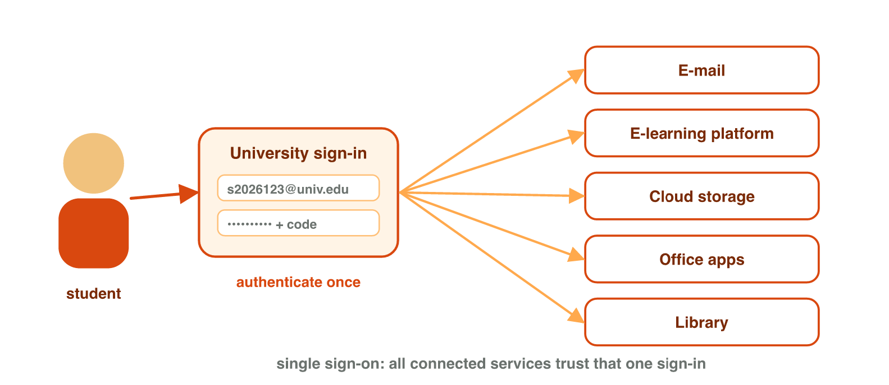
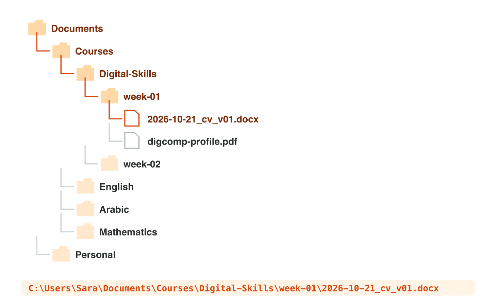
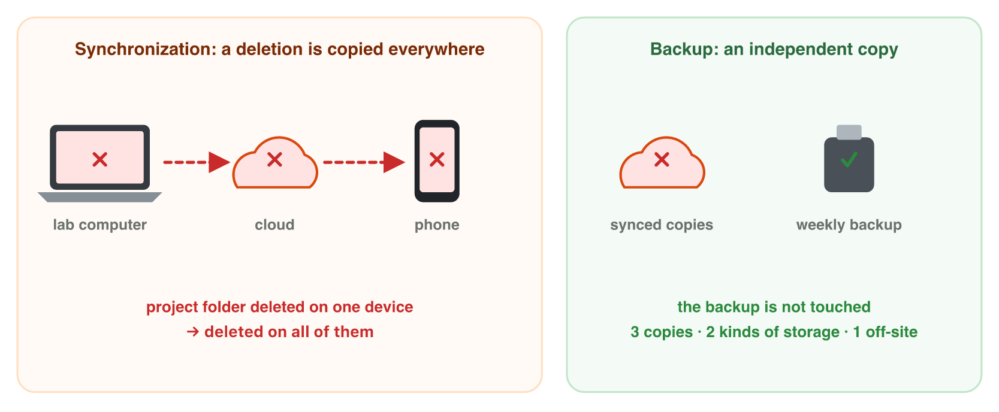

This page is the interactive version of the lesson notes (PDF). Each section
starts with a situation at work. Then it explains the idea behind it. It ends
with a **Lab task** on the lab computer and one set of questions. The full
explanations, examples and exercises are in the notes.

## Key terms



## 2.1 Your account and single sign-on

- An **account**: a name, a way to prove who you are, your data.
- **Authentication**: proving that the account is yours. Three factors: what
  you **know** (password), **have** (phone), **are** (fingerprint).
- **Single sign-on (SSO)**: sign in once, many university services open.
- Risk: a stolen university password opens everything.
- On lab computers: sign out, do not save passwords, use a private window,
  lock the screen (Windows key + L).

{width=84%}

::: {.callout-warning title="Watch out!"}
Closing the browser does not always sign you out. Press **Sign out** first.
:::

::: {.callout-note title="Lab task · One sign-in, many services"}
Sign in to your university account. Open the e-mail, the e-learning platform
and the cloud storage. How many times did you type your password? At the end
of the lab, sign out and lock the screen.
:::

::: {.callout-tip title="Try it 1 · Accounts and sign-in"}
Choose the right answer.

::: {.match extra="something you are|incognito is not safe"}
A code that arrives on your phone. Which factor?
:   something you have

Your password. Which factor?
:   something you know

You sign in once, and e-mail, cloud and e-learning all open.
:   single sign-on

The main risk of single sign-on.
:   a stolen password opens everything

You leave your lab desk for one minute. What do you do?
:   lock the screen
:::
:::

## 2.2 Files, folders and paths

- A **file**: a named piece of data. A **folder** holds files and folders.
- Storage is a tree. The **path** is the address of a file in the tree.
- Windows: `C:\Users\Sara\...` with `\`. Mac and web: `/Users/sara/...` with `/`.
- Two files can have the same name, but never the same path.
- The **file extension** (`.docx`, `.png`, `.exe`) says which program opens it.
- **File size**: 1 KB ≈ 1000 bytes, 1 MB ≈ 1000 KB, 1 GB ≈ 1000 MB.

{width=86%}



::: {.callout-warning title="Watch out!"}
`invoice.pdf.exe` looks like `invoice.pdf` when extensions are hidden. Turn on
file name extensions.
:::

::: {.callout-note title="Lab task · Extensions, sizes and paths"}
In File Explorer, turn on **File name extensions**. In the **Details** view,
write the extension and size of three files. Right-click one file → **Copy as
path**, and paste it into a document. Then play three rounds of **Path
Finder** (stages 1 and 2).
:::

::: {.callout-tip title="Try it 2 · Paths, types and sizes"}
Choose the right answer.

::: {.match extra="C:/Users/ali/notes.docx|Word"}
`notes.docx` in `week-02`, in `Digital-Skills`, in `Courses`, in `Documents` of user `ali`, on a Mac.
:   /Users/ali/Documents/Courses/Digital-Skills/week-02/notes.docx

Two files are both called `cv.docx`. What is always different?
:   their paths

Which program opens `budget.xlsx`?
:   Excel

A file called `photo.jpg.exe`. What is it really?
:   a program

A short document, a photo, a video: which is usually the biggest?
:   the video
:::
:::

## 2.3 Naming and organising files

- Say what it is, in the same pattern.
- No spaces or special characters: use `-` or `_`.
- Dates as year-month-day: 2026-10-21.
- Versions `v01`, `v02`, not `final2`.
- A short folder tree (four levels or fewer), the same shape for every
  project.

{width=70%}

::: {.callout-note title="Lab task · Build your course folders"}
In your cloud storage, create `Courses` with one folder per course, and
`Digital-Skills/week-01`. Upload your DigComp profile into `week-01` and
rename it, for example `2026-10-21_DS_week01_digcomp-profile_v01.pdf`.
:::

::: {.callout-tip title="Try it 3 · Good names"}
Choose the better choice.

::: {.match extra="21-10-2026|final_v2_new"}
A better name for `final final.pptx` (pitch, 12 November 2026, third version).
:   2026-11-12_pitch-deck_v03.pptx

The date format that sorts by date when you sort by name.
:   2026-10-21

What to use instead of spaces in a file name.
:   - or _

The way to mark the second version of a file.
:   v02

How many folder levels a good tree usually has.
:   four or fewer
:::
:::

## 2.4 Cloud storage, synchronization and backup

- **Cloud storage**: your files on a company's servers; open them anywhere.
  Limits: a **quota**, the Internet, the company's rules.
- **Synchronization**: the same files everywhere, also your mistakes.
- **Backup**: a separate copy that a mistake does not reach.
- Recycle bin and version history help, but they are not a backup.
- **3-2-1 rule**: 3 copies, 2 kinds of storage, 1 in another place.

{width=90%}

::: {.callout-note title="Lab task · Versions, delete and restore"}
Rename your file to `v02` and open its **version history**. Then delete it,
restore it from the **recycle bin**, and check that it is back. How long does
your recycle bin keep files?
:::

::: {.callout-tip title="Try it 4 · Sync or backup?"}
Choose the right answer.

::: {.match extra="synchronization is a backup|2 copies"}
You delete a file on the lab computer. What happens on your synchronized phone?
:   it is deleted too

A weekly copy of your project on a USB drive at home.
:   a backup

The cloud feature that keeps deleted files for some time.
:   the recycle bin

The cloud feature that keeps older versions of a file.
:   version history

The 3-2-1 rule: how many copies?
:   3 copies
:::
:::

## Game challenge: Sara's media project {.challenge}

Work alone. Use every section of today.

Sara (user `sara` on a Mac) prepares a project for Digital Media. Her folder
`Documents/Courses/Digital-Media/week-01` contains a video `trailer.mp4` and
a document named `final final (2).docx`, made on 5 November 2026. The folder
is synchronized with her university cloud storage. Every Sunday she copies it
to a USB drive that she keeps at home.

::: {.callout-tip title="Try it 5 · Sara's project (harder)"}
Choose the right answer.

::: {.match extra="final_v3.docx|the synchronized laptop"}
A better name for `final final (2).docx`.
:   2026-11-05_DM_project-notes_v01.docx

The extension of the trailer. Which program opens it?
:   a media player

The path of `trailer.mp4` in that folder.
:   /Users/sara/Documents/Courses/Digital-Media/week-01/trailer.mp4

She deletes the folder on the lab computer by mistake. Where can she restore it first?
:   the cloud recycle bin

Her USB copy at home, in the 3-2-1 rule.
:   the copy in another place
:::
:::

## Summary {.summary}

- Account + authentication (know, have, are); SSO: one sign-in, many services.
- Storage is a tree; a path is the full address of a file.
- Show extensions; sizes grow by about 1000: KB, MB, GB.
- Names: say what it is, no spaces, year-month-day, v01.
- Synchronization copies mistakes; a backup does not; 3-2-1.
