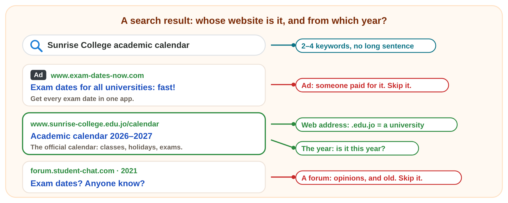
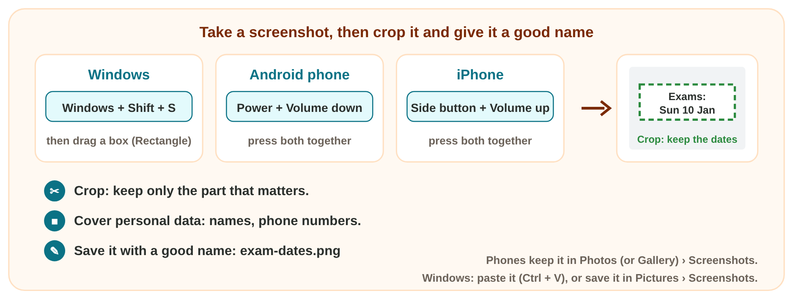
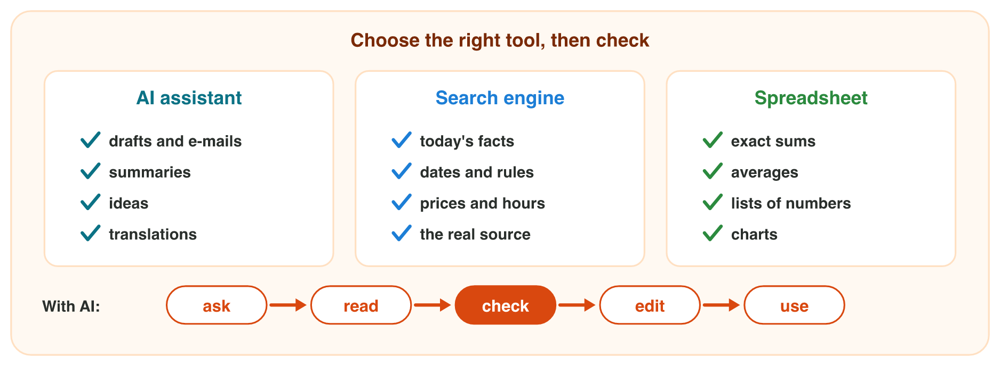

::: {.lead}
Huda starts her first semester. She needs the date of the final exams, a
picture of the exam dates on her phone, and a short notice for her study
group. Three everyday skills help her: a search engine, a screenshot and
an AI assistant. Each one is fast, and each one needs a check. These notes
are a short reference: in class you practise each skill as an experiment
of the **worksheet**.
:::

## Key terms



## 2.1 Search for a fact: the official source

Huda types "when are the final exams" into a search engine. She gets
thousands of results: ads, forums, videos and old pages. Which one tells
the truth?

A **search engine** (Bing, Google) finds web pages. Four habits make a
search fast and safe:

1. **Type 2–4 keywords**, not a long sentence: *Israa University
   calendar*.
2. **Read the web address** under each result. Its main part shows whose
   website it is: `.edu.jo` is a university in Jordan, `.gov.jo` is the
   government of Jordan, and `microsoft.com` is the company Microsoft.
3. **Open the official website** of the owner of the fact: the university
   for exam dates, the company for its prices and hours (@fig-search).
4. **Skip ads, forums and old pages.** A result marked **Ad** or
   **Sponsored** is paid. A forum shows what people think. Check the year
   on the page.

::: {.callout-important title="Definition 2.1 — Official website"}
The **official website** is the website of the organization that owns a
fact. It is the real source of that fact.
:::

{#fig-search width=100%}

::: {.callout-note title="Example 2.1 — Huda's exam date"}
1. Huda types three keywords: *Israa University calendar*.
2. The first result is an ad for an app. She skips it.
3. The third result ends in `.edu.jo`: the university's own website. She
   opens it.
4. The page has two calendars: 2024–2025 and 2026–2027. It is November
   2026, so she uses the calendar of 2026–2027.
:::

::: {.callout-warning title="Common mistake"}
"It is the first result, so it is right." The first results are often ads.
Read the web address first.
:::



*In class: Experiment 1 of the worksheet, an official fact found with a search engine, and the three searches of Search Lab.*

## 2.2 Screenshots: keep the part that matters

Huda found the exam dates. She wants them on her phone, also without the
Internet. A screenshot keeps them.

A **screenshot** is a picture of the screen at one moment, saved as an
image file (@fig-shot).

| Device | Keys | Where it goes |
|---|---|---|
| Windows | **Windows + Shift + S** (the **Snipping Tool**): drag a box | the clipboard (Ctrl + V pastes it); save it with Ctrl + S |
| Android phone | **Power + Volume down**, together | Photos or Gallery › Screenshots |
| iPhone | **Side button + Volume up**, together | Photos › Screenshots |

: Screenshots on three devices. {#tbl-shots}

Then three habits:

- **Crop** it: keep only the part that matters. On a phone, tap the small
  preview, then **Crop**.
- **Cover personal data**: names, phone numbers, ID numbers of other
  people.
- **Give it a good name**, like a file of Lecture 1: `exam-dates.png`, not
  `Screenshot_20261108_104512.png`.

{#fig-shot width=100%}

::: {.callout-note title="Example 2.2 — The exam dates on Huda's phone"}
1. On the calendar page, Huda presses **Power + Volume down**.
2. She taps the small preview and chooses **Crop**. She keeps only the
   exam dates.
3. In the lab, she does the same in Windows: **Windows + Shift + S**, a box
   around the dates, then **Ctrl + S** and the name `exam-dates.png`.
:::

::: {.callout-warning title="Common mistake"}
Sharing a full screenshot of a chat. It shows other people's names and
phone numbers. Crop it, or cover them first.
:::

*In class: Experiment 2 of the worksheet, a snip in Windows pasted into Word, and a cropped screenshot on the phone.*

## 2.3 An AI draft: check its facts and numbers

Huda's study group meets in a new room. She asks an AI assistant for a
short notice. In ten seconds, she has a good draft. Can she send it?

An **AI assistant** (Microsoft Copilot, ChatGPT, Gemini) learned from a
huge amount of text. It writes **likely words**. So it is fast and good at
five jobs: a **draft**, a **summary**, **ideas**, a **rewrite** and a
**translation**. But likely is not always true. Three weak spots matter
most:

1. **Invented facts:** a time, a name or a book that nobody gave it. This
   is a **hallucination**.
2. **Old information:** it learned from data up to a date, so it may not
   know newer facts.
3. **Wrong numbers:** mistakes in sums and percentages.

::: {.callout-important title="Definition 2.2 — Hallucination"}
A **hallucination** is an AI answer that sounds sure, but is invented or
wrong.
:::

So each tool has its job (@tbl-tools, @fig-tools). With AI, follow five
steps: **ask, read, check, edit, use**. You are responsible for what you
use.

| Tool | Best for | Example |
|---|---|---|
| AI assistant | drafts, summaries, ideas, rewrites, translations | a notice for the study group |
| search engine | facts, dates, rules, prices: on the official website | the last day to pay the fees |
| spreadsheet (Excel) | exact sums and averages | the total of 40 prices |

: Three tools and their best jobs. {#tbl-tools}

{#fig-tools width=100%}

::: {.callout-note title="Example 2.3 — Twelve pens"}
Huda asks: "How much are 12 pens at 0.25 JD each?" The AI answers: "12 pens
cost 3.50 JD."

1. She checks in a spreadsheet: =12\*0.25 gives 3.00 JD.
2. The AI answer is 0.50 JD too much: a wrong number.
3. For numbers, she uses a spreadsheet, not the AI.
:::



*In class: Experiment 3 of the worksheet, an AI notice checked against the prompt, and an AI total checked in a spreadsheet.*

## Case study: Omar's newsletter

Omar writes the October newsletter of Sunrise Company. He finds the date
of the next public holiday on the government's website (`.gov.jo`), takes
a screenshot of the sales chart with **Windows + Shift + S**, and asks an
AI assistant for a draft. Then he checks every AI sentence against the
company records.

| Company records, October 2026 | |
|---|---|
| Sales | September 3 500 JD, October 4 200 JD |
| New staff | Lina and Sami |
| Shop hours | 9 a.m. to 6 p.m., Saturday to Thursday; closed on Friday |
| Awards | none |

: The facts that Omar checks against. {#tbl-records}

Three AI sentences are wrong: "a rise of 1 200 JD" (4 200 − 3 500 = 700
JD), "won the Best Shop award" (invented) and "open every day" (closed on
Friday).



## Further reading

Evans, Martin and Poatsy, *Technology in Action*, 18th ed., the chapters on
the Internet and on artificial intelligence. Microsoft Support, "Use
Snipping Tool to capture screenshots".

## Exercises

1. How many keywords do you type into a search engine?
2. Which web address belongs to a university in Jordan:
   `www.uni-news.com`, `www.sunrise-college.edu.jo` or
   `forum.student-chat.com`?
3. A result is marked **Ad**. Do you open it for the exam dates? (yes / no)
4. Which keys take a screenshot of a part of the screen in Windows?
5. Which keys take a screenshot on an Android phone?
6. Which name is better for a screenshot of the exam dates:
   `Screenshot_20261108.png` or `exam-dates.png`?
7. Which tool for each job: the last day to pay the fees; the total of 40
   prices; a first draft of a notice?
8. An AI says: "12 pens at 0.25 JD cost 3.50 JD." Is it right? Write the
   right total.
9. Put the five steps of using AI in order: check, ask, use, read, edit.

## Answers to the exercises

::: {.answers}
1. Two to four.
2. `www.sunrise-college.edu.jo` (`.edu.jo`).
3. No: an ad is paid, and it is not the university's website.
4. Windows + Shift + S.
5. Power + Volume down.
6. `exam-dates.png`.
7. A search engine (the official website); a spreadsheet; an AI assistant.
8. No: 12 × 0.25 = 3.00 JD.
9. Ask, read, check, edit, use.
:::
