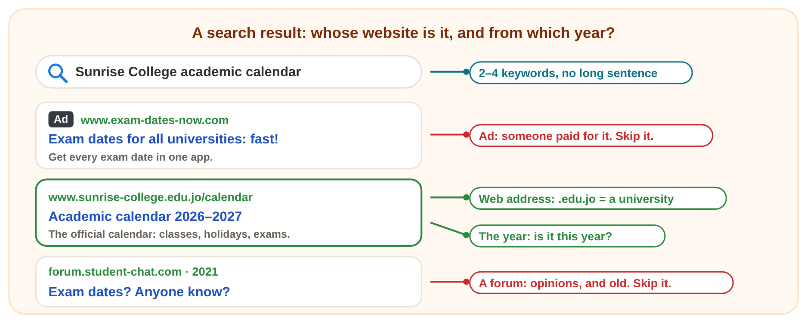
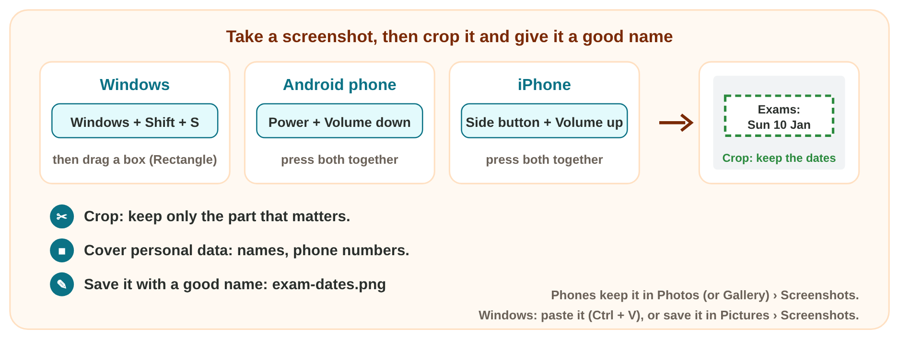
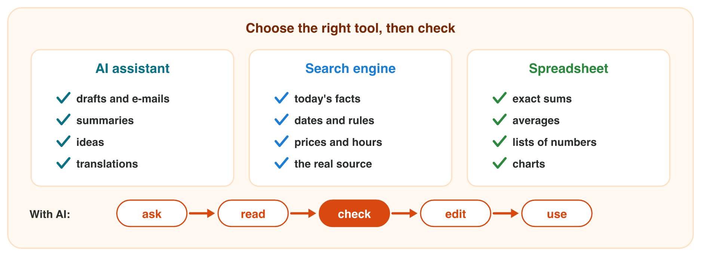

## Keywords



## Search for a fact: the official source

:::: {.columns}
::: {.column width="50%"}
- Type 2–4 keywords into a search engine, not a long sentence.
- The web address shows whose website it is: .edu.jo is a university.
- Open the official website of the owner of the fact.
- Skip ads, forums and old pages, and check the year.
:::
::: {.column width="50%"}

:::
::::

## Live demo · Search Lab



## Try it 1 · The real source

a) Which result do you open for the exam dates: an ad, a forum or a .edu.jo page?
b) Which ending belongs to the government of Jordan?
c) It is November 2026. Which calendar do you use: 2024–2025 or 2026–2027?

::: {.answer}
a) the .edu.jo page
b) .gov.jo
c) 2026–2027
:::

## Screenshots: keep the part that matters

:::: {.columns}
::: {.column width="50%"}
- A screenshot is a picture of the screen, saved as an image file.
- Windows: Windows + Shift + S, then drag a box around the part.
- Android: Power + Volume down. iPhone: Side button + Volume up.
- Crop it, cover personal data, and give it a good name.
:::
::: {.column width="50%"}

:::
::::

## Try it 2 · Screenshots

a) Which keys take a screenshot of a part of the screen in Windows?
b) Which name is better: Screenshot_20261108.png or exam-dates.png?
c) A chat screenshot shows two phone numbers. What do you do before you share it?

::: {.answer}
a) Windows + Shift + S
b) exam-dates.png
c) crop it, or cover the numbers
:::

## An AI draft: check its facts and numbers

:::: {.columns}
::: {.column width="50%"}
- An AI assistant writes likely words: fast drafts, summaries and ideas.
- Likely is not always true: it can invent a fact, a hallucination.
- It can give old information and wrong numbers.
- Check facts on the official website and numbers in a spreadsheet.
:::
::: {.column width="50%"}

:::
::::

## Live demo · Bill Check



## Try it 3 · Which tool?

a) Which tool is best for the total of 40 prices?
b) Which tool is best for a first draft of a notice?
c) The AI adds a time that is not in your prompt. What do you do?

::: {.answer}
a) a spreadsheet
b) an AI assistant
c) delete the time
:::

## Summary

- Search with 2–4 keywords, and open the official website of the owner of the fact.
- Read the web address and the year; skip ads, forums and old pages.
- A screenshot keeps what you see: crop it, cover personal data, name it well.
- An AI assistant writes fast drafts, but it can invent facts and get numbers wrong.
- Check facts on the official website and numbers in a spreadsheet.

## Your worksheet

:::: {.columns}
::: {.column width="50%"}
- In the computer lab, do the three experiments of the worksheet alone.
- Part A is in a browser, Windows, Word, Excel and an AI assistant.
- Part B is on your phone, or on a simulator: scan its QR code or click its link.
- Never type personal data into the AI, and write your result after each step.
:::
::: {.column width="50%"}

:::
::::

## Results of the worksheet

Which results do you have in your table?

::: {.reveal}
- Experiment 1: The official result ends in .edu.jo, and its calendar is for 2026–2027.
- Experiment 2: The snip is saved as exam-dates.png, and Ctrl + V pastes it into Word.
- Experiment 3: The notice keeps the day and the room, and the bill is 9.00 JD.
:::

## Game challenge · Omar's newsletter



## Try it 4 · Omar's newsletter (harder)

The facts: sales were 3 500 JD in September and 4 200 JD in October. The shop is open Saturday to Thursday. The company won no awards.

a) Where does Omar find the date of the next public holiday?
b) The AI writes "a rise of 1 200 JD". What is the real rise?
c) Why is the AI sentence "The shop is open every day" wrong?

::: {.answer}
a) on the government's website (.gov.jo)
b) 700 JD
c) The shop is closed on Friday.
:::
