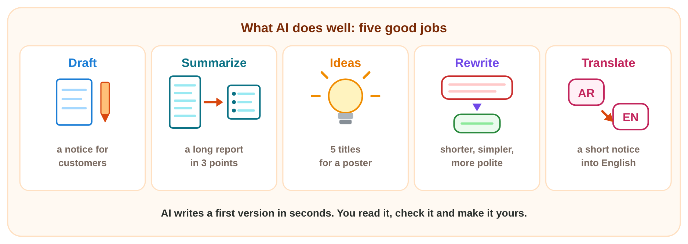
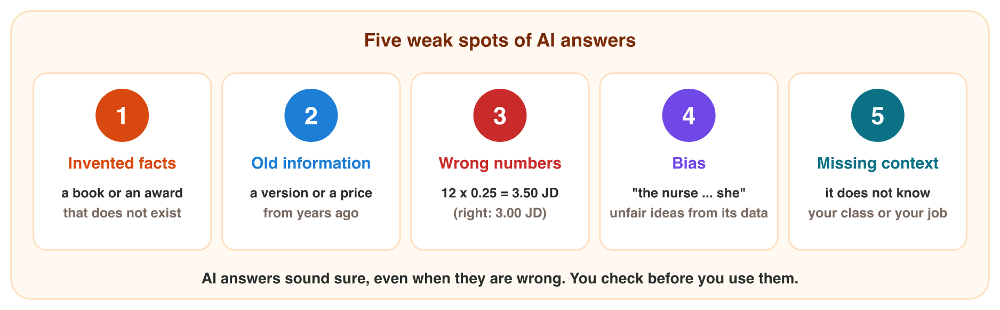
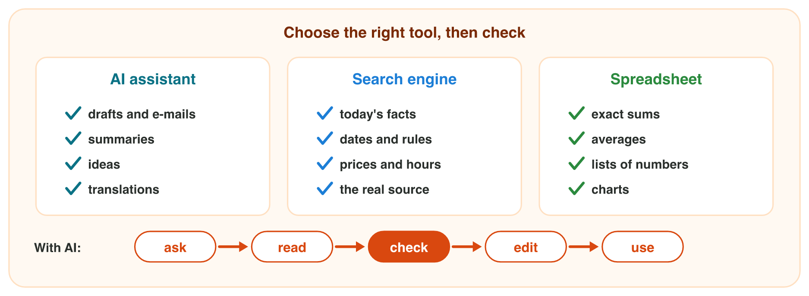

## Keywords



## Before you start

:::: {.columns}
::: {.column width="50%"}
- Open an AI assistant that the university allows, for example Copilot.
- Have a search engine and a calculator ready to check the AI.
- Do each experiment of the worksheet when the teacher shows it.
- Write your result after each step, then check it at the end of the worksheet.
:::
::: {.column width="50%"}

:::
::::

## Experiment 1 · Two good jobs

:::: {.columns}
::: {.column width="50%"}
- Generative AI writes likely words, so it is fast but not always true.
- **Step 1:** Ask for 5 ideas for a class trip. Which two do you like?
- **Step 2:** Ask for a summary of the library text. What are the three points?
- **Step 3:** Did the AI add a fact that is not in the text?
:::
::: {.column width="50%"}

:::
::::

## Check 1 · Two good jobs

What did you record in Experiment 1?

::: {.reveal}
- Step 1: Five places for one day, for example Jerash, Ajloun and the Dead Sea.
- Step 2: The hours are 8 a.m. to 4 p.m., three books for two weeks, and ten new computers.
- Step 3: Often none, but you delete every fact that is not in the text.
:::

## Experiment 2 · Test the weak spots

:::: {.columns}
::: {.column width="50%"}
- An AI answer can be invented, old, wrong in numbers, unfair or without context.
- **Step 1:** Ask the price of 12 pens at 0.25 JD. What does the calculator give?
- **Step 2:** Ask for 3 books about Excel. Can you find each book with a search?
- **Step 3:** Play Weak Spots. What is your score?
:::
::: {.column width="50%"}

:::
::::

## Live demo · Weak Spots



## Check 2 · Test the weak spots

What did you record in Experiment 2?

::: {.reveal}
- Step 1: The calculator gives 3.00 JD, and a different AI number is a wrong number.
- Step 2: A book that no search finds is a hallucination, an invented book.
- Step 3: Weak Spots has two invented facts, old information, a wrong number, bias, missing context and one good draft.
:::

## Experiment 3 · The right tool

:::: {.columns}
::: {.column width="50%"}
- Use AI for drafts, a search engine for facts and a spreadsheet for numbers.
- **Step 1:** Ask the AI for the library hours of the university. What does it say?
- **Step 2:** Look on the university website. Which answer do you trust?
- **Step 3:** Play Right Tool. Which tool fits the fees date, 40 prices and an e-mail?
:::
::: {.column width="50%"}

:::
::::

## Live demo · Right Tool



## Check 3 · The right tool

What did you record in Experiment 3?

::: {.reveal}
- Step 1: The AI answer may be old or invented, so it needs a check.
- Step 2: You trust the university website, because it is the official source.
- Step 3: A search engine for the fees date, a spreadsheet for 40 prices and AI for the e-mail.
:::

## Game challenge · Omar's newsletter



## Try it 4 · Omar's newsletter (harder)

The facts: sales were 3 500 JD in September and 4 200 JD in October. The shop is open Saturday to Thursday. The company won no awards.

a) The AI writes "a rise of 1 200 JD". What is the real rise?
b) Which weak spot is the AI sentence "We won the Best Shop award in 2025"?
c) Why is the AI sentence "The shop is open every day" wrong?

::: {.answer}
a) 700 JD
b) an invented fact (a hallucination)
c) The shop is closed on Friday.
:::

## Table of results

Which results do you have in your table?

::: {.reveal}
- Experiment 1: Two trip ideas, and a summary with no added facts.
- Experiment 2: 12 pens cost 3.00 JD, and a book that no search finds is invented.
- Experiment 3: The official website wins, and each job has its own tool.
:::

## Summary

- Generative AI learned from training data and writes likely words.
- AI writes drafts, summaries, ideas, rewrites and translations very fast.
- AI answers can have invented facts, old information, wrong numbers, bias or missing context.
- Use AI for drafts, a search engine for facts and a spreadsheet for numbers.
- With AI, you ask, read, check, edit and use, and you are responsible for the result.
