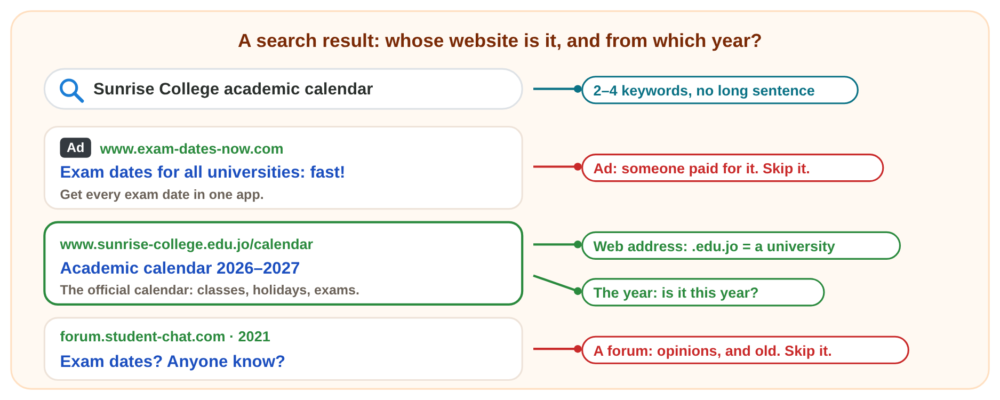
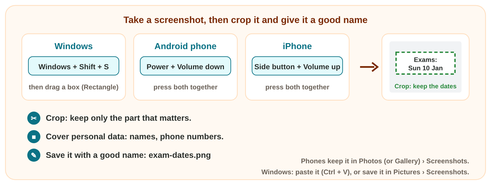
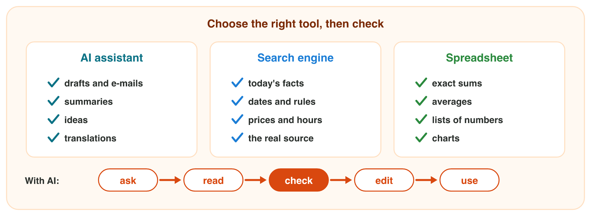

This page is the lecture, in class and at home. Each section explains one
idea, then shows its experiment. The page checks every step at once.

**In class, the teacher chooses the way for each experiment,** by the topic
and the time:

- **On the simulator** of the section, here on the page: nothing to
  install, and it works at home too.
- **In the real app** on the teacher's laptop, connected to the smart
  screen (HDMI): follow the steps of **Part A**.
- **In the computer lab:** each student follows the **worksheet (PDF)**,
  Part A in the app and Part B on the simulator, and checks each result
  here.
- **AI prompts:** tap **Copy prompt**, then paste it into an AI assistant
  in another tab.
- **You need:** a browser, Excel, an AI assistant that the university allows (for example `copilot.microsoft.com`), and your phone. **Never type personal data** into an AI assistant.

## Key terms



## 2.1 Search for a fact: the official source

- Type 2–4 **keywords**, not a long sentence.
- The **web address** shows whose website it is: `.edu.jo` is a
  university in Jordan, `.gov.jo` the government.
- Open the **official website** of the owner of the fact. Skip ads,
  forums and old pages.

{width=100%}





::: {.callout-tip title="Try it 1 · The real source"}
Choose the right answer.

::: {.match extra="www.example.com|a forum"}
You need today's opening hours of the university library. Where do you look?
:   the university website

    Why: The owner of the fact is the university, so its website is the official source.

Which web address belongs to the government of Jordan?
:   www.example.gov.jo

    Why: .gov.jo is the government of Jordan.
:::
:::

## 2.2 Screenshots: keep the part that matters

- A **screenshot** is a picture of the screen, in an image file.
- Windows: **Windows + Shift + S** (the **Snipping Tool**).
- Android: **Power + Volume down**. iPhone: **Side button + Volume up**.
- **Crop** it, cover personal data, and name it well.

{width=100%}



::: {.callout-tip title="Try it 2 · Screenshots"}
Choose the right answer.

::: {.match extra="Ctrl + Z|share it as it is"}
Which keys take a screenshot of a part of the screen in Windows?
:   Windows + Shift + S

    Why: Windows + Shift + S opens the Snipping Tool; you drag a box.

A chat screenshot shows the exam date and two phone numbers. What do you do before you share it?
:   cover the numbers

    Why: Phone numbers are personal data: crop them out or cover them.
:::
:::

## 2.3 An AI draft: check its facts and numbers

- An **AI assistant** writes likely words: fast drafts, summaries and
  ideas.
- Likely is not always true: it can invent a fact (a **hallucination**)
  or get a number wrong.
- Check facts on the official website and numbers in a spreadsheet.

{width=100%}





::: {.callout-tip title="Try it 3 · Which tool?"}
Choose the best tool.

::: {.match extra="a screenshot|a search engine"}
Which tool is best for the total of 40 prices?
:   a spreadsheet

    Why: A spreadsheet adds exactly; an AI can get sums wrong.

Which tool is best for a first draft of a notice?
:   an AI assistant

    Why: A draft is a good job for AI; you check its facts before you use it.

:::
:::

## Table of results



## Game challenge: Omar's newsletter {.challenge}

Omar writes the October newsletter of Sunrise Company: a holiday date from
the official website, a screenshot of the sales chart, and an AI draft. He
checks the AI sentences against the company records.



::: {.callout-tip title="Try it 4 · Omar's newsletter (harder)"}
The records: sales 3 500 JD in September and 4 200 JD in October; open
Saturday to Thursday; no awards. Choose the right answer.

::: {.match extra="1 200 JD|a forum"}
Where does Omar find the date of the next public holiday?
:   a .gov.jo website

    Why: Public holidays come from the government: its official website ends in .gov.jo.

Omar wants only the sales chart from his screen in Windows. What does he use?
:   Windows + Shift + S

    Why: The Snipping Tool takes only the part in the box.

The AI writes "Sales rose by 1 200 JD." What is the real rise?
:   700 JD

    Why: 4 200 − 3 500 = 700 JD: a wrong number from the AI.
:::
:::

## Summary {.summary}

- Search with 2–4 keywords, and open the official website of the owner of the fact.
- Read the web address and the year; skip ads, forums and old pages.
- A screenshot keeps what you see: crop it, cover personal data, give it a good name.
- An AI assistant writes fast drafts, but it can invent facts and get numbers wrong.
- Check facts on the official website and numbers in a spreadsheet.
