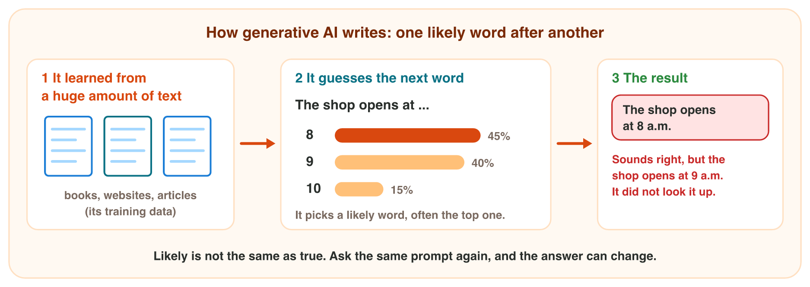

This page is the short, interactive version of the lesson notes (PDF). Each
section has a **simulator** to try, a **Lab task** for the lab computer and
one set of questions.

## Key terms



## 3.1 How generative AI writes

- An AI assistant learned from a huge amount of text: its **training data**.
- It writes **one likely word after another**. It does not look up facts.
- **Likely is not the same as true.**
- Example: "The shop opens at …": "8" is 45% likely, "9" is 40%. The AI
  writes "8 a.m.", but the shop opens at 9 a.m.
- The AI does not always choose the most likely word. So the same prompt
  can give a different answer each time.
- Some AI assistants also search the web and show links. Open them.

{width=100%}



::: {.callout-note title="Lab task · Ask the same prompt twice"}
Ask an AI assistant: *Write one sentence about the city of Amman.* Start a
new chat and ask again. Copy both answers into Word. Are they the same?
:::

::: {.callout-tip title="Try it 1 · How AI writes"}
Choose the right answer.

::: {.match extra="it reads the shop's records|it always gives the same answer"}
What does an AI assistant learn from?
:   its training data

How does an AI write a sentence?
:   one likely word after another

"9" is 40% likely and "8" is 45% likely. Which word is more likely?
:   8

You ask the same prompt again. What can happen?
:   a different answer

Is a likely sentence always true?
:   no, check it
:::
:::

## 3.2 Five weak spots of AI answers

1. **Invented facts:** a book, a name, an award or a link that does not
   exist. This is a **hallucination**.
2. **Old information:** the AI learned from data up to a date (its
   **knowledge cutoff**).
3. **Wrong numbers:** mistakes in sums and percentages. Example: "12 pens at
   0.25 JD cost 3.50 JD." Right: 12 × 0.25 = 3.00 JD.
4. **Bias:** unfair ideas from its data, for example "the nurse … she".
5. **Missing context:** it does not know your class, job or company.

{width=100%}



::: {.callout-warning title="Watch out!"}
A link in an AI answer is not proof. Open it: the page may say something
else, or it may not exist.
:::

::: {.callout-note title="Lab task · Do these books exist?"}
Ask an AI assistant: *Give me 3 books about Microsoft Excel, with the author
and the year.* Search for each title in a search engine. Write "found" or
"not found" for each book.
:::

::: {.callout-tip title="Try it 2 · Which weak spot?"}
Choose the weak spot. You can use an answer more than once.

::: {.match extra="a good draft"}
The AI names a book that no library or shop has. Which weak spot?
:   an invented fact

It is 2026. The AI says the newest version of an app is from 2021. Which weak spot?
:   old information

The AI says that 12 pens at 0.25 JD cost 3.50 JD. Which weak spot?
:   a wrong number

The AI writes a job advert: "We need a nurse. She must be kind." Which weak spot?
:   bias

You ask for an e-mail about "the homework", but you do not say which homework. Which weak spot?
:   missing context

What is the name for an answer that sounds sure but is invented?
:   a hallucination
:::
:::

## 3.3 AI, search engine or spreadsheet?

| Tool | Best for | Example |
|---|---|---|
| AI assistant | drafts, summaries, ideas, translations | a polite reminder e-mail |
| search engine (Bing, Google) | today's facts, dates, rules, prices | the last day to pay fees |
| spreadsheet (Excel) | exact sums, averages, numbers | the total of 40 prices |

- A **search engine** finds web pages. Read the real source, for example
  the university website.
- With AI, follow five steps: **ask, read, check, edit, use**.
- You are responsible for the text that you use.

{width=100%}



::: {.callout-note title="Lab task · AI or the website?"}
Ask an AI assistant for the opening hours of the library of Al-Israa
University. Then find them on the university website. Which answer do you
trust, and why?
:::

::: {.callout-tip title="Try it 3 · Which tool?"}
Choose the best tool. You can use an answer more than once.

::: {.match extra="a word processor"}
Which tool is best for the last day to apply for a scholarship?
:   a search engine

Which tool is best for the average of 30 test marks?
:   a spreadsheet

Which tool is best for 5 ideas for a class trip?
:   an AI assistant

Which tool is best for today's price of the dollar?
:   a search engine

You have an AI draft. Which step comes after "read"?
:   check
:::
:::

## Game challenge: Omar's newsletter {.challenge}

Work alone. Use every section of today.

Omar asks an AI assistant for the October newsletter of Sunrise Company.
He checks each sentence against the company records:

- Sales: September 3 500 JD, October 4 200 JD.
- New product: green tea cups. New staff: Lina and Sami.
- Shop hours: 9 a.m. to 6 p.m., Saturday to Thursday. Closed on Friday.
- Awards: none.



::: {.callout-tip title="Try it 4 · Omar's newsletter (harder)"}
The records: sales 3 500 JD in September and 4 200 JD in October; new staff
Lina and Sami; open 9 a.m. to 6 p.m., Saturday to Thursday; no awards.
Choose the right answer.

::: {.match extra="1 200 JD|7 700 JD"}
The AI writes "a rise of 1 200 JD". What is the real rise?
:   700 JD

The AI writes "We won the Best Shop award in 2025." What should Omar do?
:   delete the sentence

The AI writes "The shop is open every day." Why is it wrong?
:   it is closed on Friday

"We welcome Lina and Sami." What should Omar do?
:   keep it: it matches the records

Which weak spot is the award sentence?
:   an invented fact
:::
:::

## Summary {.summary}

- Generative AI learned from training data and writes likely words.
- Likely is not true: the same prompt can give different answers.
- Five weak spots: invented facts, old information, wrong numbers, bias, missing context.
- Use AI for drafts and ideas, a search engine for current facts, a spreadsheet for numbers.
- With AI: ask, read, check, edit, use. You are responsible for what you use.
