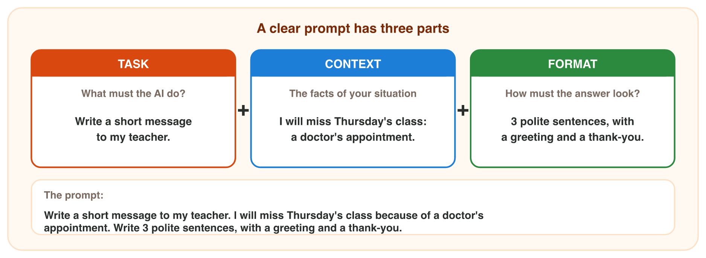
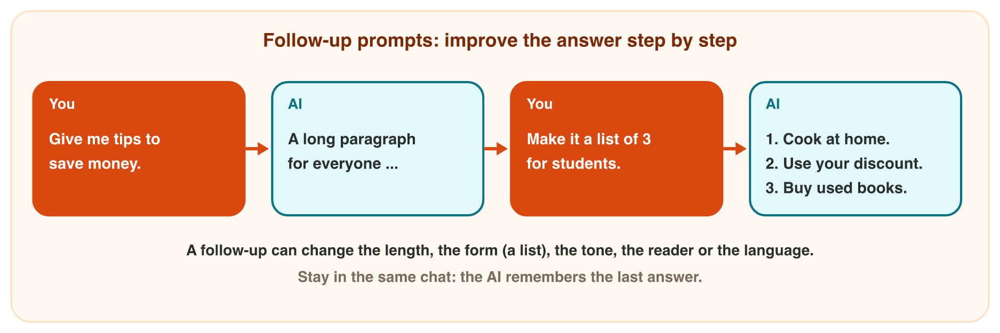

## Before you start {.study}

- **What you need:** your university account, an AI assistant that the
  university allows (for example `copilot.microsoft.com`), and Word (on the
  computer, on the web or the phone app).
- **Time:** about 60 minutes. Work alone, at your own speed.
- **How it works:** do Steps 1–3 on this page. Each step has a short text, a
  simulator and a self-check. Then do the **Tasks to submit**.
- **What you submit:** one Word file and your answers to Tasks 3–4, on the
  university e-learning platform, before lecture 5.
- **Remember:** never type personal data (ID numbers, phone numbers,
  addresses) into an AI tool.

## Key terms {.study}



## Step 1 · The three parts of a clear prompt {.study}

- In lecture 3 you saw that AI does not know your situation. A clear prompt
  tells it.
- A clear prompt has three parts:
  - **Task:** what must the AI do? *Write a short message to my teacher.*
  - **Context:** the facts of your situation. *I will miss Thursday's class
    because of a doctor's appointment.*
  - **Format:** how must the answer look? Length, a list or a table, and the
    **tone** (polite, friendly). *Write 3 polite sentences.*
- Without a task, the AI does not know what to do. Without context, the
  answer is general. Without a format, the answer is often too long.
- Words like "quickly!!!" or "very, very good" add nothing.

{width=100%}



::: {.callout-tip title="Try it 1 · Parts of a prompt"}
Choose the part. You can use an answer more than once.

::: {.match extra="a follow-up prompt"}
"Write a short message to my teacher." Which part is it?
:   the task

"I will miss Thursday's class because of a doctor's appointment." Which part is it?
:   the context

"Write 3 polite sentences, with a greeting and a thank-you." Which part is it?
:   the format

A prompt has a task and a format, but no facts. What is the answer like?
:   general, without your facts

"Polite" or "friendly" in a prompt. What does it set?
:   the tone
:::
:::

## Step 2 · Improve the answer with follow-up prompts {.study}

- The first answer is often not right yet. Do not start again: write a
  **follow-up prompt** in the same chat.
- The AI remembers the last answer in the chat. Each follow-up changes
  something: *Make it shorter.* *Make it a list of 3.* *Make it friendlier.*
  *Write it for students.* *Translate it into Arabic.*
- Change one or two things at a time. Then read the new answer.
- In a new chat, the AI does not remember the old answer.

{width=100%}



::: {.callout-tip title="Try it 2 · Follow-up prompts"}
Choose the right answer.

::: {.match extra="start a new chat|Add more details."}
The answer is a long paragraph. You want 3 points. What do you write?
:   Make it a list of 3.

The answer is too long. What do you write?
:   Make it shorter.

The answer is for everyone, but you want it for students. What do you write?
:   Write it for students.

Where do you write a follow-up prompt?
:   in the same chat

You start a new chat. Does the AI remember the old answer?
:   no
:::
:::

## Step 3 · Fix a weak prompt {.study}

Before you press Send, check your prompt:

1. **Task:** does it say what to do?
2. **Context:** does it give the facts (who, what, when)?
3. **Format:** does it say how long, which form (list, table), which tone?
4. **Safe:** no personal data?

| Weak prompt | What is missing | Clear prompt |
|---|---|---|
| Write a polite e-mail of 4 sentences. | context | Write a polite e-mail of 4 sentences to the library. Ask if I can keep the book "Easy Accounting" for one more week. |
| Make 5 slides for my talk. | context | Make an outline of 5 slides for my 5-minute talk about saving water, for first-year students. |
| Write an invitation for our class trip to Petra on 14 November at 8 a.m. | format | … Write 3 friendly sentences for our class group chat. |



::: {.callout-tip title="Try it 3 · What is missing?"}
Choose what is missing. You can use an answer more than once.

::: {.match extra="the tone only"}
"Write a polite e-mail of 4 sentences." What is missing?
:   the context

"Shop sales: 3 500 JD in September, 4 200 JD in October. Use one short paragraph." What is missing?
:   the task

"Write an invitation for our trip to Petra on 14 November at 8 a.m." What is missing?
:   the format

"Sum up this text about healthy food in 3 bullet points for my classmates." What is missing?
:   nothing

"Write a polite e-mail. My phone number is 0791234567." What is wrong?
:   personal data
:::
:::

## Tasks to submit {.tasks}

### Task 1 · A clear prompt (2 marks)

1. In an AI assistant, ask for a message to your teacher: you will be late
   for Sunday's class because your bus was late. Write a prompt with a task,
   a context and a format.
2. Copy your prompt and the answer into a Word document. After each part of
   your prompt, write **(T)**, **(C)** or **(F)**.
3. Save it with a good name, for example `2026-11-01_clear-prompt_v01.docx`.

*Submit:* the Word file.

### Task 2 · Two follow-ups (2 marks)

In the same chat, write two follow-up prompts that change the answer (for
example shorter, friendlier, a list, in Arabic). Add both follow-ups and the
last answer to the same Word file. What changed in the answer?



### Task 3 · Fix a weak prompt (1 mark)

The weak prompt: *Write about saving water.* Write a clear prompt with a
task, a context and a format.



### Task 4 · What is missing? (1 mark)

Write the missing part (task, context or format) of each prompt.

a) *Write a thank-you message to my neighbour Huda for the cake that she made.*



b) *Write an e-mail of 3 short, polite sentences.*



## How to submit

Upload the Word file (Tasks 1–2) and your answers to Tasks 3–4 (in the same
file, or a photo of this page) to the university e-learning platform,
**before lecture 5**.
