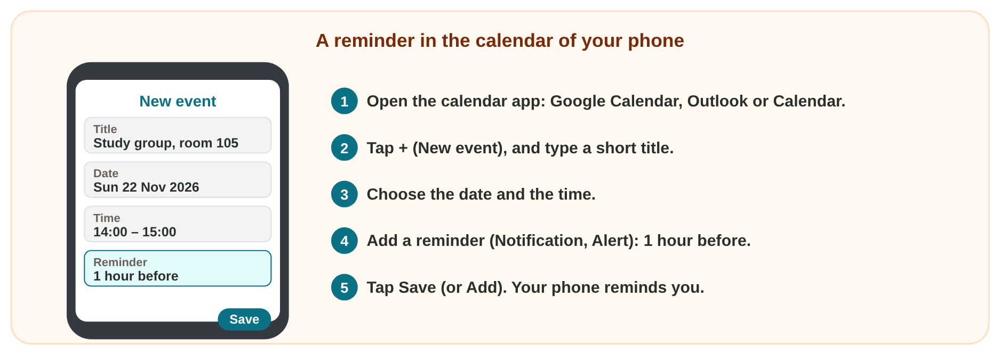
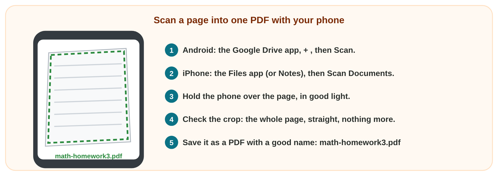

## Before you start {.study}

- **What you need:** your phone (Android or iPhone) and a page of your
  notebook. An AI assistant that the university allows (for example
  `copilot.microsoft.com`) is optional.
- **Time:** about 40 minutes. Work alone, at your own speed.
- **How it works:** read Steps 1–3 and answer their questions: the page
  checks each answer at once. Then do the **Tasks to submit**.
- **What you submit:** a screenshot, a PDF and three short answers, on the
  university e-learning platform, before lecture 3.

## Key terms {.study}



## Step 1 · A reminder in the calendar of your phone {.study}

- Your phone has a calendar: **Google Calendar** (Android), **Calendar**
  (iPhone) or **Outlook** (your university account).
- An event has a title, a date and a time. A **reminder** (on some phones
  "Notification" or "Alert") shows a message before it.
- Add every lecture change, exam and due date, with a reminder: you never
  miss one.

{width=100%}

::: {.callout-note title="Model · An event with a reminder"}
Huda's study group meets in room 105 on Sunday 22 November at 14:00. She
opens Google Calendar and taps **+**, then **Event**. Title: *Study group,
room 105*. Date: Sun 22 Nov 2026. Time: 14:00 to 15:00. Notification:
**1 hour before**. She taps **Save**. At 13:00 her phone reminds her.
Task 1 asks for the same, for your next Digital Skills lecture.
:::

::: {.callout-tip title="Try it 1 · Reminders"}
Choose the right answer.

::: {.match extra="Delete the event.|a new contact"}
Where do you add a lecture with its date and time?
:   the calendar app

    Why: A calendar keeps events with their date and time.

You want a message one hour before the lecture. What do you add?
:   a reminder

    Why: A reminder (Notification, Alert) shows a message at the time you choose.

You added the event. What do you tap at the end?
:   Save

    Why: Without Save (or Add), the phone keeps nothing.
:::
:::

## Step 2 · Scan a page into one PDF {.study}

- A homework on paper? A **scan** is better than a photo: straight, clear,
  and one PDF file.
- **Android:** the **Google Drive** app, **+**, then **Scan**.
- **iPhone:** the **Files** app (or **Notes**), then **Scan Documents**.
- Check the crop (the whole page, nothing more), then save it as a PDF with
  a good name, like the files of Online activity 1.

{width=100%}

::: {.callout-note title="Model · A scanned homework"}
Omar has a math homework on paper. He opens Google Drive, taps **+**, then
**Scan**. He holds the phone over the page in good light, checks that the
whole page is in the box, and taps **Save**. Name: `math-homework3.pdf`.
He uploads one clear PDF instead of a dark photo. Task 2 asks for the
same, with one page of your notebook.
:::

::: {.callout-tip title="Try it 2 · A scan"}
Choose the right answer.

::: {.match extra="a screenshot|.docx"}
Which file type does a scan of a page make?
:   PDF

    Why: The scan app saves the page as one PDF file.

Which name is good for a scan of math homework 3?
:   math-homework3.pdf

    Why: A short name that says what is in the file.

Where do you scan on an iPhone?
:   the Files app

    Why: Files (or Notes) has Scan Documents.
:::
:::

## Step 3 · Choose a clear prompt {.study}

You do not need to write prompts: you choose a clear one and copy it. A
clear prompt has three parts:

- the **task**: what the AI must do (*Write a short message*);
- the **context**: the facts of your situation (*I cannot come on Monday;
  I have an exam*);
- the **format**: how the answer must look (*3 polite sentences*).

If the answer is not right, send a **follow-up prompt** in the same chat:
*Make it shorter.* · *Make it a list of 3.* · *Write it in Arabic.*

**In Prompt Doctor:** for each weak prompt, choose the missing part, then
the better prompt.



::: {.callout-note title="Model · A clear prompt, with its parts marked"}
> Write a short message to my club leader. **(task)** I cannot come to the
> meeting on Monday, because I have an exam that day. **(context)** Write 3
> polite sentences with a greeting and a thank-you. **(format)**

Without the context, the AI does not know the day or the reason. Without
the format, the answer can be one line or a whole page.
:::

::: {.callout-tip title="Try it 3 · Parts of a prompt"}
Choose the part. You can use an answer more than once.

::: {.match extra="the tone only"}
"Give me 5 ideas, in a short list." What is missing?
:   the context

    Why: It does not say ideas for what, or for whom.

"Write an invitation for our trip to Petra on 14 November at 8 a.m." What is missing?
:   the format

    Why: It does not say how long, which form or which tone.

The answer is good, but you need it in Arabic. Which follow-up do you send?
:   Write it in Arabic.

    Why: A follow-up in the same chat changes the language of the last answer.
:::
:::

## Tasks to submit {.tasks}

### Task 1 · A reminder for your next lecture

1. In the calendar of your phone, add your next **Digital Skills
   lecture** (Lecture 3), with its date and time.
2. Add a reminder **1 hour before**, and save.
3. Take a screenshot of the event, and name it `lecture3-reminder.png`.

*Submit:* the screenshot. (Step 1 and its model show how.)

### Task 2 · A scan in one PDF

1. Write today's date at the top of one page of your notebook.
2. Scan the page with your phone into one PDF.
3. Name it `scan-test.pdf`.

*Submit:* the PDF. (Step 2 and its model show how.)

### Task 3 · What is missing?

Write the missing part of each prompt: **task**, **context** or
**format**. (Step 3 shows how.)

a) *Write a thank-you message to my neighbour Huda for the cake that she
made.*



b) *Write a polite e-mail of 4 sentences.*



c) *My bus was late, and I missed the first 10 minutes of the lecture.
Use 3 polite sentences.*



## How to submit

Upload the screenshot (Task 1), the PDF (Task 2) and your three answers
(Task 3) to the university e-learning platform, **before lecture 3**.
