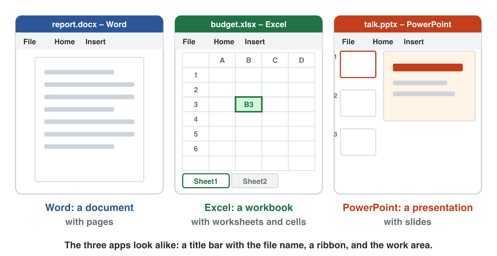
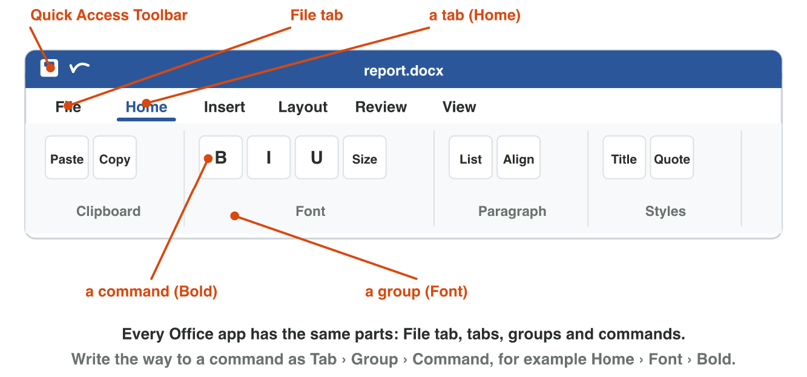
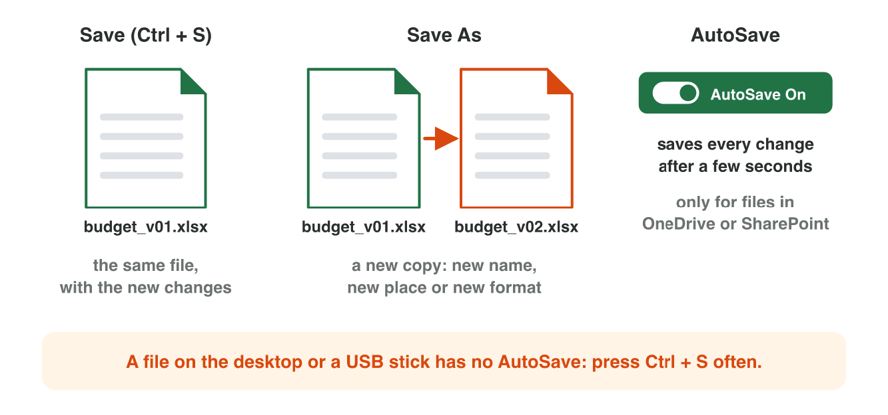
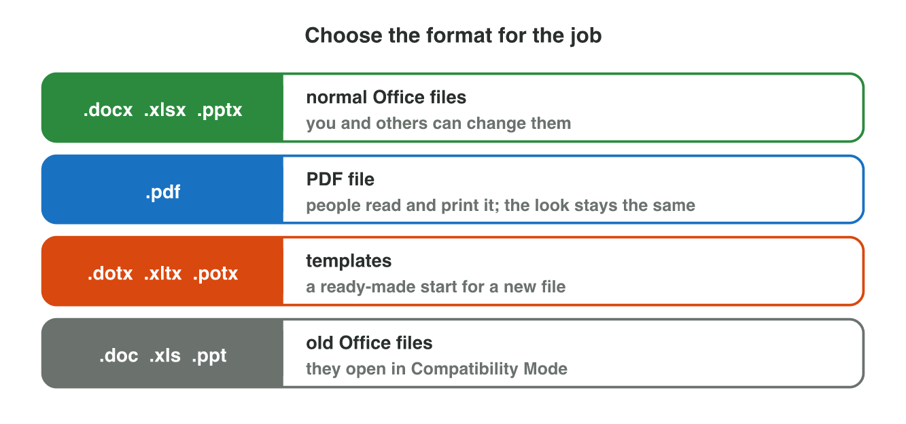

::: {.lead}
Huda starts a new job in the office of Sunrise Company. On the first day,
her manager says: "Open the price list in Excel, put the total in cell B3,
make the title of the report bold, and send the customer a PDF." Huda knows
the apps, but not all the words. In this lesson you learn the words of
Microsoft Office: document, workbook, cell, slide, ribbon, tab, template,
format. You also learn the parts that the three apps share, and how to save
your work so that you never lose it.
:::

## Key terms



## 3.1 Three apps and their files

Word, Excel and PowerPoint make three kinds of files (@fig-files).

- **Word** makes a **document**. A document has pages of text, tables and
  pictures.
- **Excel** makes a **workbook**. A workbook has one or more
  **worksheets**. A worksheet is a big grid. One box of the grid is a
  **cell**. Its name is the column letter and the row number, for example
  **B3**.
- **PowerPoint** makes a **presentation**. A presentation has
  **slides**.

{#fig-files width=100%}

The three apps look alike. At the top, the **title bar** shows the file
name. Under it is the ribbon (section 3.2). At the bottom, the **status
bar** shows facts such as the page number or the zoom.

You do not always start with an empty file. **File → New** shows many
**templates**: ready-made files with a design, for example a letter, a CV, a
budget or a party invitation. You start from a template and write your own
text.

::: {.callout-important title="Definition 3.1 — Template"}
A **template** is a ready-made file with a design and a layout. You start
from it and add your own content.
:::

::: {.callout-note title="Example 3.1 — Huda's first tasks"}
1. "Put the total in B3": B3 is a cell of the worksheet, in column B and
   row 3.
2. "Make the slides for Monday": slides are pages of a PowerPoint
   presentation.
3. "Make an invitation for the staff party": Huda opens Word, chooses
   **File → New**, and starts from an invitation template.
:::



::: {.callout-note title="Lab task · Find the parts"}
1. On the lab computer, open Word, Excel and PowerPoint.
2. In each app, find the file name in the title bar.
3. In Excel, click the cell **C4**. Look at the box on the left, above the
   grid: it shows the name of the cell. Add a second worksheet with **+**
   at the bottom.
4. In Word, choose **File → New** and open a template that you like.

*Your result:* the name of the template, and one sentence for each app: what
kind of file it makes.

::: {.check}
Excel shows **C4** in the box on the left, above the grid, and the new
worksheet is called Sheet2. A good answer: "Word makes a document, Excel a
workbook, PowerPoint a presentation", and the name of your template, for
example "Event invitation".
:::
:::

## 3.2 The ribbon: tabs, groups and commands

Huda must make a title bold. Where is the button? In every Office app, the
commands are on the **ribbon**, the wide bar at the top (@fig-ribbon).

- The ribbon has **tabs**: Home, Insert, Layout, Review, View …
- Each tab has **groups**. The name of a group is under it, for example
  **Font**.
- Each group has **commands**, for example **Bold**.
- The **File tab** opens a full page: New, Open, Save, Save As, Print,
  Share, Export.
- The **Quick Access Toolbar** shows Save and Undo. It stays on the screen
  in every tab.

We write the way to a command like this: **Home › Font › Bold**.

{#fig-ribbon width=100%}

| What you want | Where it is |
|---|---|
| make text bold | Home › Font › Bold |
| add a picture | Insert › Illustrations › Pictures |
| add a table | Insert › Tables › Table |
| turn the page sideways | Layout › Page Setup › Orientation |
| check the spelling | Review › Proofing › Spelling & Grammar |
| print | File › Print |

: Some common commands in Word. {#tbl-cmds}

The other apps use the same tabs for the same kinds of jobs. Insert adds
things in Word, Excel and PowerPoint. Home has the font and the clipboard in
all three.

::: {.callout-note title="Example 3.2 — Where is it?"}
Huda must add the company logo to a letter.

1. A logo is a picture. Pictures are things that you *add*.
2. Things that you add are on the **Insert** tab.
3. The way is **Insert › Illustrations › Pictures**.
:::

::: {.callout-warning title="Common mistake"}
Looking for Print or Save on the Home tab. Commands for the whole file
(New, Open, Save, Print, Share) are on the **File** tab.
:::



::: {.callout-note title="Lab task · Four commands"}
1. Play the **Ribbon Finder** simulator above.
2. Then open Word on the lab computer. Find these commands: **Bold**,
   **Pictures**, **Orientation**, **Spelling & Grammar**.
3. For each one, write the way: Tab › Group › Command.

*Your result:* four ways, for example "Home › Font › Bold".

::: {.check}
Home › Font › Bold; Insert › Illustrations › Pictures; Layout › Page Setup
› Orientation; Review › Proofing › Spelling & Grammar.
:::
:::

## 3.3 Saving: Save, Save As, formats and AutoSave

Huda works for one hour on a report. Then the electricity goes off. Is the
work lost? It depends on how Huda saved it (@fig-save).

- **Save** (Ctrl + S) keeps the **same file** with the new changes.
- **Save As** makes a **new copy**: with a new name, in a new place, or in
  a new **format**. The old file stays.
- **AutoSave** saves every change after a few seconds. It works only for
  files in **OneDrive** (or SharePoint). The switch is at the top left. For
  a file in OneDrive with AutoSave on, the File tab shows **Save a Copy**
  instead of Save As.

{#fig-save width=100%}

The **format** of a file is the way its data is stored. The extension shows
it (@fig-formats).

{#fig-formats width=96%}

::: {.callout-important title="Definition 3.2 — Save As"}
**Save As** saves a new copy of a file with a new name, in a new place or
in a new format.
:::

::: {.callout-note title="Example 3.3 — The price list"}
Omar must send the price list to a customer. Nobody may change the prices.

1. The price list is `prices.xlsx`. Anyone can change an Excel file.
2. Omar uses **Save As** and chooses the type **PDF**.
3. Now there are two files: `prices.xlsx` (for Omar) and `prices.pdf` (for
   the customer).
:::

::: {.callout-warning title="Common mistake"}
Working on a file on the desktop or a USB stick and waiting for AutoSave.
AutoSave does not work there. Press **Ctrl + S** often, or keep the file in
OneDrive.
:::



::: {.callout-note title="Lab task · Two formats"}
1. In Word, write your name and one sentence about this lesson.
2. Use **Save As**. Save it in Documents as
   `2026-11-03_lab3_v01.docx` (use today's date).
3. Use **Save As** again and choose the type **PDF**.
4. Open the Documents folder in File Explorer.

*Your result:* a screenshot of the folder with the two files.

::: {.check}
The folder shows two files with the same name and two extensions, for
example `2026-11-03_lab3_v01.docx` and `2026-11-03_lab3_v01.pdf`. Save As
with the type PDF adds a second file; the Word file stays.
:::
:::

## Case study: the Help Desk at Sunrise Company

On Huda's second week, the colleagues send questions. Omar wants to send the
price list so that nobody can change the prices. Lina asks where the Bold
button is. Sami wants a copy of `budget_v01.xlsx` with the name
`budget_v02.xlsx`. Mona's laptop turned off. Mona's report was in OneDrive
with AutoSave on. The manager says: "Write the total in B3." In the
mini-game below, you answer eight such messages.



::: {.callout-note title="Lab task · The help desk"}
Play **Help Desk** (above) to the end.

*Your result:* your stars, and the two messages that were hardest for you,
with the right answers.

::: {.check}
The right answers: a PDF file; Home › Font › Bold; Save As; no, AutoSave
saved every change; a cell, column B and row 3; File › New and an
invitation template; AutoSave works only in OneDrive or SharePoint; Excel.
Every answer right at the first try gives 16 stars.
:::
:::

## Further reading

Lambert and Frye, *Microsoft Office Step by Step (Office 2021 and Microsoft
365)*, the first chapter on the parts that all Office apps share.
Microsoft 365 Training (support.microsoft.com/training): Word, Excel and
PowerPoint quick starts.

## Exercises

1. What kind of file does each app make: Word, Excel, PowerPoint?
2. What is a cell? What is the name of the cell in column D, row 7?
3. What is a template? Give one example.
4. Write the way to the Bold command.
5. Which tab has Print and Share?
6. What is the difference between Save and Save As?
7. When does AutoSave work?
8. You must send a report that nobody can change. Which format do you use?
9. Your file is on a USB stick. How do you keep your work safe?

## Answers to the exercises

::: {.answers}
1. Word: a document. Excel: a workbook with worksheets. PowerPoint: a presentation with slides.
2. One box of a worksheet where a column and a row meet. D7.
3. A ready-made file with a design; for example an invitation, a CV or a budget.
4. Home › Font › Bold.
5. The File tab.
6. Save keeps the same file. Save As makes a new copy with a new name, place or format.
7. Only for files in OneDrive (or SharePoint), when the switch is on.
8. PDF.
9. Press Ctrl + S often (or move the file to OneDrive and turn AutoSave on).
:::
