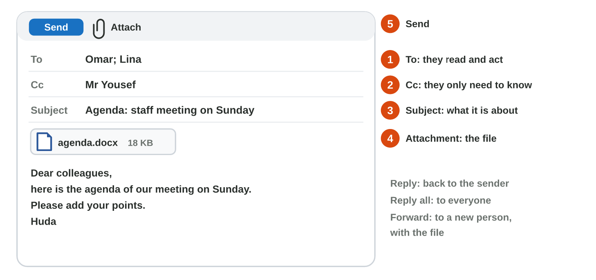
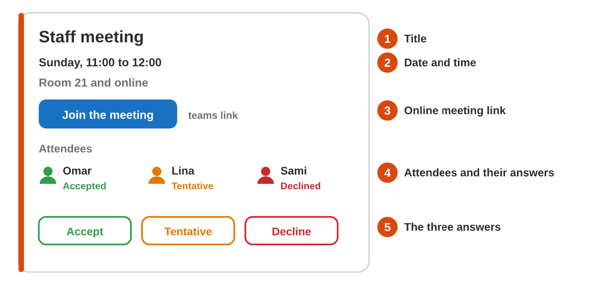
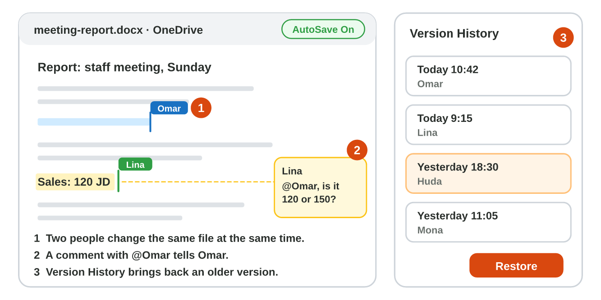

::: {.lead}
Huda works in the office of Sunrise Company. On Sunday the staff has a
meeting, and Huda organizes it. She sends the agenda by e-mail, invites
four colleagues to the meeting, and shares the agenda so that everybody can
add a point. One colleague works from home, so the meeting must also work
online. In this lesson you learn the digital tools of a team: e-mail, the
calendar, online meetings and shared files. These notes are a short
reference: in class you try each idea in the apps, as an experiment of the
**worksheet**.
:::

## Key terms



## 3.1 A clear e-mail with a file

Huda must send the agenda to the colleagues of the meeting. The manager is
not in the meeting, but he wants to know about it. A good e-mail tells each
person what to do, at once (@fig-email).

- **To:** the people who must read the e-mail and act.
- **Cc** (carbon copy): the people who only need to know.
- **Subject:** what the e-mail is about, in a few words, for example
  *Agenda: staff meeting on Sunday*. "Hello" or "Important!!!" says
  nothing.
- **Attachment:** a file that travels with the e-mail. Click **Attach**
  (the paperclip). In the Inbox, a paperclip shows that an e-mail has a
  file.

{#fig-email width=100%}

When an e-mail comes, you have three ways to answer it:

| Button | Who gets it | The file |
|---|---|---|
| Reply | only the sender | not sent again |
| Reply all | the sender and everyone in To and Cc | not sent again |
| Forward | a new person that you choose | sent with it |

: Reply, Reply all and Forward. {#tbl-reply}

::: {.callout-important title="Definition 3.1 — Cc"}
**Cc** (carbon copy) is the line of an e-mail for the people who only need
to know. The people in **To** must read the e-mail and act.
:::

::: {.callout-note title="Example 3.1 — The agenda"}
Huda sends the agenda of Sunday's meeting.

1. Omar and Lina come to the meeting: they go in **To**.
2. Mr Yousef, the manager, only needs to know: he goes in **Cc**.
3. Subject: *Agenda: staff meeting on Sunday*. Attachment: `agenda.docx`.
4. Later, Sami asks for the agenda. Huda clicks **Forward**: Sami gets the
   e-mail with its file.
:::

::: {.callout-warning title="Common mistake"}
Reply all to an e-mail of the whole staff, for a short answer such as
"Thanks!". Fifty people get an e-mail that only one person needs. Use
Reply.
:::



*In class: Experiment 1 of the worksheet, an e-mail with a file to your own
address, and Reply or Forward.*

## 3.2 A meeting in the calendar, online

The meeting is on Sunday. Omar works from home on Sundays. How do five
people meet at the same time, in two places? With a meeting invitation and
an online meeting link (@fig-invite).

- A **meeting invitation** is an event of the calendar that you send to
  people. It has a title, the date, the start and end time, the
  **attendees**, and a room or an online meeting link.
- In Outlook: **Calendar › New event**, then turn on **Teams meeting**. In
  Google Calendar: **Add Google Meet video conferencing**. Zoom works in the
  same way.
- Each attendee answers **Accept**, **Tentative** (maybe) or **Decline**.
  The meeting goes into their calendar, and the organizer sees each answer.
- Before you send, find a time when everybody is free. Outlook shows the
  free and busy times of your colleagues (the **Scheduling Assistant**).

{#fig-invite width=100%}

In an online meeting, click **Join** a few minutes early. Turn off your
microphone when you do not speak, and use **Share** to show a file on your
screen.

::: {.callout-important title="Definition 3.2 — Online meeting"}
An **online meeting** is a meeting on the Internet, with sound, video and a
shared screen (Teams, Google Meet or Zoom). The attendees join with a link
from a computer or a phone.
:::

::: {.callout-note title="Example 3.2 — A time for everybody"}
Sunday, from 8:00 to 14:00. Huda is busy from 8:00 to 9:00, Omar from 9:00
to 10:00, and Lina from 10:00 to 11:00. When can they meet for one hour?

1. 8:00 to 9:00: Huda is busy. 9:00 to 10:00: Omar is busy.
2. 10:00 to 11:00: Lina is busy.
3. 11:00 to 12:00: all three are free. The meeting is at 11:00, online,
   because Omar works from home.
:::

::: {.callout-warning title="Common mistake"}
A meeting time sent in an ordinary e-mail. It is not in anybody's calendar,
and nobody gets a reminder. Send a meeting invitation.
:::



*In class: Experiment 2 of the worksheet, a meeting with a Teams link in
your calendar, and the three answers.*

## 3.3 One file, edited together

After the meeting, four colleagues must add their parts to one report. If
Huda sends the report by e-mail, four people change four copies. Who
collects them? Which copy is the last one? A shared file solves it
(@fig-coedit).

- Keep **one** file in OneDrive (or Google Drive). Click **Share**, choose
  **Specific people** and **Can edit**, and send the link.
- **Co-editing:** the people change the same file at the same time. Each
  person sees the names of the others where they type. AutoSave keeps every
  change.
- A **comment** is a note next to the text: select the words, then
  **Review › New Comment**. Type **\@** and a name, and that person gets an
  e-mail. When the problem is solved, click **Resolve**.
- **Version History** (File › Info › Version History) keeps the older
  versions of the file, with the date, the time and the name. Open a
  version and click **Restore** to bring it back.

{#fig-coedit width=100%}

::: {.callout-important title="Definition 3.3 — Co-editing"}
**Co-editing** is when two or more people change the same file at the same
time, each from their own device.
:::

::: {.callout-note title="Example 3.3 — The report of the meeting"}
Mona, Omar, Lina and Huda write the report of the meeting.

1. Huda saves `meeting-report.docx` in OneDrive and shares it with the
   three colleagues: Specific people, Can edit.
2. Each person writes their part in the same file, at the same time.
3. Lina is not sure about a number. She adds a comment: *\@Omar, is it 120
   or 150?* Omar gets an e-mail and answers in the comment.
4. On Monday, Mona deletes a paragraph by mistake. Huda opens Version
   History and restores the version of Sunday evening.
:::

::: {.callout-warning title="Common mistake"}
Sharing with **Anyone with the link** and **Can edit** to save time. The
link can travel to strangers, and they can change the file. Share with
specific people, and give Can edit only to the people who must change it.
:::



*In class: Experiment 3 of the worksheet, the agenda shared with Can edit,
a comment, and Version History.*

## Case study: the Team Desk at Sunrise Company

Huda's colleagues send her questions all week. Lina sent an e-mail to ten
people, and one of them asks a question only for her. Omar wants the
manager to know about his e-mail to a customer. Sami must send a training
video of 2 GB to the staff. Five people must change the same report. Mona
deleted a paragraph yesterday. Omar works from home, but the meeting is at
the office. In the mini-game below, you answer eight such messages.



## Further reading

Evans, Martin and Poatsy, *Technology in Action*, the chapter on using the
Internet: communicating and collaborating online. Microsoft 365 Training
(support.microsoft.com/training): Outlook (e-mail and calendar), Teams
meetings, and collaborating in Word.

## Exercises

1. The manager only needs to know about your e-mail. Do you put him in To or in Cc?
2. Which sign in the Inbox shows that an e-mail has a file?
3. Which one is a clear subject: (A) Hello, (B) Agenda: staff meeting on Sunday, or (C) Read this now!!!?
4. A new colleague needs an e-mail and its file. Which button do you click: Reply, Reply all or Forward?
5. Name the three answers to a meeting invitation.
6. Huda is busy from 9:00 to 10:00 and Omar from 10:00 to 11:00. Both are free from 8:00 to 12:00 at other times. When is the first free hour?
7. Which button of the invitation do you click to take part in an online meeting?
8. Three people must change one report. Which share settings do you choose?
9. Where do you find the older versions of a file in Word?
10. Is it safe to share a report with Anyone with the link and Can edit: yes or no?

## Answers to the exercises

::: {.answers}
1. In Cc: Cc is for the people who only need to know.
2. A paperclip.
3. (B): it says what the e-mail is about in a few words.
4. Forward: it sends the e-mail and its file to a new person.
5. Accept, Tentative and Decline (in Google Calendar: Yes, Maybe and No).
6. 8:00 to 9:00: both are free then.
7. Join.
8. Specific people, Can edit.
9. File › Info › Version History.
10. No: the link can travel to strangers, and they could change the report.
:::
