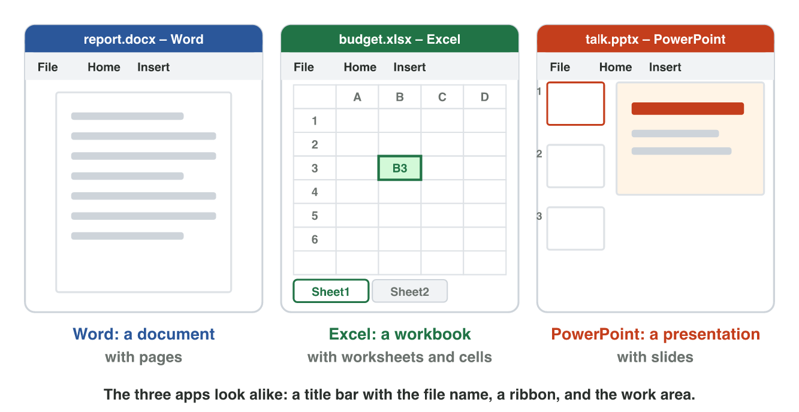
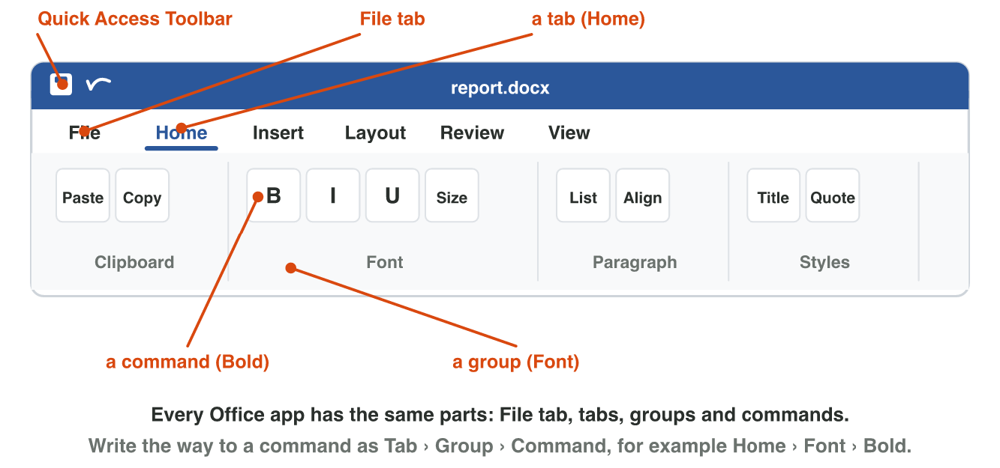
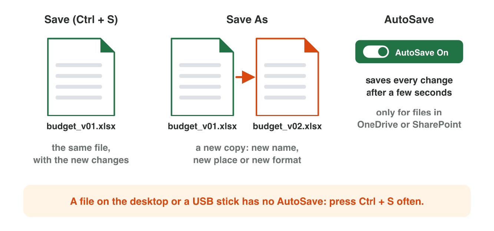

::: {.lead}
Huda works in the office of Sunrise Company. On Sunday the staff has a
meeting, and Huda prepares it with Microsoft Office: she writes the agenda
in Word, saves it in OneDrive and as a PDF, shares it so that colleagues
can add points, sends it by e-mail and invites everybody to an online
meeting. In this lesson you learn the words of Office and the tools of a
team. These notes are a short reference: in class you try each idea in the
apps, as an experiment of the **worksheet**.
:::

## Key terms



## 3.1 The Office window and the ribbon

Word, Excel and PowerPoint make three kinds of files (@fig-files):
**Word** a **document** (pages of text), **Excel** a **workbook** of
worksheets (one box is a **cell**, named by its column and row: **B3**),
**PowerPoint** a **presentation** of **slides**.

{#fig-files width=100%}

The three apps look alike: the **title bar** (the file name) at the top,
the **ribbon** under it, and the **status bar** (the page, the zoom) at the
bottom. The ribbon has **tabs** (Home, Insert, Layout, Review); each tab
has **groups** (Font, Paragraph); each group has **commands** (Bold). We
write the way to a command like this: **Home › Font › Bold**. Save, Print
and Share are on the **File** tab. **File › New** shows **templates**:
ready-made files with a design (an invitation, a CV, a budget).

{#fig-ribbon width=100%}

::: {.callout-note title="Example 3.1 — Where is it?"}
1. Center a title: a paragraph command, so **Home › Paragraph › Center**.
2. Add a table: you add something, so **Insert › Tables › Table**.
3. Turn the page sideways: the whole page, so **Layout › Orientation**.
:::



*In class: Experiment 1 of the worksheet, the agenda in Word.*

## 3.2 Save, a PDF, and one shared file

- **Save** (Ctrl + S) keeps the same file. **Save As** makes a **new copy**
  with a new name, place or **format**.
- The **format** is the kind of file: `.docx` `.xlsx` `.pptx` can change;
  **`.pdf`** keeps its look on every device (for reading and printing).
- **AutoSave** saves every change, but only for files in **OneDrive**. For
  a file on the desktop or a USB stick, press Ctrl + S often.

{#fig-save width=100%}

To work together, do not send copies back and forth: keep **one** file in
OneDrive and **Share** it (Specific people, **Can edit**). People change it
at the same time (**co-editing**). A **comment** (Review › New Comment) is
a note next to the text; **\@** and a name tells that person. **Version
History** (File › Info) keeps the older versions (@fig-coedit).

{#fig-coedit width=100%}

::: {.callout-warning title="Common mistake"}
Sharing with **Anyone with the link** and **Can edit**. The link can travel
to strangers, and they can change the file.
:::



*In class: Experiment 2 of the worksheet, the agenda in OneDrive, as a PDF
and shared.*

## 3.3 An e-mail and a meeting

An e-mail has **To** (the people who must act), **Cc** (the people who only
need to know), a short **subject** and an **attachment** (a file; the
Inbox shows a paperclip) (@fig-email). **Reply** answers the sender;
**Reply all** answers everyone in To and Cc; **Forward** sends the e-mail
and its file to a new person. A big file (a video of 2 GB) goes as a
OneDrive link, not as an attachment.

{#fig-email width=100%}

A **meeting invitation** is a calendar event that you send: a title, the
time, the attendees and a room or an **online meeting** link (Teams, Google
Meet, Zoom). Each attendee answers **Accept**, **Tentative** or
**Decline**. At the time, they click **Join** (@fig-invite).

{#fig-invite width=100%}

::: {.callout-note title="Example 3.2 — The agenda e-mail"}
1. To: Omar and Lina (they come). Cc: Mr Yousef (he only needs to know).
2. Subject: *Agenda: staff meeting on Sunday*. Attachment:
   `staff-agenda.pdf`.
3. The meeting invitation has a Teams link, because Omar works from home.
:::



*In class: Experiment 3 of the worksheet, the e-mail and the invitation in
Outlook.*

## Case study: the Team Desk at Sunrise Company

Huda's colleagues send questions all week: an answer only for one person,
a manager who only needs to know, a video of 2 GB, five people and one
report, a lost paragraph, a meeting for a colleague at home. In the
mini-game below, you answer eight such messages.



## Further reading

Lambert and Frye, *Microsoft Office Step by Step*, the first chapter.
Microsoft 365 Training (support.microsoft.com/training): Word, Outlook and
Teams quick starts.

## Exercises

1. What does Excel make: a document or a workbook?
2. Write the way to the Bold command.
3. Which tab has Print and Share?
4. Does AutoSave work for a file on a USB stick: yes or no?
5. Nobody may change your report. Which format do you send?
6. Five people must change one report. Which share settings?
7. The manager only needs to know about your e-mail. To or Cc?
8. A new colleague needs an e-mail and its file. Reply or Forward?
9. Which button of an invitation starts an online meeting?

## Answers to the exercises

::: {.answers}
1. A workbook.
2. Home › Font › Bold.
3. The File tab.
4. No: only for files in OneDrive.
5. PDF.
6. Specific people, Can edit.
7. Cc.
8. Forward.
9. Join.
:::
