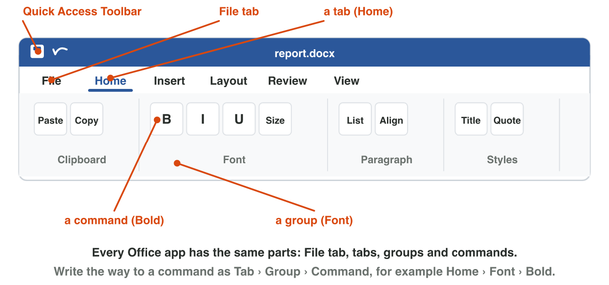
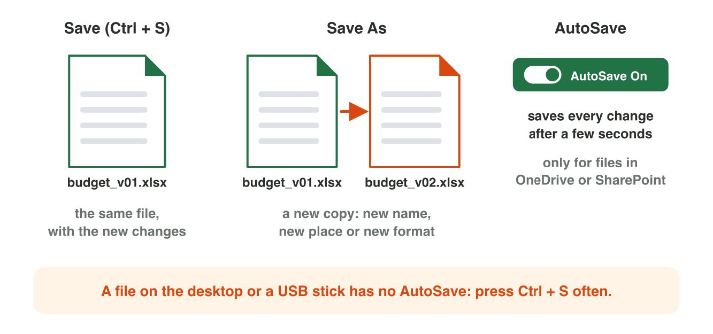
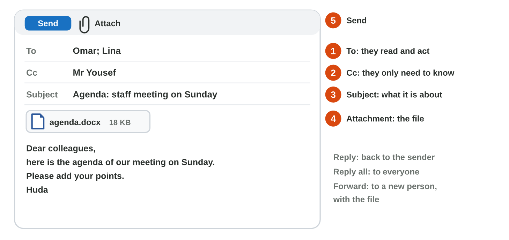

## Keywords



## The Office window and the ribbon

:::: {.columns}
::: {.column width="50%"}
- Word, Excel and PowerPoint share the title bar, the ribbon and the status bar.
- The ribbon has tabs, groups and commands, like Home › Font › Bold.
- Save, Print and Share are on the File tab.
- File › New shows templates, which are ready-made files with a design.
:::
::: {.column width="50%"}

:::
::::

## Live demo · Ribbon Finder



## Try it 1 · The ribbon

a) Which way leads to Center?
b) You want to turn the page sideways. Which way do you use?
c) You want a ready-made invitation. What do you use?

::: {.answer}
a) Home › Paragraph › Center
b) Layout › Page Setup › Orientation
c) a template
:::

## Save, a PDF, and one shared file

:::: {.columns}
::: {.column width="50%"}
- Save As makes a new copy with a new name, place or format.
- A PDF keeps its look, so people read it but do not change it.
- AutoSave works only for files in OneDrive.
- You share one file with Can edit, and people edit it together.
:::
::: {.column width="50%"}

:::
::::

## Live demo · Save Lab



## Try it 2 · Save and share

a) A customer must read the price list but not change it. Which format do you send?
b) Your file is on a USB stick. How do you keep your work safe?
c) Five people must change one report. How do you share it?

::: {.answer}
a) .pdf
b) Press Ctrl + S often.
c) one file in OneDrive, Specific people, Can edit
:::

## An e-mail and a meeting

:::: {.columns}
::: {.column width="50%"}
- To is for the people who act, and Cc is for the people who only need to know.
- The paperclip adds a file, and Forward sends the e-mail and its file to a new person.
- A meeting invitation has a time, the attendees and an online link.
- The attendees answer Accept, Tentative or Decline, and they click Join.
:::
::: {.column width="50%"}

:::
::::

## Live demo · Mail Lab



## Try it 3 · E-mail and meetings

a) Lina wrote to eight people, and Huda answers only Lina. What does Huda click?
b) A new colleague needs the agenda e-mail with its file. What does Huda click?
c) Sami is on holiday on the meeting day. What does he answer?

::: {.answer}
a) Reply
b) Forward
c) Decline
:::

## Summary

- Word, Excel and PowerPoint share the title bar, the ribbon and the status bar.
- A command has a way: its tab, its group and its name.
- Save As makes a copy, a PDF keeps its look, and AutoSave works in OneDrive.
- One shared file with Can edit replaces copies by e-mail.
- To is for the people who act, and Cc is for the people who only need to know.
- A meeting invitation can have an online link, and the attendees click Join.

## Your worksheet

:::: {.columns}
::: {.column width="50%"}
- In the computer lab, do the three experiments of the worksheet alone.
- Part A is in Word and Outlook, with agenda-start.docx.
- Send every test e-mail and invitation only to your own address.
- Write your result after each step, and fill in the table at the end.
:::
::: {.column width="50%"}

:::
::::

## Results of the worksheet

Which results do you have in your table?

::: {.reveal}
- Experiment 1: The title bar shows agenda-start, Center is Home › Paragraph › Center, and Print is on File.
- Experiment 2: AutoSave is on in OneDrive, there is a .docx and a .pdf, and the share is Specific people, Can edit.
- Experiment 3: A paperclip shows the file, the event has Join, and the manager goes in Cc.
:::

## Game challenge · The Team Desk



## Try it 4 · The team (harder)

The facts: Sami must send a video of 2 GB to Omar and Lina. The manager only needs to know. Omar works from home on meeting day.

a) How does Sami send the video?
b) Where does the manager go in Sami's e-mail?
c) What does the meeting invitation need for Omar?

::: {.answer}
a) a OneDrive link, not an attachment
b) Cc
c) an online meeting link (Join)
:::
