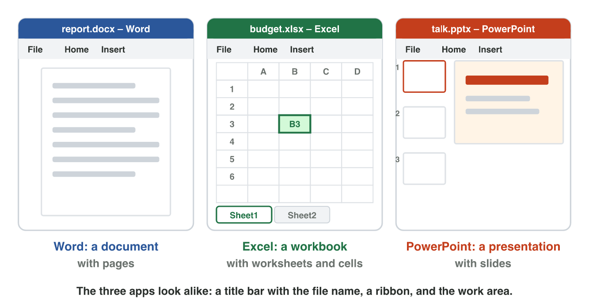
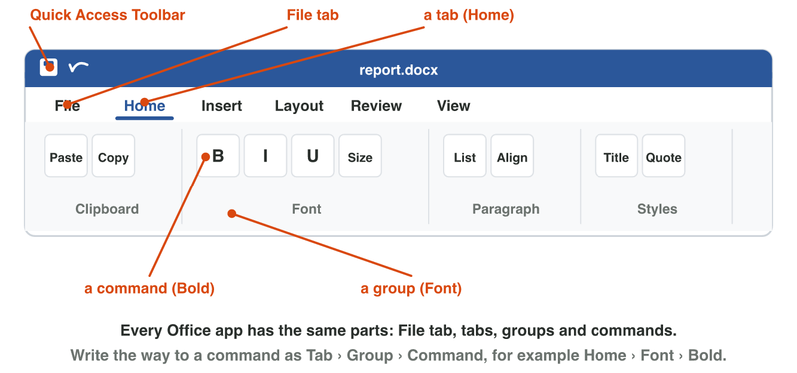
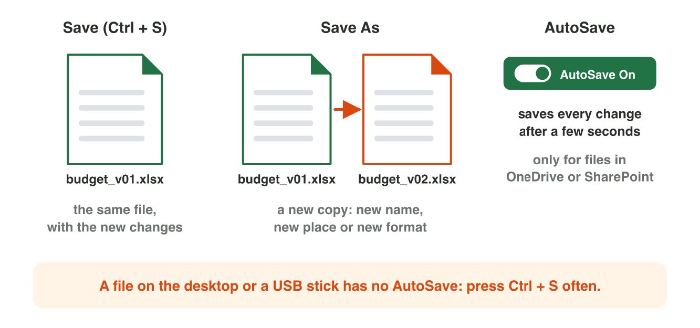
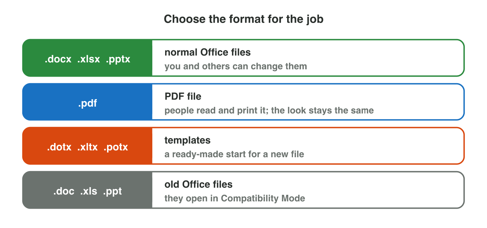

This page is the lecture, in class and at home. Each section explains one
idea, then shows its experiment. The page checks every step at once.

**In class, the teacher chooses the way for each experiment,** by the topic
and the time:

- **On the simulator** of the section, here on the page: nothing to
  install, and it works at home too.
- **In the real app** on the teacher's laptop, connected to the smart
  screen (HDMI): open the start file and follow the steps of **Part A**.
- **In the computer lab:** each student follows the **worksheet (PDF)**,
  Part A in the app and Part B on the simulator, and checks each result
  here.
- **You need:** Word, Excel and PowerPoint (the desktop apps, or Office on the web at `office.com`) and the start file, or only the simulators of this page.

## Key terms



## Before you start



## 3.1 Three apps and their files

- **Word** makes a **document**: pages of text.
- **Excel** makes a **workbook** of **worksheets**. A box is a **cell**,
  named by its column and row: **B3**.
- **PowerPoint** makes a **presentation** with **slides**.
- All three have a **title bar** (the file name), a ribbon and a **status
  bar**.
- **Templates** (File → New) are ready-made files with a design, such as
  an invitation.

{width=100%}





::: {.callout-tip title="Try it 1 · Files and parts"}
Choose the right answer.

::: {.match extra="a document|a slide"}
You want a ready-made invitation with a nice design. What do you use?
:   a template

    Why: A template is a ready-made file with a design.
:::
:::

## 3.2 The ribbon: tabs, groups and commands

- The **ribbon**, at the top of every Office app, has **tabs** (Home, Insert, Layout, Review, View). Each tab has
  **groups** (Font, Paragraph). Each group has **commands** (Bold).
- Write the way like this: **Home › Font › Bold**.
- The **File** tab: New, Open, Save, Save As, Print.

{width=100%}

::: {.callout-warning title="Watch out!"}
Save, Print and Share are on the **File** tab, not on Home.
:::





::: {.callout-tip title="Try it 2 · Where is it?"}
Choose the right way.

::: {.match extra="Home › Insert › Pictures"}
You want to turn the page sideways.
:   Layout › Page Setup › Orientation

    Why: The setup of the page is on the Layout tab.
:::
:::

## 3.3 Saving: Save, Save As, formats and AutoSave

- **Save** (Ctrl + S): the **same file** gets the new changes.
- **Save As**: a **new copy** with a new name, place or format. The old
  file stays.
- **AutoSave** saves every change, **only in OneDrive**. Elsewhere, press
  Ctrl + S often.
- **Formats:** `.docx` `.xlsx` `.pptx` (people can change them), `.pdf`
  (the look stays), `.dotx` (a template).

{width=100%}

{width=90%}





::: {.callout-tip title="Try it 3 · Save it right"}
Choose the right answer.

::: {.match extra="Save (Ctrl + S)|.dotx"}
A customer must read the price list but not change it. Which format?
:   .pdf

    Why: A PDF keeps the look, and people do not easily change it.
:::
:::

## Table of results



## Game challenge: the Help Desk at Sunrise Company {.challenge}

Huda helps her colleagues at Sunrise Company. Omar sends a price list that
nobody may change. Lina cannot find Bold. Mona's laptop turned off; her
report is in OneDrive with AutoSave on.



::: {.callout-tip title="Try it 4 · Answer the colleagues"}
Help Desk: Omar (a price list, no changes), Lina (Bold), Mona (OneDrive,
AutoSave on). Choose the right answer.

::: {.match extra="Review › Font › Bold|the last hour is lost"}
What does Omar send?
:   a PDF file

    Why: Nobody can easily change a PDF.

Where is Bold for Lina?
:   Home › Font › Bold

    Why: Bold is a command of the Font group on the Home tab.

(Harder) Mona's laptop turned off. What happened to her report?
:   nothing is lost: AutoSave saved it

    Why: Her report is in OneDrive with AutoSave on, so every change was saved at once.
:::
:::

## Summary {.summary}

- Word makes documents, Excel workbooks (cells such as B3), PowerPoint slides.
- A template is a ready-made file: File → New.
- The ribbon: tab › group › command, for example Home › Font › Bold.
- Save As makes a new copy, also as a PDF. AutoSave works only in OneDrive.
