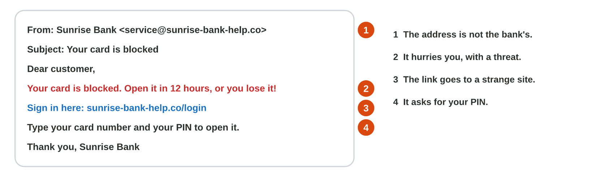
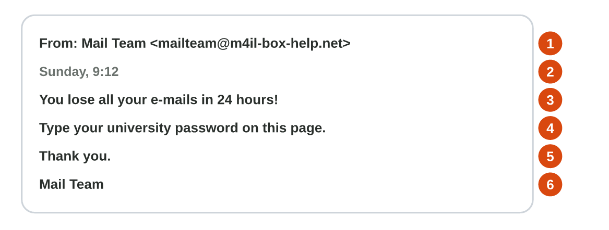

## Before you start {.study}

- **What you need:** your phone (Android or iPhone). A computer is not
  needed.
- **Time:** about 45 minutes. Work alone, at your own speed.
- **How it works:** read Steps 1–3, try each simulator and answer the
  questions: the page checks each answer at once. Then do the **Tasks to
  submit**.
- **Your phone:** Step 3 shows the screens of the Settings app. Choose
  **Android** or **iPhone** above the screens.
- **What you submit:** short answers and one screenshot, on the university
  e-learning platform, before lecture 4.
- **Never** type a real password on this page or in any simulator.

## Key terms {.study}



## Step 1 · A strong password and two-step verification {.study}

- A **strong password** is long (12 characters or more) and hard to guess.
  Join three or four random words, with a number and a symbol:
  `Blue-Camel-Rain-47`.
- Never a name, a birthday or a common word (`sami2005`, `qwerty`).
- **One password for one account.** If one site loses your password, the
  others stay safe.
- **Two-step verification:** after the password, your phone shows a
  number or a code. A thief with your password still cannot sign in.



::: {.callout-note title="Model · Lina signs in with two-step verification"}
Lina signs in to her university account on a lab computer. She types her
password. Then the screen shows a number, **47**, and her phone asks: *Are
you trying to sign in?* She types 47 and taps **Yes**. If her phone asks
when she is **not** signing in, she taps **No, it's not me**, and she
changes her password.
:::

**The same on Android and iPhone** (the Microsoft Authenticator app). The
orange numbers show where to look and tap.

::: {.screens}
![[1]{.step-n} After the password, the sign-in page shows a number.](images/twostep-win-1.png)

![[2]{.step-n} On your phone, type the same number. [3]{.step-n} Tap **Yes**.](images/twostep-phone-1.png)
:::

::: {.callout-tip title="Try it 1 · Passwords"}
Choose the right answer.

::: {.match extra="sami2005|Huda1990!"}
Which password is the strongest?
:   green lamp river 82

    Why: Four words: long, with no name, no year and no common word.

Omar uses one password for his e-mail, his bank and a game. One game site loses it. What can happen?
:   a stranger signs in to his e-mail and bank too

    Why: The same password opens every account; use one password for one account.

Your phone asks "Are you trying to sign in?", but you are not signing in. What do you tap?
:   No, it's not me

    Why: Somebody has your password: say no, then change the password.
:::
:::

## Step 2 · Find a phishing message {.study}

**Phishing** is a fake message that looks like it comes from a bank, a shop
or the university. It wants your password, a code or your money. The
warning signs:

- the **sender's address** is strange (not the real bank or university);
- it **hurries** you, often with a threat ("in 24 hours", "or you lose
  it");
- a **link** goes to a strange site;
- it asks for a **password, a PIN, a code** or money, or offers a prize.

**What to do:** do not tap the link. Open the real app or site yourself.
Report the message, then delete it.

::: {.callout-note title="Model · Omar's two fake messages"}
Omar gets an e-mail from "Sunrise Bank". It has four warning signs (the
picture). He also gets an SMS about a parcel. He touches and holds the
link: the real address is *parcel-jo-pay.info*, not a company that he
knows. He does not open it, and he reports the e-mail in Outlook.
:::

{width=100%}

**See the real address of a link, and report the e-mail.** The orange
numbers show where to tap.

::: {.screens}
![[1]{.step-n} Touch and hold the link (do not tap it). [2]{.step-n} The menu shows its real address.](images/link-phone-1.png)

![In Outlook: [1]{.step-n} click **Report**, then [2]{.step-n} **Report phishing**.](images/report-win-1.png)
:::



::: {.callout-tip title="Try it 2 · Phishing"}
Choose the right answer.

::: {.match extra="tap the link to check it|answer and ask who it is"}
A message says: "Your account closes in 2 hours!" Which sign is it?
:   it hurries you, with a threat

    Why: Phishing hurries you, so you act before you think.

A message from your "cousin" on a new number asks for the code that came to your phone. What is it?
:   phishing: the code opens your account

    Why: Nobody real needs your code; with it a stranger takes your account.

An e-mail from "the bank" asks for your PIN. What do you do?
:   report it and delete it

    Why: A real bank never asks for your PIN by e-mail.
:::
:::

## Step 3 · Your privacy: app permissions and AI tools {.study}

- Apps ask for **permissions**: your location, the camera, the microphone,
  your contacts, your photos.
- Give an app only what it needs. A map needs your location **while you
  use it**. A photo editor does not need it at all.
- Choose **Allow only while using the app** (iPhone: **While Using the
  App**), **Ask every time**, or **Don't allow** (iPhone: **Never**).
- Check your apps now and then. And never post your ID number, address or
  phone number.
- **AI tools:** never type a password, an ID number, a phone number, an
  address, grades or a real name of another person into an AI chat. Use
  made-up names: *Student A*, *Customer 1*.

::: {.callout-note title="Model · Sami's photo app"}
Sami's photo editor, **PhotoFix**, uses his location all the time. A photo
editor does not need it. The screens below show how he turns it off.
:::

**Choose your phone.** The orange numbers show where to tap.

::: {.panel-tabset group="phone"}
### Android

::: {.screens}
![Open **Settings › Apps** and tap the app. [1]{.step-n} Tap **Permissions**, then **Location**.](images/perm-android-1.png)

![[2]{.step-n} Choose **Don't allow** (or **Allow only while using the app** for a map).](images/perm-android-2.png)
:::

### iPhone

::: {.screens}
![Open **Settings › Privacy & Security › Location Services**. [1]{.step-n} Tap the app.](images/perm-iphone-1.png)

![[2]{.step-n} Choose **Never** (or **While Using the App** for a map).](images/perm-iphone-2.png)
:::
:::

::: {.callout-tip title="Try it 3 · Permissions"}
Choose the right setting. You can use an answer more than once.

::: {.match extra="Allow all the time|the real names and grades"}
A map app shows you the way to the college.
:   Allow only while using the app

    Why: The map needs your location, but only while you use it.

A calculator app asks for your location.
:   Don't allow

    Why: A calculator does not need to know where you are.

A flashlight app asks for your contacts.
:   Don't allow

    Why: A flashlight needs no contacts; an app that asks for more than it needs is a warning sign.

You ask an AI tool to write a message about a friend's grades. What do you type?
:   made-up names, no real data

    Why: An AI chat may keep what you type: never real personal data.
:::
:::

## Tasks to submit {.tasks}

### Task 1 · Passwords and two-step verification

Made-up passwords: **A** `sami2005` · **B** `Password123` · **C**
`Blue-Lamp-Rain-58` · **D** `qwerty`. (Step 1 shows how.)

a) Which password is the strongest? Write its letter.



b) "Are you trying to sign in?", but you are not. **A** Yes · **B** No,
it's not me



### Task 2 · A phishing e-mail

{width=55%}

a) Three numbers of the e-mail show warning signs (Step 2). Write them.



b) What do you do? **A** click the link · **B** answer it · **C** report
and delete it.



### Task 3 · Privacy

a) On your phone, open the **location permission** of the **Camera** app,
choose a setting and take a screenshot of it (Step 3).

b) Which one may you type into an AI chat? **A** your password · **B**
*Customer 1 ordered 2 cakes* · **C** your friend's phone number



## How to submit

Upload your answers and the screenshot, **before lecture 4**.
