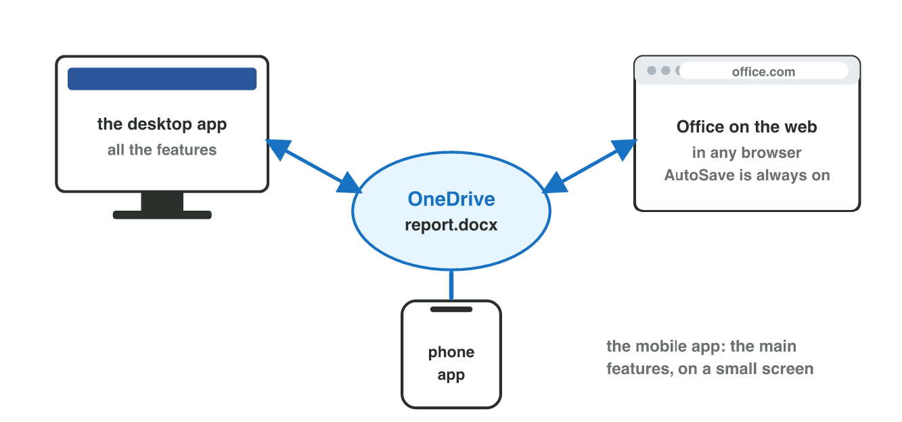
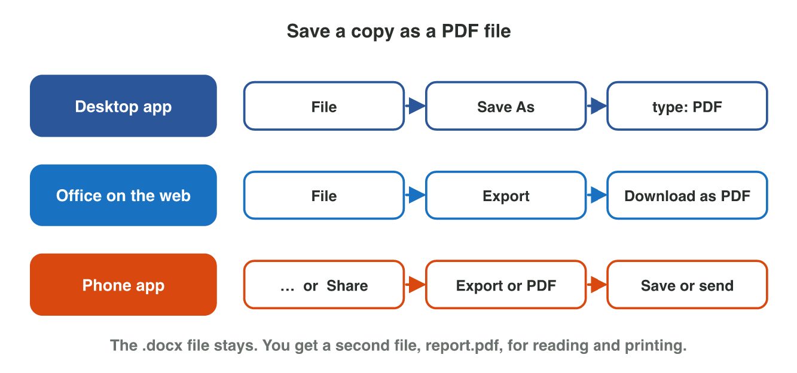
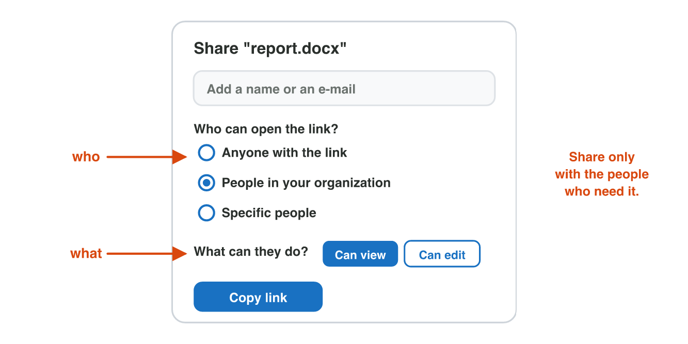

## Before you start {.study}

- **What you need:** your university account, and Word and Excel (the
  desktop apps, Office on the web at `office.com`, or the free phone apps).
- **Time:** about 60 minutes. Work alone, at your own speed.
- **How it works:** do Steps 1–3 on this page. Each step has a short text, a
  simulator and a self-check. Then do the **Tasks to submit**.
- **What you submit:** a PDF file, a Word file, a screenshot and two short
  answers, on the university e-learning platform, before lecture 4.
- **Remember:** use made-up details in your files, not your real phone
  number or address.

## Key terms {.study}



## Step 1 · One file, three places, and a PDF copy {.study}

- Your files in **OneDrive** open in three places:
  - the **desktop app** on a computer: all the features;
  - **Office on the web** in any browser, at `office.com`: no install,
    and AutoSave is always on;
  - the **phone app**: the main features, on a small screen.
- A **PDF** copy keeps the look of every page. People read and print it,
  but they do not easily change it. Send a PDF when nobody may change the
  file.
- **Desktop app:** File → Save As → choose the type **PDF**.
- **Office on the web:** File → Export → **Download as PDF**.
- **Phone app:** look for **Share** → **Send a copy** → **PDF**, or
  **Export** → **PDF** (the names differ a little on Android and iPhone).
- The `.docx` file stays. You get a second file, the `.pdf`.

{width=90%}

{width=100%}



::: {.callout-tip title="Try it 1 · Three places and a PDF"}
Choose the right answer.

::: {.match extra="the .docx file is deleted|only on the phone"}
You are at an Internet café without Word. Where can you open your file?
:   Office on the web, in the browser

    Why: Office on the web opens in any browser, with no install.

Where is AutoSave always on?
:   Office on the web

    Why: On the web, AutoSave is always on.

In the desktop app, how do you make a PDF?
:   File → Save As → type PDF

    Why: In the desktop app, Save As can change the type to PDF.

You make a PDF copy of notice.docx. What happens to notice.docx?
:   it stays, and notice.pdf is added

    Why: A PDF copy is a second file; the .docx stays.

A customer must read the notice but not change it. What do you send?
:   the PDF file

    Why: A PDF keeps the look, and people do not easily change it.
:::
:::

## Step 2 · Copy a table from Excel to Word {.study}

- **Copy** (Ctrl + C) puts the table on the **clipboard**. **Paste**
  (Ctrl + V) puts it into Word.
- After you paste, a small **Paste Options** button appears (or press
  Ctrl). It has four choices:
  1. **Keep Source Formatting:** a Word table with the Excel look;
  2. **Use Destination Styles:** a Word table with the look of your
     document;
  3. **Picture:** an image; nobody can change the numbers;
  4. **Keep Text Only:** only the words and numbers, no table lines.
- In choices 1 and 2 you can still change the numbers in Word.

{width=100%}



::: {.callout-tip title="Try it 2 · Paste Options"}
Choose the right Paste Option. You can use an answer more than once.

::: {.match extra="Save As"}
The table must look like the rest of your report, and you must still change the prices.
:   Use Destination Styles

    Why: It takes the look of your document and stays a table that you can change.

The table must look exactly as in Excel.
:   Keep Source Formatting

    Why: It keeps the look of the Excel table.

Nobody may change the prices by mistake.
:   Picture

    Why: A picture is an image: nobody can change the numbers in it.

You want only the words and numbers, no table lines.
:   Keep Text Only

    Why: It pastes only the words and the numbers.

Where is the table after Ctrl + C, before you paste?
:   on the clipboard

    Why: Copy puts the table on the clipboard until you paste it.
:::
:::

## Step 3 · Share a file safely {.study}

- In OneDrive (or in the app), press **Share**. Choose two things:
  - **Who** can open the link: *Anyone with the link*, *People in your
    organization* (the university), or *Specific people*.
  - **What** they can do: **Can view** (only read) or **Can edit** (also
    change).
- Then press **Copy link** and send it (in e-mail, Teams or a chat).
- Share only with the people who need the file. Give **Can edit** only
  when they must change it.
- A link for *Anyone* can travel to strangers. Never use it for personal
  data.

{width=90%}



::: {.callout-tip title="Try it 3 · Who and what?"}
Choose the right settings.

::: {.match extra="Anyone with the link, Can edit"}
Your teacher must read your report, but not change it.
:   Specific people, Can view

    Why: Only your teacher gets the link, and only to read.

Your classmate must add two slides to your presentation.
:   Specific people, Can edit

    Why: Only your classmate gets the link, and they must change the file.

Every customer who gets the link may read the price list.
:   Anyone with the link, Can view

    Why: Every customer with the link may read the list, but not change it.

All students and staff of the university may read the club notes.
:   People in your organization, Can view

    Why: Only the people of the university may open it, and only to read.
:::
:::

## Tasks to submit {.tasks}

Do the tasks alone. Your teacher marks them (6 marks).

### Task 1 · A PDF copy (2 marks)

1. In Word (on the computer, on the web or on the phone), write a short
   notice for your class of three lines, for example: *The library is closed
   on Thursday. Please return books on Wednesday. Thank you.*
2. Save it in OneDrive as `2026-11-05_notice.docx` (use today's date).
3. Make a PDF copy of it: `2026-11-05_notice.pdf`.

*Submit:* the PDF file. Write where you made it: desktop app, web or phone.



### Task 2 · From Excel to Word (2 marks)

1. In Excel, type this table: **Item, Price (JD)**; **Pen, 0.25**;
   **Notebook, 1.50**; **Folder, 0.75**.
2. Copy it. In a new Word document, write the title *Our prices* and paste
   the table with **Use Destination Styles**.
3. In Word, change the price of the folder to **0.80**.
4. Save it as `2026-11-05_prices.docx`.

*Submit:* the Word file.

### Task 3 · Share safely (1 mark)

Open your file `2026-11-05_prices.docx` in OneDrive and press **Share**.
Choose **Specific people** (or **People in your organization**) and **Can
view**. Do not send it. Take a screenshot of these settings.

*Submit:* the screenshot.

### Task 4 · Short answers (1 mark)

a) Which Paste Option makes a table that nobody can change by mistake?



b) A classmate must add slides to your presentation. Which permission do
you give: Can view or Can edit?



## How to submit

Upload the PDF (Task 1), the Word file (Task 2), the screenshot (Task 3) and
your answers to Task 4 to the university e-learning platform, **before
lecture 4**.
