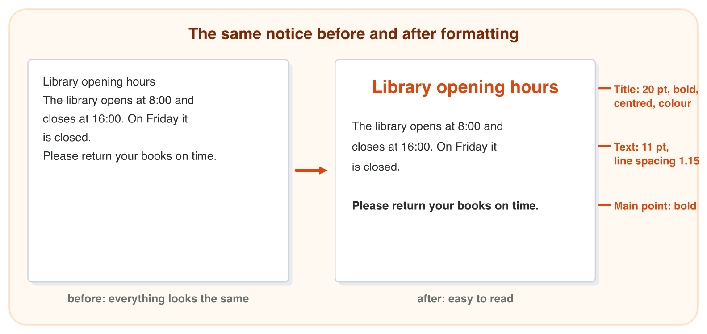
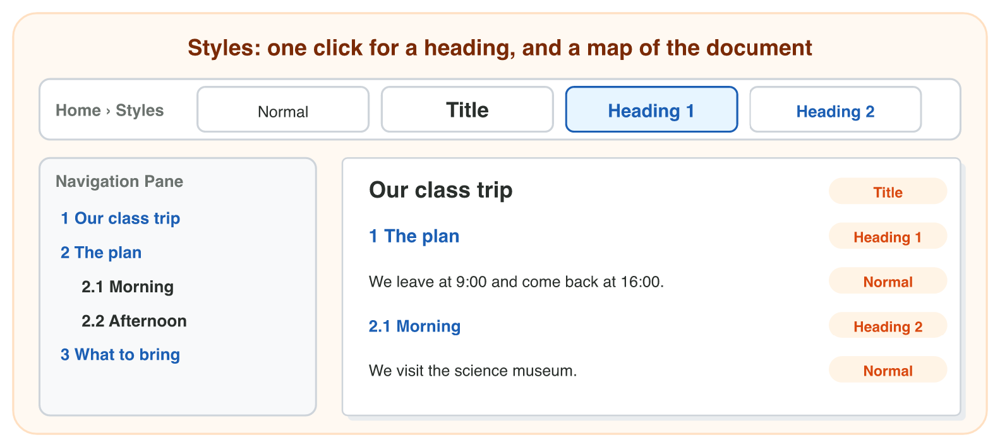
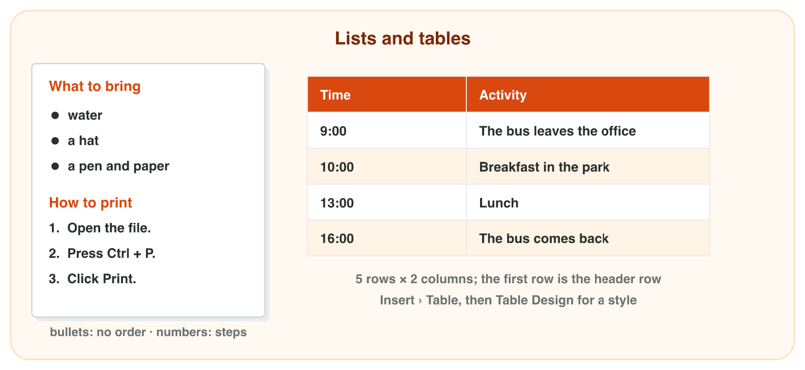
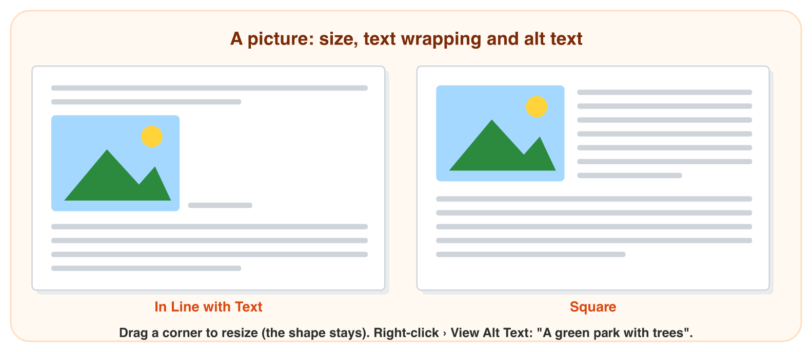
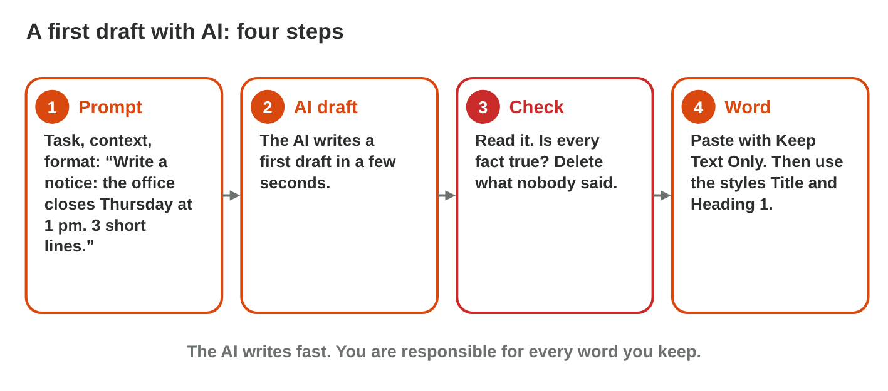

::: {.lead}
Huda works at Sunrise Company. Her manager asks for a notice for the staff
Family Day: "Make it easy to read. Put the plan in a table, and add a nice
picture." Huda types the text in Word. But all the lines look the same, and
the notice is hard to read. In this lesson you learn how Word makes a
document clear: you format text and paragraphs, you use **styles** for the
title and the headings, you make **lists** and **tables**, and you add a
**picture**. These notes are a short reference: in class you try each idea
in Word, as an experiment of the **worksheet**.
:::

## Key terms



## 4.1 Formatting and styles

Formatting changes the look of the text. There are two kinds
(@fig-format):

- **Text formatting** changes letters and words: the font, the size, bold
  (B), italic (I), underline (U) and the colour. It is in **Home › Font**.
- **Paragraph formatting** changes a whole paragraph: the **alignment**
  (left, centre, right, justified), the **line spacing** and the space
  after a paragraph. It is in **Home › Paragraph**.

First **select** the text. Then click the command. For a whole paragraph, it
is enough to click inside it.

{#fig-format width=100%}

::: {.callout-note title="Example 4.1 — The library notice"}
1. Huda selects the first line and clicks size **20**, **Bold** and
   **Center**. It becomes a clear title.
2. She clicks inside the text and chooses line spacing **1.15**. The lines
   are easier to read.
3. She makes only the last line bold: "Please return your books on time."
   Now the main point stands out.
:::

::: {.callout-warning title="Common mistake"}
Making everything bold or big. If every line is bold, nothing stands out.
Use bold for one or two important words or lines only.
:::



### Styles: headings with one click

Huda's class report has ten headings. She formats each heading by hand: size
14, bold, blue. Then her teacher says: "Make all the headings green." Now
she must change ten headings again. A **style** saves her this work
(@fig-styles).

::: {.callout-important title="Definition 4.1 — Style"}
A **style** is a saved set of formatting with a name, such as **Title**,
**Heading 1** or **Normal**. You apply it with one click. Change the style
once, and all the text with this style changes.
:::

{#fig-styles width=100%}

Use the styles like this:

- **Title** for the name of the whole document (once);
- **Heading 1** for the main headings, **Heading 2** for smaller headings
  under them;
- **Normal** for the normal text.

Word also uses the headings for a map of the document: **View › Navigation
Pane**. Click a heading there, and Word jumps to it. In Online activity 4,
Word makes a table of contents from the same headings.

::: {.callout-note title="Example 4.2 — The class trip"}
1. "Our class trip" gets **Title**.
2. "The plan" and "What to bring" get **Heading 1**.
3. "Morning" and "Afternoon" are parts of "The plan": they get **Heading 2**.
4. Huda changes the colour of Heading 1 once. Both main headings change.
:::

::: {.callout-warning title="Common mistake"}
Making a heading "by hand" with bold and a big size. It looks like a
heading, but for Word it is normal text: it is not in the Navigation Pane,
and it will not be in the table of contents.
:::



*In class: Experiment 1 of the worksheet, one word in bold, one line in the center, then Title, Heading 1 and the Navigation Pane.*

## 4.2 A table and a picture

Some text has two or more kinds of information on each line: a time and
its activity, a book and its price. Word puts it in a **table**
(@fig-lists). (For a list of things, Home › Paragraph › Bullets; for steps,
Numbering.)

- A **table** (Insert › Table) is for information in rows and columns:
  each time with its activity. Choose the number of columns and rows. The
  first row, the **header row**, names the columns. **Table Design** gives
  the table a style. Press **Tab** in the last cell to add a row.

{#fig-lists width=100%}

::: {.callout-note title="Example 4.3 — The bus plan"}
The plan has four times, each with an activity.

1. Two kinds of information (time, activity): **2 columns**.
2. One row for the names of the columns and one for each time: **5 rows**.
:::



A picture makes a notice friendly. Word adds it with **Insert ›
Pictures**: from the computer (This Device), from free **Stock Images**, or
from the web (Online Pictures; check that you may use the picture).

- **Size:** drag a **corner** of the picture. Then the shape stays right.
  A side handle makes the picture too wide or too thin.
- **Text wrapping** (the Layout Options button next to the picture):
  *In Line with Text* puts the picture in a line of its own; *Square* lets
  the text flow around it (@fig-wrap).
- **Alt text:** right-click › **View Alt Text**. Write a short description,
  for example "A green park with trees". A screen reader reads it aloud for
  people who cannot see the picture.

{#fig-wrap width=100%}

::: {.callout-note title="Example 4.4 — The park picture"}
1. Huda inserts a picture of a park from Stock Images.
2. She drags a corner: the picture becomes smaller, and the trees keep their
   shape.
3. She chooses **Square**: the text "What to bring" flows next to the
   picture.
4. She writes the alt text "A green park with trees".
:::

::: {.callout-warning title="Common mistake"}
Taking any picture from the internet. Many pictures belong to someone. Use
your own photos, Stock Images in Word, or pictures that say you may use
them.
:::

*In class: Experiment 2 of the worksheet, a table of prices and a picture with Square wrapping.*

## 4.3 A draft from AI, checked and proofread

An AI assistant (for example Microsoft Copilot with the university
account) writes a **first draft** of a notice, an e-mail or a summary in
seconds (@fig-draft). But it can add a fact that nobody gave, or change a
number. So:

1. **Give the facts** in the prompt: the days, the times, the price.
2. **Check every line** against your facts; delete what nobody gave, fix
   the numbers.
3. **Paste with Keep Text Only** (only the words), so that the styles of
   Word give the look.
4. **Proofread:** Review › Spelling & Grammar (F7) finds spelling
   mistakes; a wrong fact or number is spelled right, so only you find it.

{#fig-draft width=100%}

::: {.callout-note title="Example 4.5 — Three lines about the book fair"}
1. Prompt: the book fair is from Sunday to Tuesday, 10:00 to 15:00, entry
   is free.
2. The AI adds "Every book costs 1 JD": nobody said it, so Huda deletes it.
3. She pastes the lines with Keep Text Only, presses F7 and saves.
:::

::: {.callout-warning title="Common mistake"}
Sending an AI draft without reading it. You are responsible for every word
that you send.
:::



*In class: Experiment 3 of the worksheet, a draft from an AI assistant,
checked and proofread in Word.*

## Case study: the Family Day notice

Huda must make the notice for the Sunrise Company Family Day. The text is
typed, but nothing is formatted. The notice needs: the title "Sunrise Family
Day" with the style **Title**; the headings "The plan" and "What to bring"
with **Heading 1**; the things to bring (water, a hat, sun cream) as a
**bulleted list**; the bus plan (9:00 The bus leaves the office; 10:00
Breakfast in the park; 13:00 Lunch; 16:00 The bus comes back) as a
**table**; and a picture of a park with **Square** wrapping and **alt
text**. In the mini-game below, you make the notice with as few wrong clicks
as you can.



## Further reading

Lambert and Frye, *Microsoft Office Step by Step (Office 2021 and Microsoft
365)*, the Word chapters on formatting text, styles, lists, tables and
pictures. Microsoft 365 Training (support.microsoft.com/training): Word for
beginners.

## Exercises

1. Where are Bold and the font size: Home › Font or Home › Paragraph?
2. Which style do you use for the name of a report: Title or Heading 1?
3. How do you open the Navigation Pane?
4. A price list has 6 items, each with a price. How many rows does its table need (with a header row)?
5. How do you make a picture smaller without changing its shape: a corner or a side handle?
6. The text must flow around a picture. Which wrapping?
7. An AI draft adds a fact that nobody gave. Keep it or delete it?
8. Which paste option takes only the words of an AI chat?
9. Does Spelling & Grammar find a wrong time, like 17:00 instead of 15:00: yes or no?

## Answers to the exercises

::: {.answers}
1. Home › Font.
2. Title.
3. View › Navigation Pane.
4. 7 rows (and 2 columns).
5. A corner.
6. Square.
7. Delete it.
8. Keep Text Only.
9. No: a wrong number is spelled right; only you can check it.
:::
