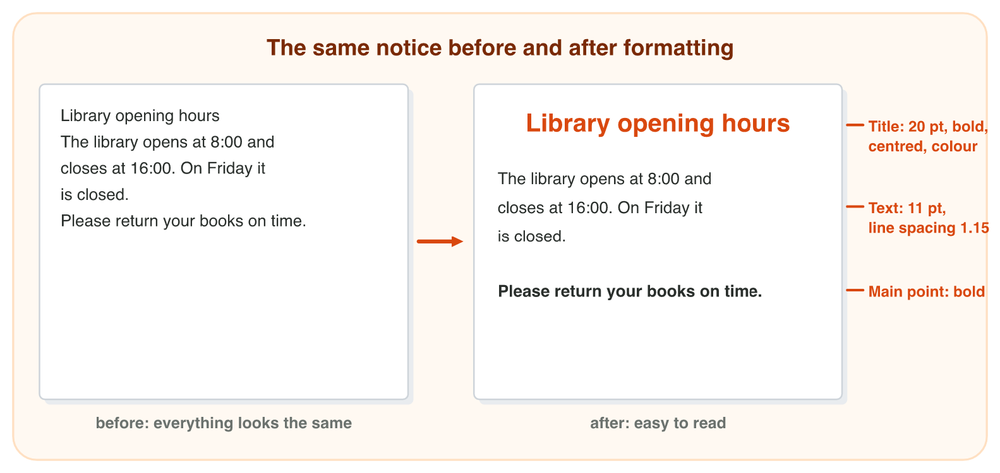
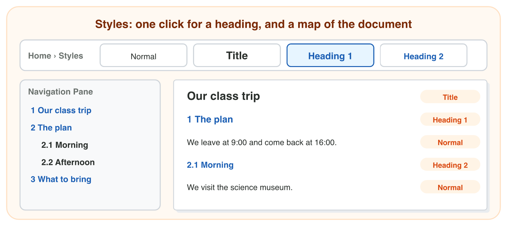
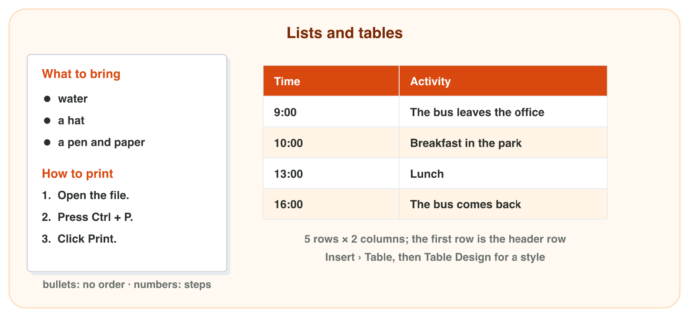
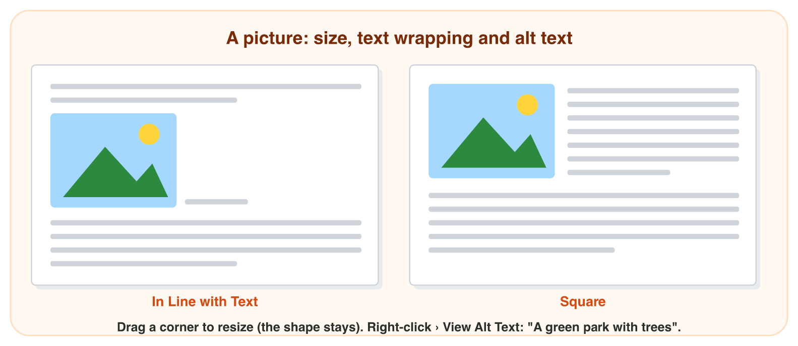

## Keywords



## Before you start

:::: {.columns}
::: {.column width="50%"}
- Open the page of Lecture 4 and download book-fair-start.docx and books.png.
- The notice for the book fair has no formatting yet, and the picture is for Experiment 4.
- Do each experiment of the worksheet when the teacher shows it.
- Write your result after each step, then check it at the end of the worksheet.
:::
::: {.column width="50%"}

:::
::::

## Experiment 1 · Text and paragraph formatting

:::: {.columns}
::: {.column width="50%"}
- Home › Font changes the selected text, and Home › Paragraph changes a whole paragraph.
- **Step 1:** Select only the word free and click Bold. What is bold now?
- **Step 2:** Click in the same line and click Center. What moves?
- **Step 3:** Select all and choose line spacing 1.5. What happens to the lines?
:::
::: {.column width="50%"}

:::
::::

## Live demo · Format Lab



## Check 1 · Text and paragraph formatting

What did you record in Experiment 1?

::: {.reveal}
- Step 1: Only the word free is bold, because Bold changes the selected text.
- Step 2: The whole line moves to the center, because Center changes the paragraph.
- Step 3: The lines move apart, and the notice is easier to read.
:::

## Experiment 2 · Styles and headings

:::: {.columns}
::: {.column width="50%"}
- A style is saved formatting with a name, such as Title or Heading 1.
- **Step 1:** Give the title Title and the four headings Heading 1. How do they look?
- **Step 2:** Open View › Navigation Pane. How many headings does it show?
- **Step 3:** Modify Heading 1 to green. What happens to the four headings?
:::
::: {.column width="50%"}

:::
::::

## Live demo · Style Lab



## Check 2 · Styles and headings

What did you record in Experiment 2?

::: {.reveal}
- Step 1: The four headings are bigger and in a colour, and they all look the same.
- Step 2: The pane shows 4 headings, and a click on Prices jumps there.
- Step 3: All four headings turn green, because you changed their style one time.
:::

## Experiment 3 · A list and a table

:::: {.columns}
::: {.column width="50%"}
- Bullets are for things in no order, and numbers are for steps in an order.
- **Step 1:** Which lines need bullets, and which need numbers?
- **Step 2:** Make a table for three prices with a header row. How many rows does it need?
- **Step 3:** Press Tab in the last cell. What does Word do?
:::
::: {.column width="50%"}

:::
::::

## Live demo · List and Table Lab



## Check 3 · A list and a table

What did you record in Experiment 3?

::: {.reveal}
- Step 1: The things to bring get bullets, and the steps of the swap get numbers.
- Step 2: The table has 2 columns and 4 rows: 1 header row and 3 items.
- Step 3: Tab in the last cell adds a new row to the table.
:::

## Experiment 4 · A picture

:::: {.columns}
::: {.column width="50%"}
- **Step 1:** Insert books.png. Where does the new picture sit?
- **Step 2:** Make the picture smaller from a corner, then from a side. What is the difference?
- **Step 3:** Choose Square in Layout Options. What does the text do?
- **Step 4:** Write the alt text. What does the picture show, in a few words?
:::
::: {.column width="50%"}

:::
::::

## Check 4 · A picture

What did you record in Experiment 4?

::: {.reveal}
- Step 1: The picture sits in the line, and the text goes on after it.
- Step 2: A corner keeps the shape, but a side handle stretches the books.
- Step 3: With Square, the text flows around the picture.
- Step 4: A good alt text is "Colourful books on a wooden shelf".
:::

## Game challenge · The Family Day notice



## Try it 5 · Huda's notice (harder)

The facts: the notice has the title "Sunrise Family Day", the headings "The plan" and "What to bring", three things to bring, a bus plan with four times and a park picture.

a) How many rows does the table of the bus plan need with a header row?
b) Huda made "The plan" bold and big by hand. Why is it not in the Navigation Pane?
c) Which alt text is good for the park picture?

::: {.answer}
a) 5 rows (and 2 columns)
b) It has no heading style, so Word sees normal text.
c) for example: "A green park with trees"
:::

## Summary

- Home › Font changes letters, and Home › Paragraph changes whole paragraphs.
- Styles format the headings with one click and make the Navigation Pane.
- Bullets are for things, numbering is for steps, and a table is for rows and columns.
- A picture keeps its shape when you drag a corner, and Square wrapping puts text around it.
- Alt text describes a picture for people who cannot see it.
