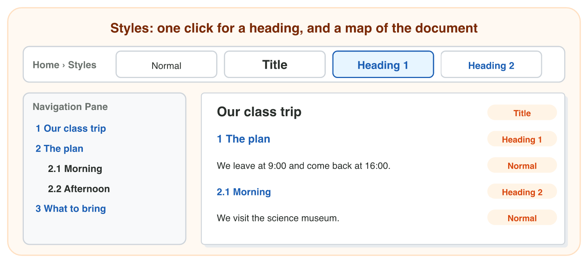
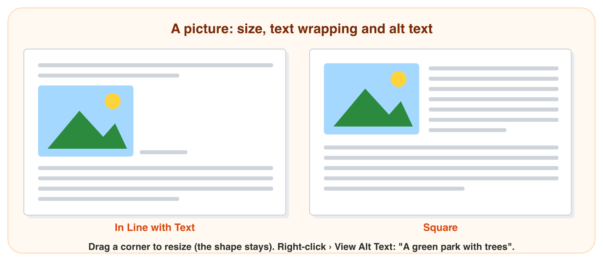

This page is the lecture, in class and at home. Each section explains one
idea, then shows its experiment. The page checks every step at once.

**In class, the teacher chooses the way for each experiment,** by the topic
and the time:

- **On the simulator** of the section, here on the page: nothing to
  install, and it works at home too.
- **In the real app** on the teacher's laptop, connected to the smart
  screen (HDMI): open the start file and follow the steps of **Part A**.
- **In the computer lab:** each student follows the **worksheet (PDF)**,
  Part A in the app and Part B on the simulator, and checks each result
  here.
- **You need:** Word, an AI assistant and the start files, or only the simulators.

## Key terms



## Before you start



## 4.1 Formatting and styles

- **Home › Font:** the selected letters (bold, size, colour).
- **Home › Paragraph:** the whole paragraph (center, line spacing).
- A **style** (Title, Heading 1): saved formatting; the **Navigation Pane**
  shows the headings.

{width=100%}





::: {.callout-tip title="Try it 1 · Styles"}
Choose the style.

::: {.match extra="Bold"}
"Morning": a smaller heading under "The plan".
:   Heading 2

    Why: Heading 2 is for smaller headings under a main heading.
:::
:::

## 4.2 A table and a picture

- **Table** (Insert › Table): rows and columns. The **header row** names
  the columns.
- **Insert › Pictures**: drag a **corner**; **Square** lets the text flow
  around it.
- **Alt text** says what the picture shows.

{width=100%}





::: {.callout-tip title="Try it 2 · Tables and pictures"}
Choose the right answer.

::: {.match extra="a side handle|8"}
A price list of 6 items, each with a price, with a header row: how many rows?
:   7

    Why: 1 header row + 6 items = 7 rows.

The text must flow around the picture. Which wrapping?
:   Square

    Why: Square lets the text flow around the picture.
:::
:::

## 4.3 A draft from AI, checked and proofread

- An **AI assistant** writes a **first draft** fast. Give the facts in the
  prompt.
- **Check** every line: delete facts that nobody gave; fix wrong numbers.
- Paste with **Keep Text Only**; then **Review › Spelling & Grammar**
  (F7).

{width=100%}





::: {.callout-tip title="Try it 3 · Check the AI"}
Choose the right answer.

::: {.match extra="send it at once|Bold"}
The AI adds "Writers come on Monday". Nobody said it. What do you do?
:   delete it

    Why: A notice has only your facts.

Which paste option takes only the words from the AI chat?
:   Keep Text Only

    Why: Then the styles of Word give the look.
:::
:::

## Table of results



## Game challenge: the Family Day notice {.challenge}

Huda makes the notice of the Sunrise Company Family Day in **Notice
Maker**: styles, a list, a table and a picture.



::: {.callout-tip title="Try it 4 · Huda's questions (harder)"}
Huda's notice: a bus plan with 4 times, a park picture, two headings. Choose
the right answer.

::: {.match extra="It is bold enough|8 rows"}
Huda made "The plan" bold and big by hand. Why is it not in the Navigation Pane?
:   it has no heading style

    Why: A heading made bold and big by hand is normal text for Word.
:::
:::

## Summary {.summary}

- Home › Font changes letters; Home › Paragraph changes alignment and line spacing.
- Styles (Title, Heading 1, Heading 2) format headings with one click and make the Navigation Pane.
- A table has rows and columns; Square wrapping lets the text flow around a picture.
- An AI draft is fast, but you check every fact and number.
- Paste with Keep Text Only, then proofread with Spelling & Grammar.
