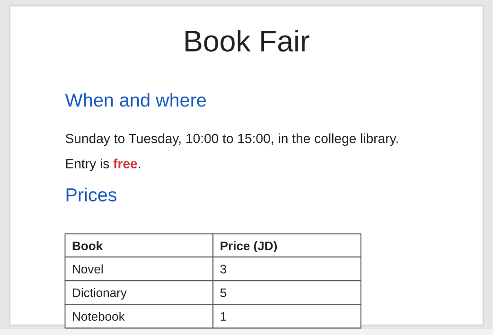

## Today in the lab

::: {.lab-plan}
1. **15 minutes, here:** the teacher shows each idea on a simulator, then
   in Word.
2. **35 minutes, in Word:** you follow the **worksheet**, step by step, on
   the lab computer. Nothing to download: you type the text yourself.
3. **At the end:** show your notice to your teacher. Then the **Extra**:
   an AI assistant changes your notice.
:::

{width=38%}

## Key terms



## 4.1 Styles, Center, Bold and a colour

### On the simulator

- A **style** (**Home › Styles**) gives the whole line a ready look:
  **Title**, **Heading 1**.
- Headings go into the **Navigation Pane** (**View** tab): a map of the
  document.
- **Center** changes the whole line: a click in the line is enough.
- **Bold** and a **colour** change only the selected word: double-click it
  first.

::: {.sim-part}

:::

### In Word: worksheet Tasks 1–3

:::: {.word-part}
Open Word, then **Blank document**, and type the five lines of the notice.
Then the same steps as on the simulator:

::: {.screens}
![[1]{.step-n} Click in **Book Fair**. [2]{.step-n} Click **Title**.](images/lab-styles-1.png)

![[1]{.step-n} Click in a heading line. [2]{.step-n} Click **Heading 1**.](images/lab-styles-2.png)

![[1]{.step-n} Click in the title. [2]{.step-n} Click **Center**.](images/lab-format-1.png)

![[1]{.step-n} Double-click **free**. [2]{.step-n} **B**. [3]{.step-n} A red colour.](images/lab-format-2.png)
:::
::::

::: {.callout-tip title="Try it 1 · Styles"}
Choose the right answer.

::: {.match extra="Bold|Center"}
"Prices" must be a heading in the Navigation Pane. Which button?
:   Heading 1

    Why: Only a heading style puts a line in the Navigation Pane. A big, bold line is still normal text.
:::
:::

## 4.2 A table

### On the simulator

- A **table** puts information in **rows** and **columns**.
- **Insert › Table**: move over the squares. **2x4 Table** = 2 columns
  across, 4 rows down.
- The first row names the columns. **Tab** goes to the next cell.

::: {.sim-part}

:::

### In Word: worksheet Task 4

:::: {.word-part}
Click at the end of **Prices** and press **Enter**. Then:

::: {.screens}
![[1]{.step-n} **Insert**. [2]{.step-n} **Table**. [3]{.step-n} 2 across, 4 down: **2x4 Table**.](images/lab-table-1.png)
:::

Type: Book | Price (JD), Novel | 3, Dictionary | 5, Notebook | 1. Press
**Tab** to go to the next cell.
::::

::: {.callout-tip title="Try it 2 · Rows"}
Choose the right answer.

::: {.match extra="5|3"}
A price list of 5 items, with a first row for the names of the columns: how many rows?
:   6

    Why: 1 row for the names + 5 items = 6 rows.
:::
:::

## 4.3 Ask AI to change your file

### On the simulator

- On **tutudocs.com** you open your own Word file in the browser, with **no
  sign-in**.
- Click **AI Assistant** and ask for **one change** in a short sentence: the
  AI changes the page at once.
- **File › Download › Microsoft Word (.docx)** gives you the new Word file.

::: {.sim-part}

:::

### In Word: Task 5 and the Extra

:::: {.word-part}
Right-click a word with a red wavy line to fix its spelling. Save with
**F12**. Then, in the Extra, the same steps as on the simulator on the real
**tutudocs.com**:

::: {.screens}
![[1]{.step-n} Right-click the word with a red line. [2]{.step-n} Click the right word.](images/lab-spell-1.png)

![Press **F12**. [1]{.step-n} **Desktop**. [2]{.step-n} **book-fair-** and your name. [3]{.step-n} **Save**.](images/lab-save-2.png)

![**tutudocs.com**: [1]{.step-n} click the box, then choose your file.](images/lab-tutu-1.png)

![[1]{.step-n} **AI Assistant**. [2]{.step-n} Type your request. [3]{.step-n} The AI changes the page.](images/lab-tutu-2.png)

![[1]{.step-n} **File**, [2]{.step-n} **Download**, [3]{.step-n} **Microsoft Word (.docx)**.](images/lab-tutu-3.png)
:::
::::

## Now: your worksheet

::: {.lab-go}
Take your **worksheet** and do Tasks 1–5 in Word on the lab computer, in
order. Tick each step. Raise your hand when you are stuck, and at the end.
Finished? Do the **Extra**: on tutudocs.com an AI assistant changes your notice.
:::

{width=36%}

## Summary {.summary}

- A style (Title, Heading 1) gives a whole line its look; headings go into the Navigation Pane.
- Center changes the whole line; Bold and a colour change only the selected word.
- Insert › Table: 2x4 = 2 columns, 4 rows; Tab goes to the next cell.
- A red wavy line is a spelling mistake: right-click it. Save with F12.
- On tutudocs.com (no sign-in), the AI Assistant changes your own file; then File › Download › Microsoft Word (.docx).
