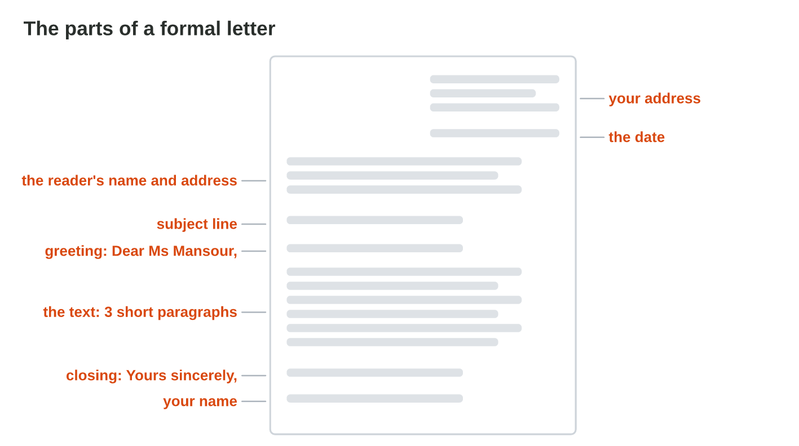
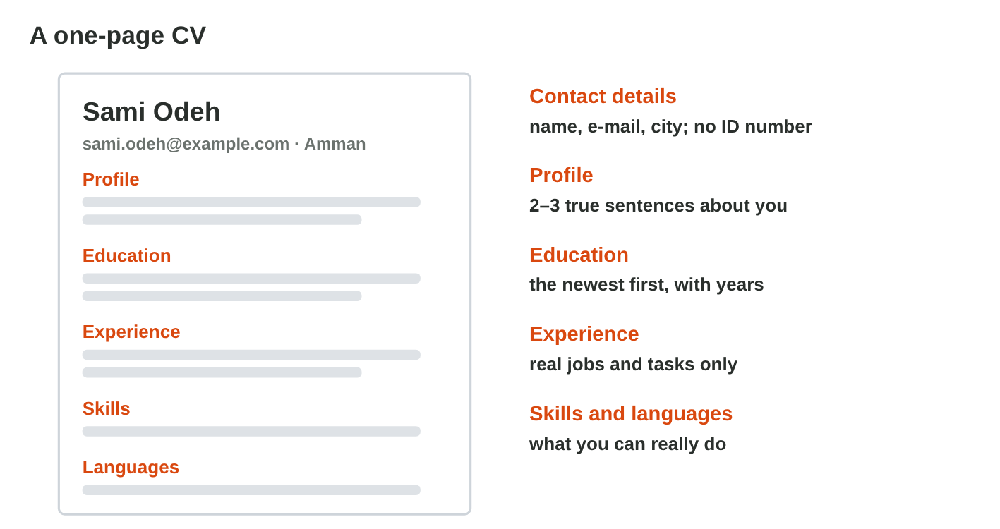

## Before you start {.study}

- **What you need:** Word (on a computer, or on the web at `office.com`)
  and an AI assistant that the university allows (for example Microsoft
  Copilot with your university account).
- **Time:** about 50 minutes. Work alone, at your own speed.
- **How it works:** read Steps 1–3 and answer their questions: the page
  checks each answer at once. Then do the **Tasks to submit**. You never
  write a prompt: you copy it.
- **What you submit:** a PDF, a Word file and three letters, on the
  university e-learning platform, before lecture 5.
- **Safety first:** use **made-up details** (address, phone, e-mail).
  Never type your ID number or your real address into an AI tool.

## Key terms {.study}



## Step 1 · The parts of a cover letter {.study}

A **cover letter** asks for a job or a training place. It is a formal
letter, with fixed parts from the top to the bottom:

1. **your address** and **the date**;
2. **the reader's name and address**;
3. the **subject line**: *Subject: Request for a training place*;
4. the **greeting**: *Dear Ms Mansour,* (or *Dear Sir or Madam,*);
5. **three short paragraphs**: why you write; about you; what you ask, and
   thanks;
6. *Yours sincerely,* and **your name**.

{width=100%}



::: {.callout-tip title="Try it 1 · The cover letter"}
Choose the right answer.

::: {.match extra="Hi Hala!|at the very end"}
What comes at the top of the letter?
:   your address and the date

    Why: A formal letter starts with your address and the date.

Which greeting fits when you know the reader's name?
:   Dear Ms Mansour,

    Why: When you know the name, the greeting uses it.

Which closing fits a formal letter?
:   Yours sincerely,

    Why: It is the formal closing before your name.
:::
:::

## Step 2 · A one-page CV {.study}

- A **CV** tells a company about you, on **one page**.
- Its parts: **contact details** (name, e-mail, city; no ID number); a
  **profile** of 2–3 true sentences; **education** (the newest first);
  **experience**; **skills** and **languages**.
- Word has **CV templates**: File › New, search for *CV* or *resume*.

{width=100%}



::: {.callout-tip title="Try it 2 · The CV"}
Choose the right answer.

::: {.match extra="three pages|your ID number"}
How long is a first CV?
:   one page

    Why: A first CV fits on one page.

Which contact details are enough?
:   name, e-mail and city

    Why: No ID number and no home address are needed.
:::
:::

## Step 3 · From an AI draft to a finished document {.study}

- An AI assistant drafts the letter in seconds. It does not know you: it
  may **invent** a job or a skill. Delete every line that is not true.
- Paste with **Keep Text Only**. Add a **header** with your name and a
  **page number** (Insert tab).
- Write the **AI-use statement** at the end: *Drafted with an AI
  assistant; checked and corrected by me.*
- Save it as a **PDF** (File › Save As › PDF): it keeps its look.

::: {.callout-note title="Model · Omar's letter"}
Omar copies a prompt with his facts into an AI assistant, pastes the
letter into Word with Keep Text Only, and deletes "I have used Excel for
five years" (not true). He adds a header *Omar Khaled · letter*, a page
number and the AI-use statement, then saves `letter.pdf`. The screens
below show the header and the PDF.
:::

**In Word on a computer.** The orange numbers show where to click.

::: {.screens}
![[1]{.step-n} Click **Insert › Header** and type your name. [2]{.step-n} The header is on every page. [3]{.step-n} Click **Page Number**.](images/word-header-1.png)

![[1]{.step-n} Click **File**.](images/pdf-win-1.png)

![[2]{.step-n} Click **Save As**, then choose the type **PDF (\*.pdf)**. [3]{.step-n} Click **Save**.](images/pdf-win-2.png)
:::



::: {.callout-tip title="Try it 3 · Check and finish"}
Choose the right answer.

::: {.match extra="keep it, it looks good|the .docx"}
The AI wrote that Sami was a manager in 2019. Sami was a child then. What do you do?
:   delete it

    Why: It is not true.

Which line do you write at the end of a document made with AI help?
:   Drafted with an AI assistant; checked and corrected by me.

    Why: The AI-use statement says honestly how you used AI.

Which file do you send, so that the look stays the same?
:   the PDF

    Why: A PDF keeps its look on every device.
:::
:::

## Tasks to submit {.tasks}

### Task 1 · A cover letter with AI

1. Copy this prompt into an AI assistant:

   ::: {.prompt}
   Write a cover letter to Ms Rana Saleh, HR Manager, Sunrise Company, 40
   Park Road, Amman. I am a first-year diploma student, and I ask for a
   summer training place in July. Three short paragraphs, formal tone,
   with a subject line.
   :::

2. Paste it into Word with **Keep Text Only**. Delete every fact that is
   not in the prompt.
3. Add a header with your name, a page number and the AI-use statement.
   Save it as `letter.pdf`. (Step 3 shows how.)

### Task 2 · A one-page CV

From a CV template, fill in your name, a made-up e-mail, your city, your
study and three skills. Save it as `cv.docx`. (Step 2 shows how.)

*Submit:* `letter.pdf` and `cv.docx`.

### Task 3 · Three letters

a) The greeting of your letter: **A** Dear Ms Saleh, · **B** Hi Rana! ·
**C** Dear friend,



b) Did the AI add a fact that is not in the prompt? **A** yes · **B** no



c) Which one is **not** in your CV? **A** your e-mail · **B** your city ·
**C** your ID number



## How to submit

Upload the two files and your three letters, **before lecture 5**.
