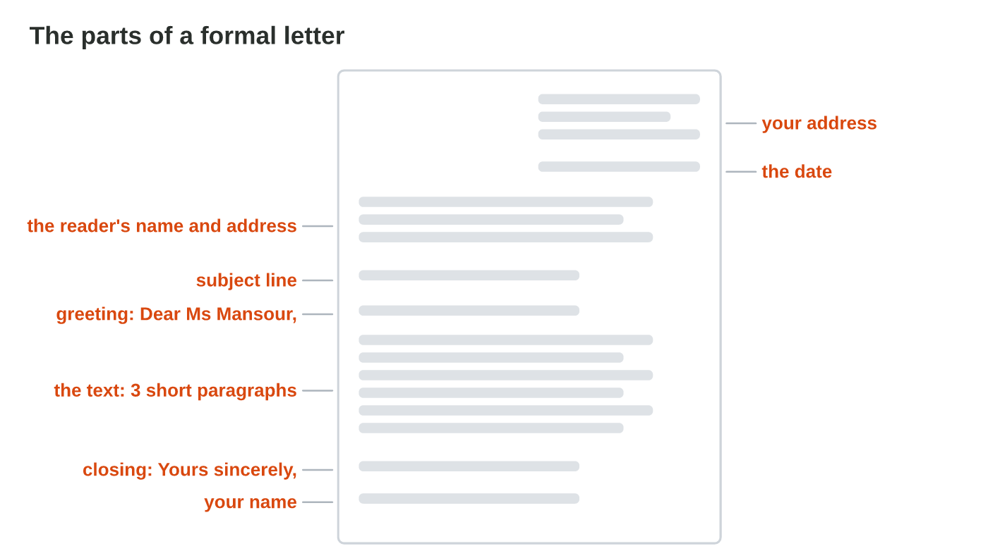
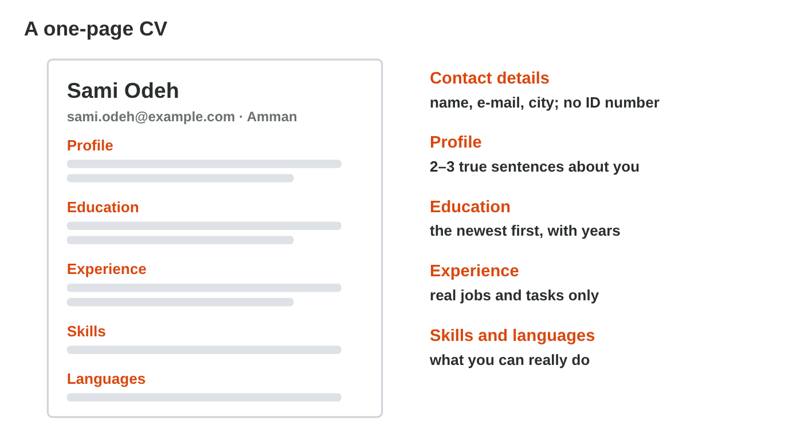

## Before you start {.study}

- **What you need:** Word (on a computer, or Word on the web at `office.com`)
  and a browser for **tutudocs.com** (no sign-in). On a phone you can do
  every Step on its simulator.
- **Time:** about 50 minutes. Work alone, at your own speed.
- **How it works:** every Step has a **simulator**: do the steps there
  first. The box **On your own computer** shows the same steps in the real
  app, with its screens. Then do the **Tasks to submit**.
- **What you submit:** a PDF, a Word file and two letters, on the
  university e-learning platform, before lecture 5.
- **Safety first:** use **made-up details** (e-mail, phone). Never type your
  ID number or your real address.

## Key terms {.study}



## Step 1 · The parts of a cover letter {.study}

A **cover letter** asks for a job or a training place, with fixed parts:
your address and the date; the reader's name; the **subject line**; the
**greeting** (*Dear Ms Saleh,*); three short paragraphs; *Yours sincerely,*
and your name.

{width=100%}

### On the simulator



::: {.callout-tip title="Try it 1 · The cover letter"}
Choose the right answer.

::: {.match extra="Hi Hala!|Cheers,"}
Which greeting fits when you know the reader's name?
:   Dear Ms Saleh,

    Why: When you know the name, the greeting uses it.
:::
:::

## Step 2 · AI makes your letter better {.study}

- Type a short letter in Word and save it: **letter-** and your name.
- On **tutudocs.com** (no sign-in) open it, click **AI Assistant** and ask
  for **one change**: a paragraph about your skills, a bold subject line.
- **File › Download › Microsoft Word (.docx)**: the new letter opens in Word.
- At the end of the letter add the **AI-use statement**: *Improved with an
  AI assistant on tutudocs.com.*

### On the simulator



### On your own computer (optional)

:::: {.word-part .home-part}
::: {.screens}
![**tutudocs.com**: [1]{.step-n} click the box, then choose your letter.](images/lab-tutu-1.png)

![[1]{.step-n} **AI Assistant**. [2]{.step-n} Your request. [3]{.step-n} The AI changes the letter.](images/lab-tutu-2.png)

![[1]{.step-n} **File**, [2]{.step-n} **Download**, [3]{.step-n} **Microsoft Word (.docx)**.](images/lab-tutu-3.png)
:::
::::

## Step 3 · A header, a page number and a PDF {.study}

- **Insert › Header**: your name on every page. **Insert › Page Number**.
- **File › Save As**, the type **PDF (\*.pdf)**: a PDF keeps its look on
  every device.

### On the simulator



### On your own computer (optional)

:::: {.word-part .home-part}
::: {.screens}
![[1]{.step-n} **Insert › Header**, your name. [2]{.step-n} It is on every page. [3]{.step-n} **Page Number**.](images/word-header-1.png)

![[1]{.step-n} Click **File**.](images/pdf-win-1.png)

![[2]{.step-n} **Save As**, the type **PDF (\*.pdf)**. [3]{.step-n} **Save**.](images/pdf-win-2.png)
:::
::::

## Step 4 · A one-page CV from a template {.study}

- A **CV** tells a company about you on **one page**: contact details
  (name, e-mail, city; no ID number), a short profile, education, skills.
- Word has CV templates: **File › New**, search for **resume**.

{width=100%}

### On the simulator



## Tasks to submit {.tasks}

### Task 1 · A cover letter, made better by AI

1. In Word, type this letter (use your own name), and save it as
   `letter-` and your name:

   *Subject: Request for a training place* · *Dear Ms Saleh,* · *I am a
   first-year diploma student. I ask for a summer training place in July.*
   · *Yours sincerely,* · your name.

2. On **tutudocs.com**, open it and ask the AI Assistant:
   *Add a short paragraph about my skills: Word, Excel and teamwork.*
   Download it (Microsoft Word, .docx). (Step 2 shows how.)
3. In Word, add a header with your name, a page number, and at the end:
   *Improved with an AI assistant on tutudocs.com.* Save it as
   `letter.pdf`. (Step 3 shows how.)

### Task 2 · A one-page CV

From a CV template, fill in your name, a made-up e-mail, your city, your
study and three skills. Save it as `cv.docx`. (Step 4 shows how.)

*Submit:* `letter.pdf` and `cv.docx`.

### Task 3 · Two letters

a) The greeting of your letter: **A** Dear Ms Saleh, · **B** Hi Rana! ·
**C** Dear friend,



b) Which one is **not** in your CV? **A** your e-mail · **B** your city ·
**C** your ID number



## How to submit

Upload the two files and your two letters, **before lecture 5**.
