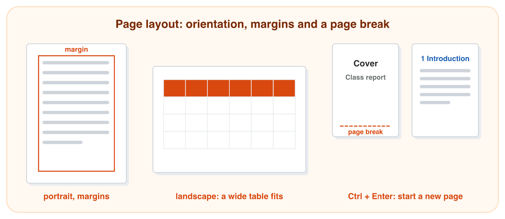
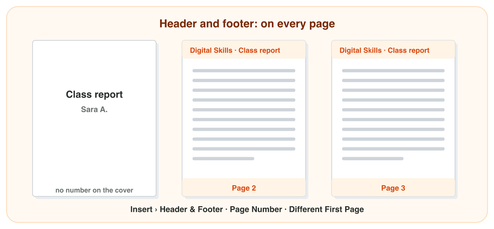
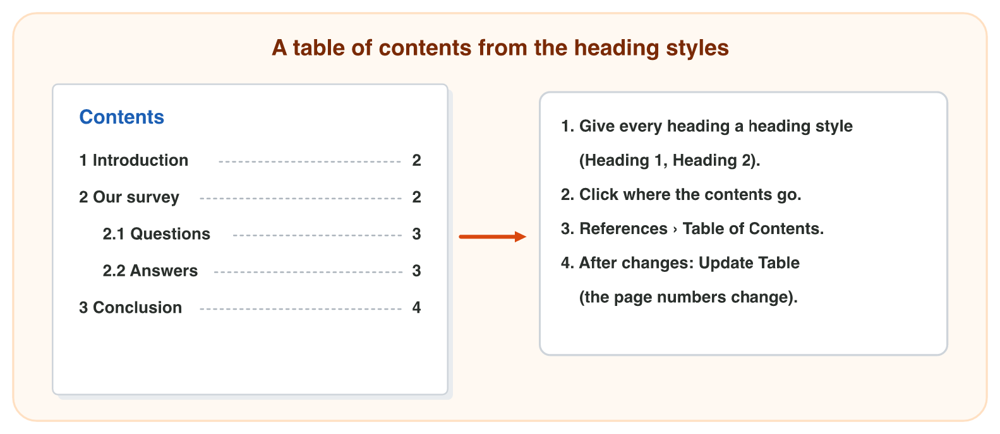

## Before you start {.study}

- **What you need:** Word (the desktop app, Word on the web at `office.com`,
  or the free phone app; the phone app has fewer features, so a computer is
  better for this activity).
- **Time:** about 60 minutes. Work alone, at your own speed.
- **How it works:** do Steps 1–3 on this page. Each step has a short text, a
  simulator and a self-check. Then do the **Tasks to submit**.
- **What you submit:** one Word file and two short answers, on the
  university e-learning platform, before lecture 5.
- **You need Lecture 4:** the styles Title, Heading 1 and Heading 2.

## Key terms {.study}



## Step 1 · The page: orientation, margins and page breaks {.study}

- **Layout › Orientation:** **Portrait** (tall, the normal page) or
  **Landscape** (wide). A wide table fits better on a landscape page.
- **Layout › Margins:** the empty space around the text: **Normal**,
  **Narrow** or **Wide**. Smaller margins give the text more room.
- On an A4 page with Normal margins, the text is about 16 cm wide in
  portrait and about 25 cm wide in landscape.
- **Page break** (**Ctrl + Enter**, or Insert › Page Break): the next text
  starts on a new page. Use it after a cover page. Do not press Enter many
  times: when the text above changes, the empty lines move.

{width=100%}



::: {.callout-tip title="Try it 1 · The page"}
Choose the right answer.

::: {.match extra="Bold|Enter, many times"}
A table is 20 cm wide. Which orientation gives it room?
:   Landscape

    Why: A landscape page is wider: about 25 cm of text instead of about 16 cm.

Which margins give the text the most room?
:   Narrow

    Why: Smaller margins leave more room for the text.

How do you start a new page after the cover?
:   Ctrl + Enter (a page break)

    Why: A page break starts the next text on a new page.

Where are Orientation and Margins?
:   in the Layout tab

    Why: The setup of the page is on the Layout tab.

Which orientation is tall, like a normal letter?
:   Portrait

    Why: Portrait is tall; landscape is wide.
:::
:::

## Step 2 · Header, footer and page numbers {.study}

- The **header** is the top area of every page; the **footer** is the
  bottom area. You type in them once, and the text is on **every page**.
- **Insert › Header** (or double-click at the top of a page). Type, for
  example, *Digital Skills · Class report*.
- **Insert › Page Number › Bottom of Page**: Word writes the right number
  on every page and changes it by itself.
- A cover page has no header and no number: tick **Different First Page**
  in the **Header & Footer** tab.
- Double-click in the text (or **Close Header and Footer**) to go back.

{width=100%}



::: {.callout-tip title="Try it 2 · Header and footer"}
Choose the right answer.

::: {.match extra="Layout › Margins|on page 1 only"}
You type the header once. Where does it appear?
:   on every page

    Why: You type the header once, and Word puts it on every page.

How do you add page numbers?
:   Insert › Page Number

    Why: Page numbers are added from the Insert tab.

The cover must have no header and no number. What do you tick?
:   Different First Page

    Why: It gives the first page its own header and footer, so the cover stays empty.

You add a new page in the middle. What happens to the page numbers?
:   Word changes them by itself

    Why: Word counts the pages again and changes every number.

Where is the footer?
:   at the bottom of every page

    Why: The footer is the bottom area of every page.
:::
:::

## Step 3 · A table of contents {.study}

- Word makes the **table of contents** from the **heading styles** of
  Lecture 4. So first give every heading **Heading 1** or **Heading 2**.
- Click where the contents go (for example on page 2, after the cover).
- **References › Table of Contents**: choose an automatic table. Word lists
  the headings with their page numbers.
- After you change, add or move a heading: click the contents and press
  **Update Table** (choose *Update entire table*). Word does not update it
  by itself while you write.
- In the desktop app, **Ctrl + click** a line of the contents to jump to
  that heading.

{width=100%}



::: {.callout-tip title="Try it 3 · Contents"}
Choose the right answer.

::: {.match extra="Home › Font|Bold and size 16"}
What does Word use to make the table of contents?
:   the heading styles

    Why: The contents list every heading that has a heading style.

Where do you insert the table of contents?
:   References › Table of Contents

    Why: The table of contents is on the References tab.

You changed a heading. What do you press?
:   Update Table

    Why: Word does not update the contents by itself while you write.

A report has a cover. Where do you put the table of contents?
:   after the cover, on page 2

    Why: The reader sees the contents before the report starts.

"The questions" is a smaller heading under "Our survey". Which style?
:   Heading 2

    Why: A smaller heading under a Heading 1 gets Heading 2.
:::
:::

## Tasks to submit {.tasks}

Do the tasks alone. Your teacher marks them (6 marks).

### Task 1 · A class report (2 marks)

1. In Word, make a short report on a topic of your class (for example *Our
   phones* or *Our study week*). Use made-up details, not real phone
   numbers or addresses.
2. Page 1, the cover: the title of the report with the style **Title**, and
   your name. Then a **page break**.
3. The report: the headings **Introduction**, **Our survey** and
   **Conclusion** with **Heading 1**, and under "Our survey" the headings
   **The questions** and **The answers** with **Heading 2**. Write one or
   two sentences under each heading.
4. Save it as `2026-11-12_report.docx` (use today's date).

### Task 2 · Header, footer and numbers (2 marks)

1. Add the header *Digital Skills · Class report*.
2. Add page numbers at the bottom of the page.
3. Tick **Different First Page**, so that the cover has no header and no
   number.

### Task 3 · The table of contents (1 mark)

1. Put a table of contents after the cover (References › Table of Contents),
   and a page break after it.
2. Change the heading "Our survey" to "Our class survey". Then press
   **Update Table**.

*Submit:* the Word file `2026-11-12_report.docx` with Tasks 1–3.

### Task 4 · Short answers (1 mark)

a) A table with 7 columns does not fit on your page. Which two things on the
Layout tab can you change?



b) You added a new heading, but it is not in the table of contents. Give
two possible reasons.



## How to submit

Upload the Word file (Tasks 1–3) and your answers to Task 4 to the
university e-learning platform, **before lecture 5**.
