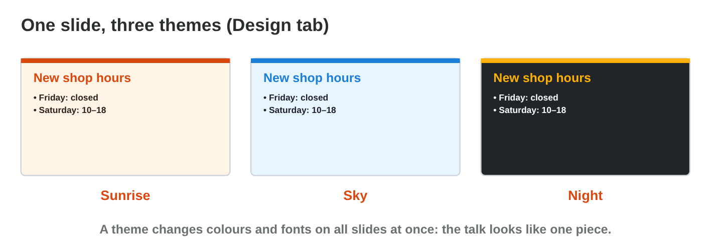

## Before you start {.study}

- **What you need:** PowerPoint: on a computer, or PowerPoint on the web
  (`office.com`, with your university account). For the simulators, only
  this page.
- **Time:** about 45 minutes. Work alone, at your own speed.
- **How it works:** each Step has a simulator and the screens of
  PowerPoint. Try the simulator, then answer its questions: the page
  checks each answer at once. Then do the **Tasks to submit**.
- **What you submit:** one PowerPoint file and two letters, on the
  university e-learning platform, before lecture 5.

## Key terms {.study}



## Step 1 · Slides and layouts {.study}

**In Slide Builder:** make one good slide, task by task. A **layout** is
the plan of a slide: **Title Slide** for the first slide, **Title and
Content** for a title and points, **Two Content** for points next to a
picture. Click a dashed box (a **placeholder**) and type.



::: {.callout-note title="Model · Omar's talk"}
Omar makes a short talk, *Saving Water at Home*. Slide 1 is a **Title
Slide**. For slide 2 he clicks **Home › New Slide** and chooses **Title and
Content**. The screen below shows where.
:::

**On a computer or on the web.** The orange numbers show where to click.

::: {.screens}
![[1]{.step-n} Click **Home › New Slide**. [2]{.step-n} Choose the layout **Title and Content**.](images/ppt-newslide-1.png)
:::

{width=100%}

::: {.callout-tip title="Try it 1 · Layouts"}
Choose the right layout. You can use an answer more than once.

::: {.match extra="Blank"}
The first slide of a talk, with its title.
:   Title Slide

    Why: The Title Slide has a big title and a subtitle.

A title and four short points.
:   Title and Content

    Why: One title and one box for the points.

Three points next to a picture.
:   Two Content

    Why: It has two boxes side by side: the points and the picture.
:::
:::

## Step 2 · One theme and a picture {.study}

**A theme** gives all slides the same colours, fonts and background:
**Design** tab, then click a theme. **A picture:** **Insert › Pictures ›
Stock Images** (free pictures). Choose dark text on a light background, or
light text on a dark one: strong **contrast**.

::: {.callout-note title="Model · A theme and a picture for Omar's talk"}
Omar clicks the **Design** tab and chooses a green theme: all three slides
change at once. On slide 3 he adds a picture of a tap from Stock Images.
:::

**On a computer or on the web.** The orange numbers show where to click.

::: {.screens}
![[1]{.step-n} Click the **Design** tab. [2]{.step-n} Click a theme. All slides change.](images/ppt-design-1.png)

![[1]{.step-n} Click **Insert**, then [2]{.step-n} **Pictures**, then [3]{.step-n} **Stock Images**. Choose a picture and click **Insert**.](images/ppt-picture-1.png)
:::

{width=100%}

::: {.callout-tip title="Try it 2 · Theme and picture"}
Choose the right answer.

::: {.match extra="Home › Font|File › Save As"}
Where do you choose a theme for all slides?
:   the Design tab

    Why: A theme on the Design tab changes all slides at once.

Where do you find free pictures in PowerPoint?
:   Insert › Pictures › Stock Images

    Why: Stock Images are free to use in your slides.

Light grey text on a light blue background. Is it easy to read?
:   no: the contrast is weak

    Why: Use dark text on light, or light text on dark.
:::
:::

## Step 3 · A clear slide {.study}

**In Slide Doctor:** each slide of the Sunrise team has one problem;
choose the best fix. A clear slide has **one idea**, a short title, **3 to
5 short points** and big text. What you want to **say** goes in the
speaker notes, not on the slide.



{width=100%}

::: {.callout-tip title="Try it 3 · Clear slides"}
Choose the right answer.

::: {.match extra="a smaller font|ten points"}
A slide has seven long sentences. What is the best fix?
:   four short points

    Why: The audience reads short points fast and then listens to you.

How many points are good on one slide?
:   3 to 5

    Why: More points make the text small and hard to read.
:::
:::

## Tasks to submit {.tasks}

### Task 1 · A short presentation

Make a presentation of three slides in PowerPoint (on a computer or on
the web). Type only the text below. (Steps 1–3 show how.)

1. Slide 1, layout **Title Slide**: *The College Library* and *Open for
   all students*.
2. Slide 2, layout **Title and Content**: *Opening hours* and the points
   *Sunday to Thursday* · *From 8:00 to 16:00* · *Closed on Friday*.
3. Slide 3, layout **Two Content**: *Our books*, the points *Books* ·
   *Magazines* · *Computers*, and one picture from Stock Images.
4. Choose one theme for all slides. Save the file as `library.pptx`.

*Submit:* the file `library.pptx`.

### Task 2 · Two letters

a) Which layout puts points next to a picture? **A** Title Slide · **B**
Two Content · **C** Blank. Write the letter.



b) Which slide is easier to read? **A** dark text on a light background ·
**B** light grey text on a light blue background. Write the letter.



## How to submit

Upload `library.pptx` and your two letters, **before lecture 5**.
