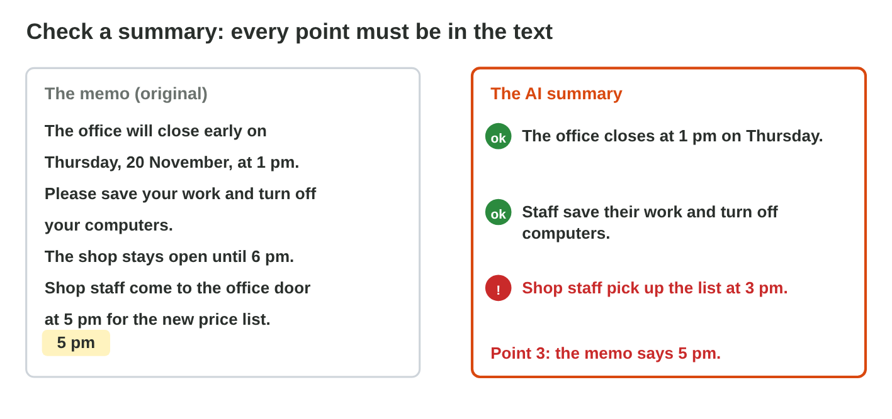
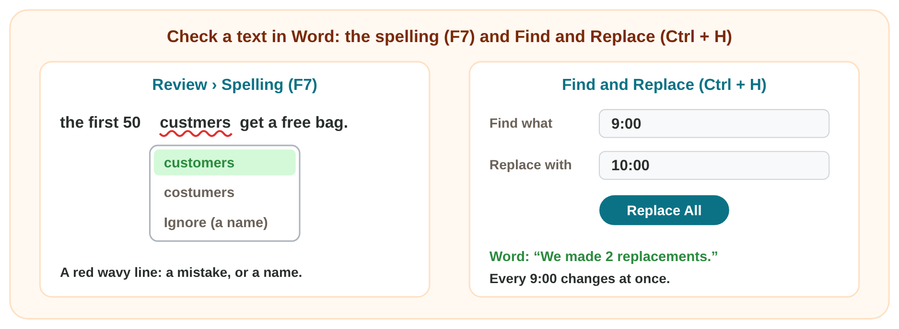
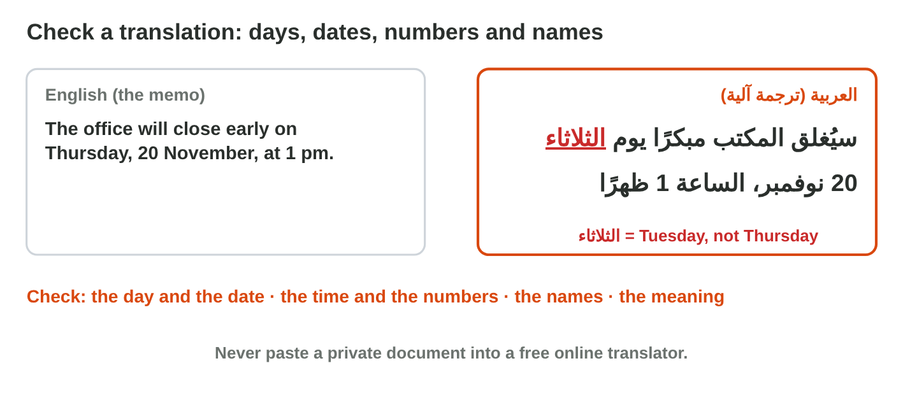
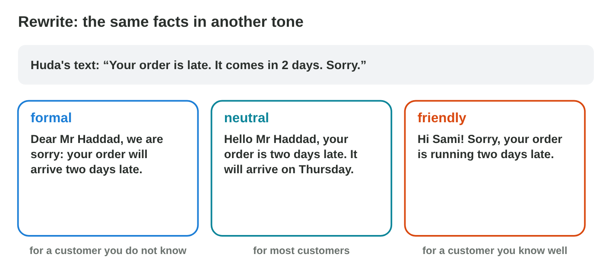

::: {.lead}
It is Monday morning at *Sunrise Company*. Huda, the office manager, must
write a notice, read a long report, fix a report with mistakes and help a
visitor who reads only Arabic. An AI tool helps with the first two jobs,
and the tools of Word do the rest. Every text is checked before it goes
out. These notes are a short reference: in class you try each job, as an
experiment of the **worksheet**.
:::

## Key terms



## 5.1 A first draft from AI, checked

Huda must write a notice: the office closes early on Thursday. She does not
want to start with an empty page. An AI tool can write a **first draft** in
a few seconds (@fig-draft). It can also **summarize** a long report.

::: {.callout-important title="Definition 5.1 — First draft and summary"}
A **first draft** is the first version of a text. A **summary** is a short
text with only the main points of a longer text. An AI tool writes both
fast. Then **you** check them, change them and format them.
:::

{#fig-draft width=100%}

::: {.callout-note title="Example 5.1 — The notice"}
1. Huda copies a prompt with the facts: *the office closes early on
   Thursday, 20 November, at 1 pm, for the yearly cleaning; three short
   lines.*
2. The AI writes three lines. One line says: "Free coffee for all staff."
   Nobody said this. Huda deletes it.
3. She pastes the text into Word with **Keep Text Only** and gives the
   first line the style **Title**.
:::

A summary can drop a point or change a number (@fig-summary). Check every
point with the original text: the original wins.

{#fig-summary width=100%}

::: {.callout-warning title="Common mistake"}
Pasting the AI answer and sending it at once. The AI can add things that are
not true, or change a time. Read every line first.
:::



*In class: Experiment 1 of the worksheet, a notice drafted by an AI assistant, with only your facts, pasted into Word, and a summary checked in Word AI Lab.*

## 5.2 Check a report in Word

The report on the new shop has two spelling mistakes, and the opening time
changed from 9:00 to 10:00. Word has the tools to fix both (@fig-check).

- **The spelling check.** A red wavy line marks a word that Word does not
  know. **Review › Spelling** (**F7**) shows each one, with suggestions.
  Choose the right word. A name (Zarqa, Saleh) is not a mistake: choose
  **Ignore**.
- **Find and Replace** (**Ctrl + H**) finds a word, a number or a name and
  changes it everywhere. Type the old text in *Find what*, the new text in
  *Replace with*, then click **Replace All**.
- **Review › Word Count** counts the words, for example for a report of at
  most 300 words.

::: {.callout-important title="Definition 5.2 — Find and Replace"}
**Find and Replace** is the Word tool that finds a text and changes it
everywhere at once. **Replace All** says how many replacements it made.
:::

{#fig-check width=100%}

::: {.callout-note title="Example 5.2 — The report on the new shop"}
1. Huda presses **F7**. Word shows *secnd*: she chooses **second**. Then
   *custmers*: she chooses **customers**. Then *Zarqa*: a name, so she
   chooses **Ignore**.
2. She presses **Ctrl + H**: Find what *9:00*, Replace with *10:00*,
   **Replace All**. Word says: "We made 2 replacements."
:::

::: {.callout-warning title="Common mistake"}
Finding a text that is too short. *Replace All* of **9** with **10** also
changes 19:00 into 110:00. Type the whole text: **9:00**.
:::



*In class: Experiment 2 of the worksheet, the spelling and Find and Replace in the report, and Check Lab.*

## 5.3 A translation and the right tone

A visitor reads only Arabic, but the notice is in English. Word can
translate: **Review › Translate** (Translate Selection or Translate
Document). This is **machine translation**: it is fast, but it can be wrong
(@fig-translate).

::: {.callout-important title="Definition 5.3 — Machine translation"}
**Machine translation** is a translation made by a program or an AI tool.
Check the days, dates, numbers and names, and the meaning of each sentence.
:::

{#fig-translate width=100%}

::: {.callout-note title="Example 5.3 — The notice in Arabic"}
1. Huda selects the notice and chooses Review › Translate › Translate
   Selection › Arabic.
2. She reads the Arabic. The day must be الخميس (Thursday). The time must be
   1 pm.
3. One translation said الثلاثاء (Tuesday). Huda corrects it.
:::

A **rewrite** says the same facts in other words: shorter, simpler or more
polite. The **tone** fits the reader: formal for a customer that you do not
know, friendly for a friend (@fig-tone). A rewrite or a translation changes
the words, never the facts, and never adds a promise.

{#fig-tone width=100%}

::: {.callout-warning title="Common mistake"}
Translating private papers with a free online tool. Do not paste contracts,
grades or personal data into a public translator or AI chat.
:::



*In class: Experiment 3 of the worksheet, a paragraph of the report translated into Arabic and checked, and the tone for three readers in Tone Lab.*

## Case study: Huda's Monday morning

Huda, the office manager of *Sunrise Company*, gets six requests on Monday
morning. The manager wants a notice (the office closes early on Thursday at
1 pm) and the main points of a 6-page report before the 10:00 meeting. A
colleague's report says "Zarka" in 12 places, but the right name is
"Zarqa". A visitor reads only Arabic. Then the AI summary says the meeting
is on Monday, but the report says Tuesday. And Word marks "custmers" in the
notice with a red line. For each request, Huda chooses the right tool, an
AI job or a tool of Word, or the right check. The Game challenge of the
interactive lesson uses this story.



## Further reading

Microsoft Support, "Check spelling and grammar in Office", "Find and
replace text" and "Translate text into a different language"
(support.microsoft.com). UNESCO, *Guidance for Generative AI in Education
and Research*, 2023, part 4.

## Exercises

1. Who checks an AI first draft before it goes out?
2. Which paste option keeps only the text?
3. A summary says 3 pm. The memo says 5 pm. Which is right?
4. Which key opens the spelling check in Word?
5. Word marks the name "Zarqa" with a red line. Do you change it? (yes / no)
6. Which keys open Find and Replace?
7. A report has 9:00 three times. How many replacements does Replace All
   make?
8. Where is Translate in Word?
9. The memo says Thursday. The translation says الثلاثاء. Is it right?
10. Which tone fits a customer that you have never met: formal or friendly?

## Answers to the exercises

::: {.answers}
1. You (the person who sends it).
2. Keep Text Only.
3. The memo: 5 pm. The original text is right.
4. F7 (Review › Spelling).
5. No: it is a name, so you choose Ignore.
6. Ctrl + H.
7. 3.
8. Review › Translate.
9. No: الثلاثاء is Tuesday; Thursday is الخميس.
10. Formal.
:::
