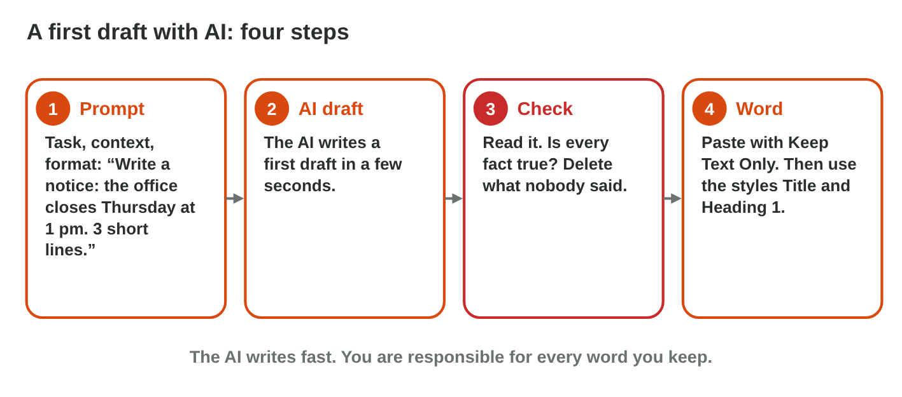
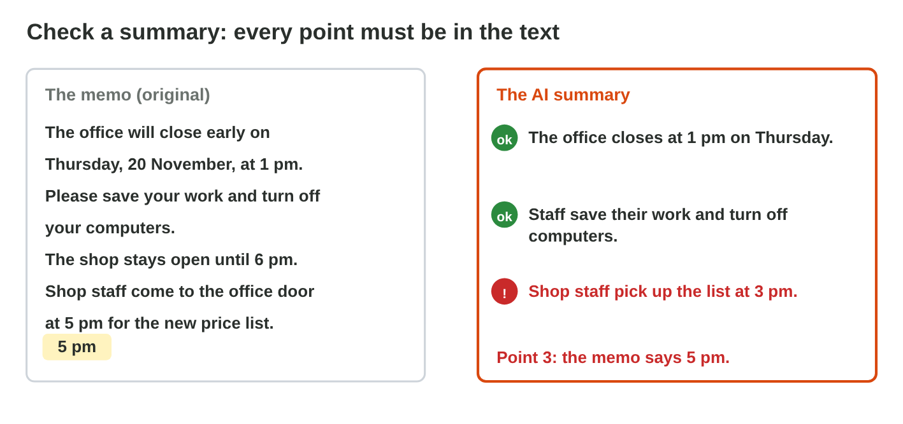
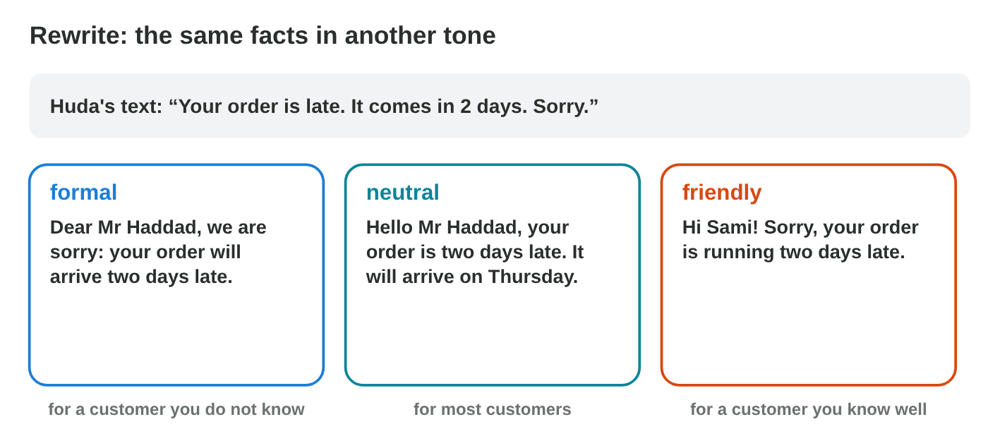
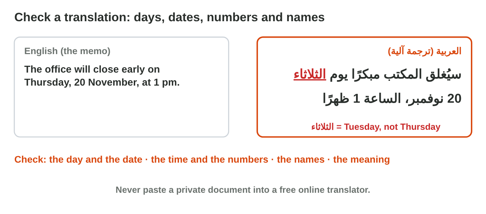

## Keywords



## Before you start

:::: {.columns}
::: {.column width="50%"}
- Open an AI assistant that the university allows, for example Copilot.
- Download report-start.docx, a short report about the new Sunrise shop.
- The AI writes new words for every person, so you check the facts.
- Write your result after each step, then check it at the end of the worksheet.
:::
::: {.column width="50%"}

:::
::::

## Experiment 1 · A first draft

:::: {.columns}
::: {.column width="50%"}
- The AI writes a first draft fast, and you keep only your facts.
- **Step 1:** Ask for a notice about the broken printer. What is its first line?
- **Step 2:** Which facts did the AI add that you did not give?
- **Step 3:** Paste the notice into Word. Why do you use Keep Text Only?
:::
::: {.column width="50%"}

:::
::::

## Check 1 · A first draft

What did you record in Experiment 1?

::: {.reveal}
- Step 1: The draft has your three facts: the first floor, the second floor and Tuesday.
- Step 2: You delete every added fact, for example a technician on Monday.
- Step 3: Keep Text Only pastes only the words, and the Title style gives the look.
:::

## Experiment 2 · A summary

:::: {.columns}
::: {.column width="50%"}
- A summary keeps the main points, but it can drop or change a detail.
- **Step 1:** Ask the AI to sum up the report in 3 points. What are they?
- **Step 2:** Compare each point with the report. Which details are missing?
- **Step 3:** In Word AI Lab, choose Sum up. Which part is wrong?
:::
::: {.column width="50%"}

:::
::::

## Live demo · Word AI Lab



## Check 2 · A summary

What did you record in Experiment 2?

::: {.reveal}
- Step 1: The shop opens in Zarqa next Saturday at 9:00, and 50 customers get a bag.
- Step 2: The summary drops details, for example the free pen or the closed Friday.
- Step 3: The summary says 3 pm, but the memo says 5 pm.
:::

## Experiment 3 · A new tone

:::: {.columns}
::: {.column width="50%"}
- A rewrite says the same facts in other words and in another tone.
- **Step 1:** Ask the AI to rewrite "We do not have your size" politely. What does it write?
- **Step 2:** Did the AI add a promise, such as a discount or a call?
- **Step 3:** In Tone Lab, which tone and length fits each reader?
:::
::: {.column width="50%"}

:::
::::

## Live demo · Tone Lab



## Check 3 · A new tone

What did you record in Experiment 3?

::: {.reveal}
- Step 1: The sentence is polite, but the size is still missing until next week.
- Step 2: You delete every promise that the shop did not make.
- Step 3: Task 1 is formal and short, Task 2 is friendly and short, and Task 3 is formal and long.
:::

## Experiment 4 · A translation

:::: {.columns}
::: {.column width="50%"}
- A machine translation is fast, but it can change a day, a number or a name.
- **Step 1:** Translate the first paragraph of the report. Which day and time does it say?
- **Step 2:** Translate the paragraph about the first day. Are 50 and 12 still there?
- **Step 3:** In Word AI Lab, choose Translate. Which word is wrong?
:::
::: {.column width="50%"}

:::
::::

## Check 4 · A translation

What did you record in Experiment 4?

::: {.reveal}
- Step 1: The Arabic says السبت and 9:00, with الزرقاء as the city.
- Step 2: The numbers 50 and 12 stay the same in the translation.
- Step 3: الثلاثاء is wrong, because the memo says Thursday, الخميس.
:::

## Game challenge · Huda's Morning



## Try it 5 · Huda checks (harder)

The facts: the AI summary says the meeting is on Monday, but the report says Tuesday. The AI draft adds "Free coffee for all staff."

a) Which day is the meeting?
b) What does Huda do with "Free coffee for all staff"?
c) What is the last step before Huda uses any AI text?

::: {.answer}
a) Tuesday, as the report says
b) She deletes it.
c) She checks it.
:::

## Table of results

Which results do you have in your table?

::: {.reveal}
- Experiment 1: The notice keeps only your facts, and every added fact is deleted.
- Experiment 2: The summary drops details, and Word AI Lab changed 5 pm to 3 pm.
- Experiment 3: The polite sentence keeps the same facts and adds no promise.
- Experiment 4: The translation keeps Saturday, 9:00, 50 and 12, and Word AI Lab changed Thursday.
:::

## Summary

- AI can draft, summarize, rewrite and translate a Word document.
- You paste with Keep Text Only and format with styles.
- You compare a summary with the original text.
- A rewrite changes the words and the tone, but never the facts.
- You check days, dates, numbers and names in a translation.
