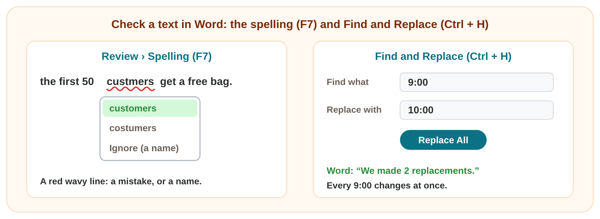
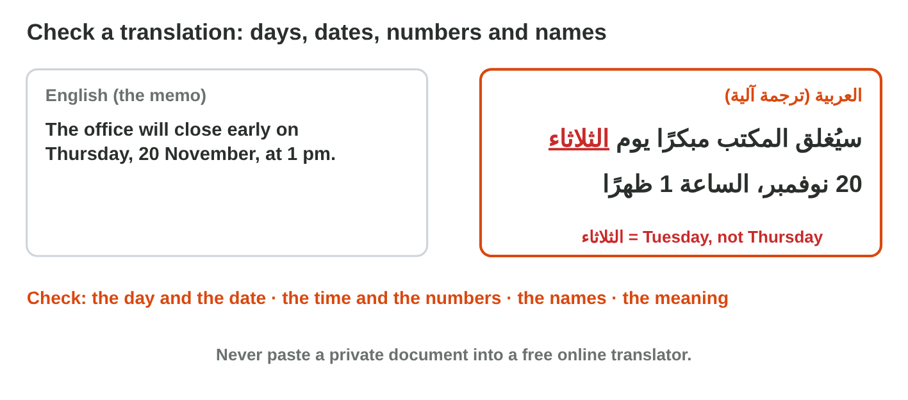

## Keywords



## A first draft from AI, checked

:::: {.columns}
::: {.column width="50%"}
- AI writes a first draft or a summary fast: a notice, the main points.
- The AI can add a fact or change a number, so you check every line.
- You delete every fact that nobody gave, and the original wins.
- Keep Text Only pastes only the words, and the styles of Word give the look.
:::
::: {.column width="50%"}

:::
::::

## Live demo · Word AI Lab



## Try it 1 · A draft and a summary

a) The draft says "Free coffee for all." Nobody said this. What do you do?
b) Which paste option takes only the text from the AI chat?
c) The summary says 3 pm, and the memo says 5 pm. Which is right?

::: {.answer}
a) Delete it.
b) Keep Text Only
c) the memo
:::

## Check a report in Word

:::: {.columns}
::: {.column width="50%"}
- A red wavy line shows a word that Word does not know.
- F7 shows each one: choose the right word, or Ignore for a name.
- Ctrl + H finds a word or a time and replaces it everywhere.
- Replace All changes every one at once, so you miss none.
:::
::: {.column width="50%"}

:::
::::

## Live demo · Check Lab



## Try it 2 · Check in Word

a) Word marks the name "Saleh" with a red line. What do you choose?
b) Which keys open Find and Replace?
c) 9:00 is in a report two times. How many replacements does Replace All make?

::: {.answer}
a) Ignore
b) Ctrl + H
c) 2
:::

## A translation and the right tone

:::: {.columns}
::: {.column width="50%"}
- Review › Translate translates a short text in Word in seconds.
- A machine translation can change a day, a number or a name.
- A rewrite keeps the facts, and the tone fits the reader.
- You never paste private texts into a free online translator.
:::
::: {.column width="50%"}

:::
::::

## Live demo · Tone Lab



## Try it 3 · Translate and tone

a) The memo says Thursday, and the Arabic says الثلاثاء. Is it right?
b) What must stay the same after a rewrite?
c) Which tone fits a customer that you have never met?

::: {.answer}
a) No: الثلاثاء is Tuesday.
b) the facts
c) formal
:::

## Summary

- AI writes a first draft or a summary fast, and you check every line.
- Paste with Keep Text Only, then format with styles.
- F7 checks the spelling, and Ctrl + H replaces a word everywhere.
- Review › Translate is fast, but you check days, numbers and names.
- A rewrite changes the words and the tone, never the facts.

## Your worksheet

:::: {.columns}
::: {.column width="50%"}
- In the computer lab, do the three experiments of the worksheet alone.
- Part A is in an AI assistant and Word, with report-start.docx.
- Part B is on a simulator: scan its QR code, or click its link.
- Never type personal data into the AI, and write your result after each step.
:::
::: {.column width="50%"}

:::
::::

## Results of the worksheet

Which results do you have in your table?

::: {.reveal}
- Experiment 1: You delete every fact that you did not give, and the price list is at 5 pm.
- Experiment 2: The two words are second and customers, and Replace All makes 2 replacements.
- Experiment 3: Saturday is السبت in the translation, and each reader of Tone Lab gets the right tone.
:::

## Game challenge · Huda's Morning



## Try it 4 · Huda's morning (harder)

The facts: the name "Zarka" is in a report 12 times, but the right name is "Zarqa". A visitor reads only Arabic. The AI draft adds "Free coffee for all staff."

a) Which tool fixes the name in all 12 places?
b) Which tool helps the visitor?
c) What is the last step before Huda uses any AI text?

::: {.answer}
a) Find and Replace (Replace All)
b) Review › Translate
c) She checks it.
:::
