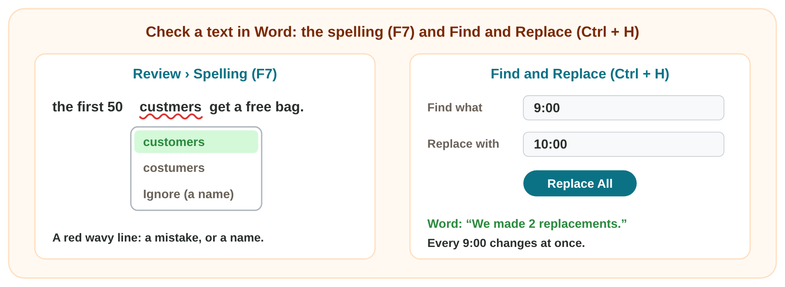
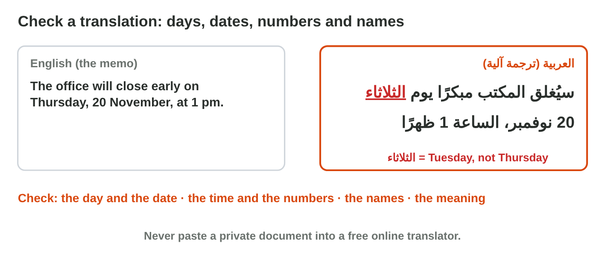

This page is the lecture, in class and at home. Each section explains one
idea, then shows its experiment. The page checks every step at once.

**In class, the teacher chooses the way for each experiment,** by the topic
and the time:

- **On the simulator** of the section, here on the page: nothing to
  install, and it works at home too.
- **In the real app** on the teacher's laptop, connected to the smart
  screen (HDMI): open the start file and follow the steps of **Part A**.
- **In the computer lab:** each student follows the **worksheet (PDF)**,
  Part A in the app and Part B on the simulator, and checks each result
  here.
- **AI prompts:** tap **Copy prompt**, then paste it into an AI assistant
  in another tab.
- **You need:** an AI assistant that the university allows (for example `copilot.microsoft.com`), Word and the start file, or only the simulators of this page. **Never type personal data** into an AI tool.

## Key terms



## Before you start



## 5.1 A first draft from AI, checked

- AI writes a **first draft** or a **summary** fast. Check every line
  with your facts or the original.
- Paste it into Word with **Keep Text Only**, then use the style
  **Title**.

{width=100%}





::: {.callout-tip title="Try it 1 · A draft and a summary"}
Choose the right answer.

::: {.match extra="send it at once|the AI summary"}
The draft says "Free coffee for all." Nobody said this. What do you do?
:   delete it

    Why: A draft must have only true facts.

An AI summary says the meeting is on Monday. The report says Tuesday. Which one is right?
:   the report

    Why: The original text wins: a summary can change a fact.
:::
:::

## 5.2 Check a report in Word

- A red wavy line: a word that Word does not know.
- **F7**: choose the right word, or **Ignore** for a name.
- **Ctrl + H**: change a word or a time everywhere (**Replace All**).

{width=100%}





::: {.callout-tip title="Try it 2 · Check in Word"}
Choose the right answer.

::: {.match extra="Copy and Paste|delete it"}
Word marks the name "Saleh" with a red line. What do you choose?
:   Ignore

    Why: A name is not a mistake: Word only does not know it.

A date is wrong in 12 places of a report. Which tool changes all of them at once?
:   Find and Replace

    Why: Replace All changes every one at once, so you miss none.
:::
:::

## 5.3 A translation and the right tone

- **Review › Translate** is fast: check the days, the numbers and the
  names.
- A **rewrite** keeps the facts. The **tone** fits the reader: formal or
  friendly.

{width=100%}





::: {.callout-tip title="Try it 3 · Translate and tone"}
Choose the right answer.

::: {.match extra="Home › Font|friendly"}
The memo says Thursday. The Arabic says الثلاثاء. Is it right?
:   no, الثلاثاء is Tuesday

    Why: Thursday is الخميس: the translation changed the day.

Which tone fits an e-mail to a customer that you have never met?
:   formal

    Why: Formal words for a person that you do not know.
:::
:::

## Table of results



## Game challenge: Huda's Monday morning {.challenge}

Huda, the office manager of *Sunrise Company*, gets six requests in one
morning. For each one she chooses the right tool, an AI job or a tool of
Word, and the check.



::: {.callout-tip title="Try it 4 · Huda's morning (harder)"}
Huda's morning: a 6-page report before the 10:00 meeting; the name "Zarka"
in 12 places, but the right name is "Zarqa"; a visitor who reads only
Arabic; an AI draft that adds "Free coffee for all staff". Choose the right
answer.

::: {.match extra="trust the AI|Copy and Paste|ask again and use the new answer"}
Which tool fixes "Zarka" in all 12 places?
:   Find and Replace

    Why: Replace All changes all 12 at once.

Which tool helps the visitor who reads only Arabic?
:   Review › Translate

    Why: Word translates the notice; then Huda checks the days, times and names.

What is always the last step before Huda uses an AI text?
:   she checks it

    Why: AI makes mistakes, and Huda is responsible for what she sends.
:::
:::

## Summary {.summary}

- AI writes a first draft or a summary fast; check every line with your facts or the original.
- Paste with Keep Text Only, then format with styles.
- F7 checks the spelling (Ignore a name); Ctrl + H changes a word everywhere with Replace All.
- Review › Translate is fast: check days, numbers, times and names.
- A rewrite changes the words and the tone, never the facts.
