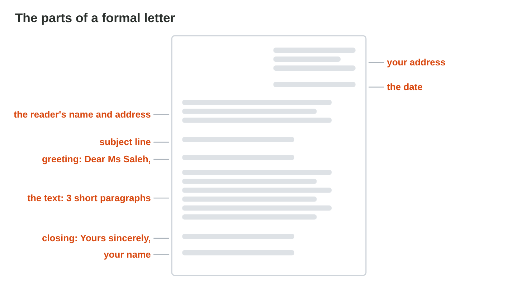
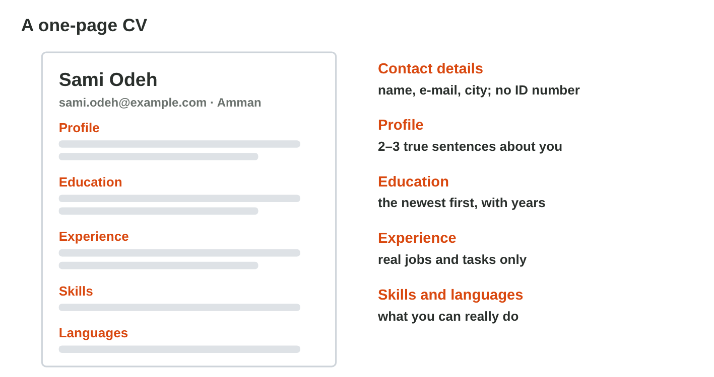
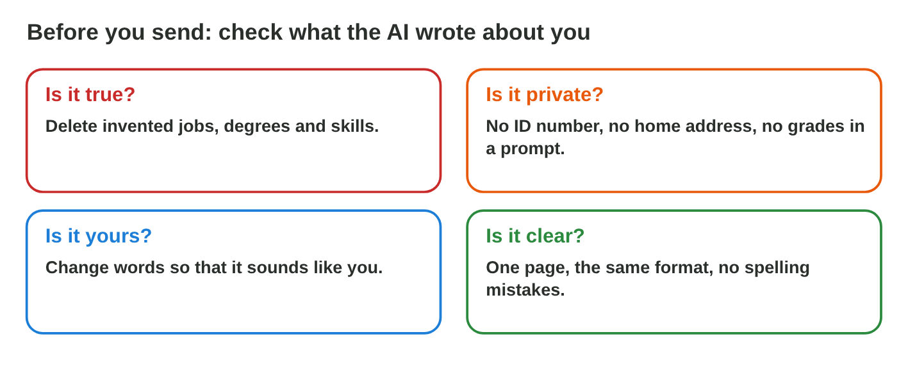

## Before you start {.study}

- **What you need:** Word (the desktop app, Word on the web at `office.com`,
  or the free phone app) and an AI chat (Microsoft Copilot with your
  university account, ChatGPT or Gemini).
- **Time:** about 60 minutes. Work alone, at your own speed.
- **How it works:** do Steps 1–3 on this page. Each step has a short text, a
  simulator and a self-check. Then do the **Tasks to submit**.
- **What you submit:** two Word files and two short answers, on the
  university e-learning platform, before lecture 6.
- **You need Lecture 5:** a first draft with AI, checking it, and Keep Text
  Only.
- **Safety first:** use **made-up details** for the letter and the CV in the
  AI chat (a made-up address and phone number). Never type your ID number,
  your real address or your grades into an AI tool.

## Key terms {.study}



## Step 1 · The parts of a formal letter {.study}

- A **formal letter** goes to a company, a school or an office. It has fixed
  parts, from the top to the bottom:
  1. **your address** (at the top, on the right) and **the date**;
  2. **the reader's name and address** (on the left);
  3. the **subject line**: *Subject: Request for a training place*;
  4. the **greeting**: *Dear Ms Saleh,* (you know the name) or *Dear Sir or
     Madam,* (you do not);
  5. the text: **three short paragraphs**: why you write; about you; what
     you ask, and thanks;
  6. the **closing** *Yours sincerely,* and **your name**.
- The tone is **polite and clear**: no "Hi!", no emoji, no slang.
- An AI chat can draft the text. A good prompt: *Write a formal letter to
  Ms Rana Saleh, HR Manager of Sunrise Company. I am a first-year diploma
  student and I ask for a summer training place in the office. Three short
  paragraphs, formal tone.* Then you check every fact.

{width=100%}



::: {.callout-tip title="Try it 1 · The formal letter"}
Choose the right answer.

::: {.match extra="Hi Rana!|at the very end"}
What comes at the top of a formal letter?
:   your address and the date

    Why: A formal letter starts with your address and the date at the top.

Which greeting fits when you know the reader's name?
:   Dear Ms Saleh,

    Why: When you know the name, the greeting uses it.

Which closing fits a formal letter?
:   Yours sincerely,

    Why: It is the formal closing before your name.

What does the subject line give?
:   what the letter is about, in one line

    Why: The reader sees the topic of the letter at once.

How many paragraphs does the text of a short letter have?
:   three short ones

    Why: Why you write; about you; what you ask, and thanks.
:::
:::

## Step 2 · A one-page CV {.study}

- A **CV** (curriculum vitae) tells a company about you, on **one page**.
- Its parts: **contact details** (name, e-mail, city; no ID number); a
  **profile** of 2–3 true sentences; **education** (the newest first, with
  the years); **experience** (real jobs, with the place, the time and your
  tasks); **skills** and **languages**.
- Word has **CV templates**: File › New, search for "resume" or "CV". Choose
  a simple one.
- AI can suggest good words for the profile and the tasks. Give it your real
  facts, and keep only what is true.

{width=100%}



::: {.callout-tip title="Try it 2 · The CV"}
Choose the right answer.

::: {.match extra="three pages|your ID number"}
How long is a CV for a first job or a training place?
:   one page

    Why: A first CV fits on one page.

Which contact details are enough?
:   name, e-mail and city

    Why: No ID number and no home address are needed.

In which order do you write your education?
:   the newest first

    Why: The reader sees your newest study first.

What is the profile?
:   2–3 true sentences about you at the top

    Why: The profile is a short, true start of the CV.

Where do you find a CV template in Word?
:   File › New, search "CV" or "resume"

    Why: Word has ready-made CV templates.
:::
:::

## Step 3 · Check what the AI wrote about you {.study}

- The AI does not know you. It may **invent** a job, a degree or a skill to
  make the CV look better (a hallucination, Lecture 2).
- Before you send a letter or a CV, ask four questions:
  - **Is it true?** Delete invented jobs, degrees and skills.
  - **Is it private?** No ID number and no home address in a prompt or a CV.
  - **Is it yours?** Change words so that it sounds like you.
  - **Is it clear?** One page, the same format, no spelling mistakes.
- An invented line is dishonest, and a company can check it with one phone
  call.

{width=100%}



::: {.callout-tip title="Try it 3 · Check the AI"}
Choose the right answer.

::: {.match extra="keep it, it looks good|make it smaller"}
The AI wrote that Sami was a manager in 2019. Sami was a child then. What do you do?
:   delete it

    Why: It is not true: Sami was a child in 2019.

Why does the AI sometimes invent a degree?
:   it does not know you, it guesses

    Why: The AI writes likely words, not facts about you.

Should your ID number be in your CV?
:   no

    Why: An ID number is personal data, and a CV does not need it.

The CV says "Expert in Python". Sami never learned it. What is it?
:   an invented skill

    Why: Sami never learned it: the AI invented it.

What do you ask first about each line the AI wrote about you?
:   is it true?

    Why: An invented line is dishonest, and a company can check it.
:::
:::

## Tasks to submit {.tasks}

Do the tasks alone. Your teacher marks them (6 marks). Use made-up details
for the address and the phone number.

### Task 1 · A formal letter (2 marks)

1. Use an AI chat to draft a formal letter to *Ms Rana Saleh, HR Manager,
   Sunrise Company, 40 Park Road, Amman*. You ask for a summer training
   place. Write your prompt with a task, context and format.
2. Paste it into Word with **Keep Text Only**. Check that it has all the
   parts of Step 1, and correct what is wrong.
3. Save it as `letter.docx`.

### Task 2 · A one-page CV (2 marks)

1. In Word, open a simple CV template (File › New, search "CV").
2. Fill it with true facts about you (made-up contact details are fine).
   You may ask an AI chat to improve the words of your profile.
3. Check that it fits on one page and has no ID number. Save it as
   `cv.docx`.

*Submit:* the files `letter.docx` and `cv.docx`.

### Task 3 · Short answers (2 marks)

a) Copy the prompt you used in Task 1.



b) Write one thing the AI wrote in your letter or CV that you changed or
deleted, and why.



## How to submit

Upload `letter.docx`, `cv.docx` and your answers to Task 3 to the university
e-learning platform, **before lecture 6**.
