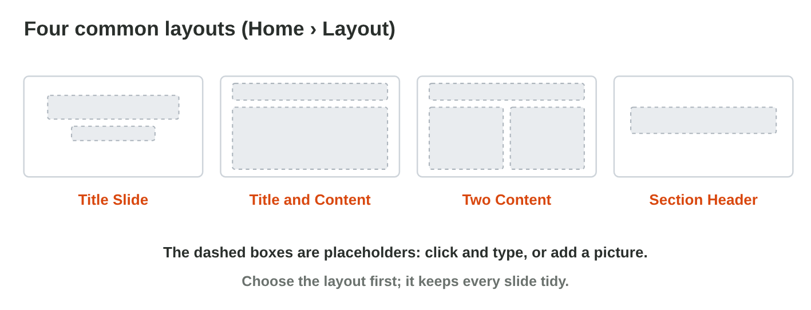
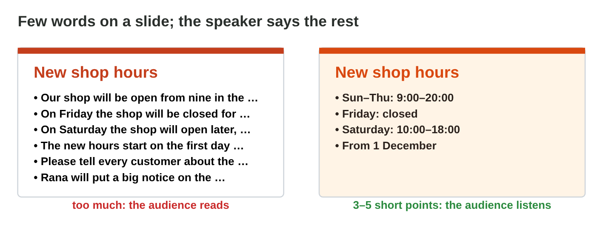
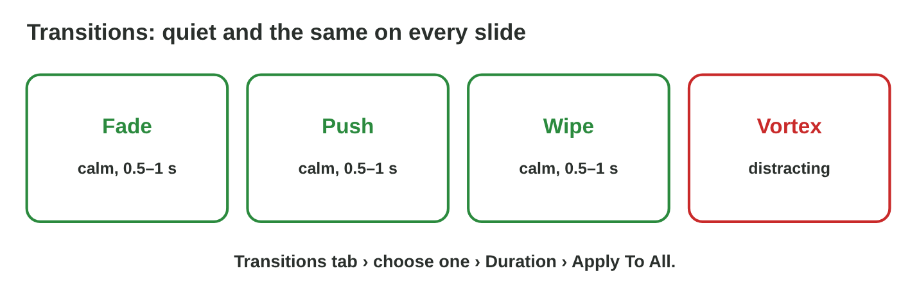

## Keywords



## Slides, layouts and a theme

:::: {.columns}
::: {.column width="50%"}
- A layout is the plan of a slide, and its placeholders are boxes where you click and type.
- The first slide is a Title Slide, and most slides are Title and Content.
- A theme gives all the slides the same colours, fonts and background.
- Dark text on a light background, or light on dark, is easy to read.
:::
::: {.column width="50%"}

:::
::::

## Live demo · Slides and a theme



## Try it 1 · Layouts and themes

a) What is the dashed box "Click to add title"?
b) Which layout puts a list next to a picture?
c) What changes when you click a theme?

::: {.answer}
a) a placeholder
b) Two Content
c) the colours and fonts of all the slides
:::

## Few words, and the rest in the notes

:::: {.columns}
::: {.column width="50%"}
- A slide has one idea, a short title and 3 to 5 points.
- Each point has about 8 words or fewer.
- The details that you say go in the speaker notes.
- In the slide show, only the speaker sees the notes.
:::
::: {.column width="50%"}

:::
::::

## Try it 2 · Few words and notes

a) How many points should a slide have?
b) Where do you write what you will say?
c) Who sees the speaker notes in the slide show?

::: {.answer}
a) 3 to 5
b) in the speaker notes
c) only the speaker
:::

## Movement: transitions and animations

:::: {.columns}
::: {.column width="50%"}
- A transition is the move from one slide to the next.
- You use one quiet transition, the same on every slide: Apply To All.
- An animation moves one thing, and By Paragraph shows the points one by one.
- Loud effects like Spin pull the eyes away from the message.
:::
::: {.column width="50%"}

:::
::::

## Live demo · Movement



## Try it 3 · Transitions and animations

a) Which button gives every slide the same transition?
b) You want the points of a list to come one by one. What do you add?
c) Why not Spin or Vortex in a work talk?

::: {.answer}
a) Apply To All
b) an animation, By Paragraph
c) They pull the eyes away from the message.
:::

## Summary

- A layout plans a slide, and you type in its placeholders.
- A theme gives the whole talk one look, with a strong contrast.
- A slide has 3 to 5 short points, and the details go in the notes.
- One quiet transition on every slide is enough.
- By Paragraph shows the points one by one, and F5 starts the show.

## Your worksheet

:::: {.columns}
::: {.column width="50%"}
- In the computer lab, follow the worksheet alone, step by step, in PowerPoint.
- Five short tasks: the title slide, a slide of points with notes, a theme, a transition and an animation, save.
- Nothing to download: you type the text yourself.
- Each step has a picture of the screen; tick each step when it is done.
- Then the Extra: on tutudocs.com an AI assistant adds a slide to your talk.
:::
::: {.column width="50%"}

:::
::::

## Results of the worksheet

What does your file show at the end?

::: {.reveal}
- Tasks 1–2: slide 1 is a Title Slide, slide 2 has 3 short points and the notes.
- Task 3: one theme changes both slides.
- Tasks 4–5: the slides fade in, the points come one by one, and the file is on the Desktop.
:::

## Game challenge · Slide Doctor



## Try it 4 · Fix the slide (harder)

The facts: one slide has seven long sentences, and the shop photo looks tall and thin. The detail "Rana puts a notice on the door" is on a slide.

a) What is the best fix for a slide with seven long sentences?
b) What went wrong with the shop photo that looks tall and thin?
c) Where does "Rana puts a notice on the door" go?

::: {.answer}
a) Keep a few short points and say the rest.
b) It was stretched with a side handle.
c) in the speaker notes
:::
