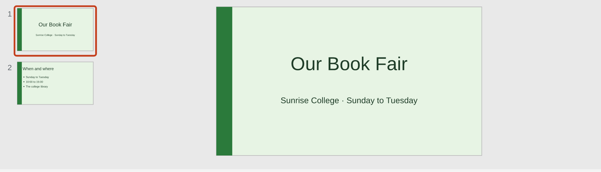

## Today in the lab

::: {.lab-plan}
1. **15 minutes, here:** the teacher shows each idea on a simulator, then
   in PowerPoint.
2. **35 minutes, in PowerPoint:** you follow the **worksheet**, step by
   step, on the lab computer. Nothing to download: you type the text
   yourself.
3. **At the end:** show your talk to your teacher. Then the **Extra**: an
   AI assistant adds a slide to your talk.
:::

{width=60%}

## Key terms



## 5.1 Slides, layouts and a theme

### On the simulator

- A **layout** is the plan of a slide; its dashed boxes are
  **placeholders**: click and type.
- The first slide: **Title Slide**. A slide of points: **Home › New Slide ▾
  › Title and Content**.
- A **theme** (**Design** tab) gives all the slides the same colours and
  fonts at once.

::: {.sim-part}

:::

### In PowerPoint: worksheet Tasks 1 and 3

:::: {.word-part}
Open PowerPoint, then **Blank Presentation**. Then the same steps as on the
simulator:

::: {.screens}
![[1]{.step-n} Click in the title and type. [2]{.step-n} The subtitle.](images/lab-title-1.png)

![[1]{.step-n} **New Slide ▾**. [2]{.step-n} **Title and Content**.](images/lab-newslide-1.png)

![[1]{.step-n} **Design**. [2]{.step-n} A theme. [3]{.step-n} A variant.](images/lab-design-1.png)
:::
::::

::: {.callout-tip title="Try it 1 · Layouts"}
Choose the right answer.

::: {.match extra="Title Slide|Blank"}
A slide with a title and three points: which layout?
:   Title and Content

    Why: It has a placeholder for the title and one for the points.
:::
:::

## 5.2 Few words on the slide, the rest in the notes

### On the simulator

- **3 to 5 short points** on a slide, each about **8 words or fewer**.
- What you **say** goes in the **speaker notes**: the box under the slide.
- In the slide show, only you see the notes.

::: {.sim-part}

:::

### In PowerPoint: worksheet Task 2

:::: {.word-part}
::: {.screens}
![[1]{.step-n} The title. [2]{.step-n} Three short points. [3]{.step-n} The notes.](images/lab-notes-1.png)
:::
::::

::: {.callout-tip title="Try it 2 · Notes"}
Choose the right answer.

::: {.match extra="on the slide, in small letters|in a new text box"}
Where do you write what you will say to the class?
:   in the speaker notes

    Why: The notes are under the slide, and only you see them in the slide show.
:::
:::

## 5.3 Movement: transitions and animations

### On the simulator

- A **transition** is the way the next slide comes in: **Transitions ›
  Fade › Apply To All**.
- An **animation** makes the points come **one by one**: click the list,
  then **Animations › Appear**.
- **F5** starts the slide show; **Esc** stops it.

::: {.sim-part}

:::

### In PowerPoint: worksheet Tasks 4 and 5

:::: {.word-part}
::: {.screens}
![[1]{.step-n} **Transitions**. [2]{.step-n} **Fade**. [3]{.step-n} **Apply To All**.](images/lab-transition-1.png)

![[1]{.step-n} Click the list. [2]{.step-n} **Animations**. [3]{.step-n} **Appear**.](images/lab-animation-1.png)

![Press **F12**. [1]{.step-n} **Desktop**. [2]{.step-n} **talk-** and your name. [3]{.step-n} **Save**.](images/lab-save-1.png)
:::
::::

## Extra: AI changes your talk

### On the simulator

- On **tutudocs.com** you open your own talk, with **no sign-in**.
- **AI Assistant**: ask for one change, for example a new slide of three
  points.
- **File › Download**, the PowerPoint file (**.pptx**).

::: {.sim-part}

:::

### On tutudocs.com: the Extra of the worksheet

:::: {.word-part}
::: {.screens}
![**tutudocs.com**: [1]{.step-n} click the box, then choose your talk.](images/lab-tutu-1.png)

![[1]{.step-n} **AI Assistant**. [2]{.step-n} Your request. [3]{.step-n} The AI adds the slide.](images/lab-tutu-2.png)

![[1]{.step-n} **File**, [2]{.step-n} **Download**, [3]{.step-n} the **.pptx** file.](images/lab-tutu-3.png)
:::
::::

## Now: your worksheet

::: {.lab-go}
Take your **worksheet** and do Tasks 1–5 in PowerPoint on the lab
computer, in order. Tick each step. Raise your hand when you are stuck,
and at the end. Finished? Do the **Extra**: on tutudocs.com an AI assistant
adds a slide to your talk.
:::

## Summary {.summary}

- Title Slide first; Home › New Slide ▾ › Title and Content for a slide of points.
- Click a placeholder and type; the theme (Design) gives all slides one look.
- 3 to 5 short points on the slide; what you say goes in the speaker notes.
- Transitions › Fade › Apply To All; the list › Animations › Appear; F5 shows the talk.
- On tutudocs.com (no sign-in) the AI Assistant changes your talk; File › Download gives the .pptx.
