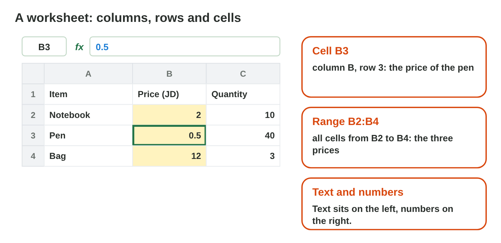
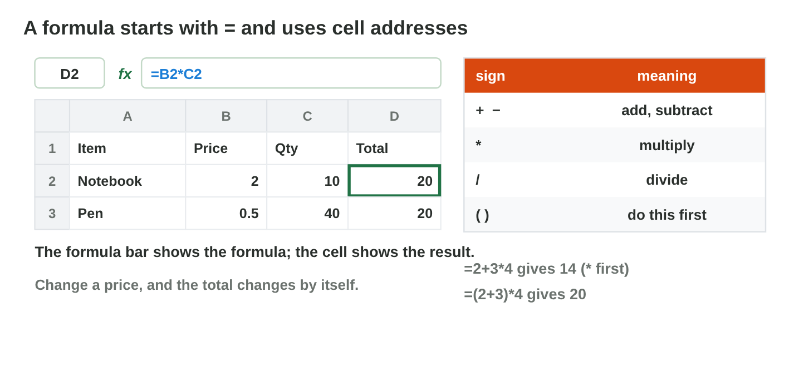
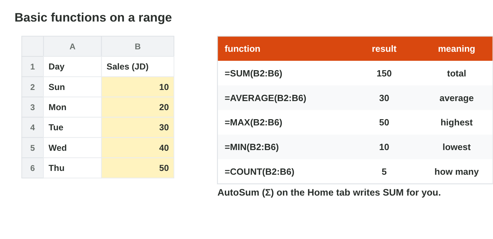

This page is the lecture, in class and at home. Each section explains one
idea, then shows its experiment. The page checks every step at once.

**In class, the teacher chooses the way for each experiment,** by the topic
and the time:

- **On the simulator** of the section, here on the page: nothing to
  install, and it works at home too.
- **In the real app** on the teacher's laptop, connected to the smart
  screen (HDMI): open the start file and follow the steps of **Part A**.
- **In the computer lab:** each student follows the **worksheet (PDF)**,
  Part A in the app and Part B on the simulator, and checks each result
  here.
- **You need:** Excel (the desktop app, or Excel on the web at `office.com`) and the start file, or only the simulators of this page.

## Key terms



## Before you start



## 6.1 Cells and formulas

- Columns have letters; rows have numbers. The **cell address** is both:
  **B3** = column B, row 3.
- A **range** is a block of cells: **B2:B4** = B2, B3, B4.
- Text sits on the left, numbers on the right.
- A **formula** starts with **=**: **=B2\*C2**. Signs: + add, − subtract,
  * multiply, / divide, ( ) first.
- * and / come before + and −: =2+3\*4 is 14; =(2+3)\*4 is 20.
- The cell shows the result; the **formula bar** shows the formula. Change a
  number, and the result changes by itself.
- The shop list: Notebook 2 JD × 10, Pen 0.5 JD × 40, Bag 12 JD × 3.

{width=100%}

{width=100%}



::: {.callout-warning title="Watch out!"}
Do not type "2 JD" in a cell: that is text. Type 2, and put JD in the
heading. And use addresses (=B2\*C2), not numbers (=2\*10).
:::



::: {.callout-tip title="Try it 1 · Cells and formulas"}
Choose the right answer.

::: {.match extra="row C, column 4|B2\*C2|11"}
What does =2+3\*4 give?
:   14

    Why: Excel multiplies first: 3 × 4 = 12, then 2 + 12 = 14.
:::
:::

## 6.2 Copy a formula: relative and absolute references

- Copy a formula with the **fill handle** (the small square; drag it or
  double-click it).
- **Relative** (B2): changes when copied: in the next row it is B3.
- **Absolute** (\$F\$1): stays when copied. Use it for a cell that every row
  needs (a rate).
- D2 =B2\*C2 copied down: D3 =B3\*C3, D4 =B4\*C4.
- Rate 10 % in F1: =B2\*F1 copied gives =B3\*F2 (empty: 0). =B2\*\$F\$1 copied
  gives =B3\*\$F\$1: right.
- Tip: press **F4** after typing F1.

{width=100%}



::: {.callout-warning title="Watch out!"}
A rate or a total that every row needs must have $ signs.
:::



::: {.callout-tip title="Try it 2 · References"}
Choose the right answer.

::: {.match extra="=B2\*C2|=B5\*\$F\$4"}
You copy =B2\*F1 down. Why do the next rows show 0?
:   F1 moved to the empty cells F2, F3

    Why: Without \$, the rate cell moves too, and empty cells count as 0.
:::
:::

## 6.3 Ready formulas: SUM, AVERAGE, MAX, MIN

- A **function** is a ready formula with a name, used on a range.
- Sales 10, 20, 30, 40, 50 in B2:B6: **=SUM(B2:B6)** = 150;
  **=AVERAGE(B2:B6)** = 30; **=MAX(B2:B6)** = 50; **=MIN(B2:B6)** = 10.
- **AutoSum** (Σ, Home): click under the numbers, press Σ, then Enter.
- Errors: **#DIV/0!** divides by 0; **#NAME?** a wrong name (=SUMM);
  **####** the column is too narrow.

{width=100%}

::: {.callout-warning title="Watch out!"}
#NAME? often means a typing mistake in the function name.
:::

Part B of this experiment is the Game challenge of this page: **The
Shop's Week**, below.



::: {.callout-tip title="Try it 3 · Functions"}
Sales 5, 10, 15, 20 in B2:B5. Choose the right answer.

::: {.match extra="15|5"}
A cell shows #NAME?. Why?
:   the function name is wrong

    Why: #NAME? means that Excel does not know the name, for example =SUMM.
:::
:::

## Table of results



## Game challenge: the shop's week {.challenge}

Work alone. Use every section of today.

Rana keeps the sales of the *Sunrise* shop in Excel. Before she presses
Enter, she predicts each cell: tea for 3 JD × 4 packs (=B2\*C2); the week of
10, 20, 30, 40, 50 JD (SUM and AVERAGE); D2 =B2\*C2 copied to D3; D2
=C2\*\$F\$1 copied to D3; and =A2/B2 when B2 is empty.



::: {.callout-tip title="Try it 4 · Rana's cells (harder)"}
Rana predicts each cell before she presses Enter. Choose the right answer.

::: {.match extra="=B2\*C2|=C3\*\$F\$2|7"}
A2 has 50, and B2 is empty. What does =A2/B2 show?
:   #DIV/0!

    Why: An empty cell counts as 0, and Excel cannot divide by 0.
:::
:::

## Summary {.summary}

- A cell address is a column letter and a row number; a range is written like B2:B6.
- A formula starts with = and uses addresses, so it changes by itself.
- Copying changes relative references (B2) but not absolute ones (\$F\$1).
- SUM, AVERAGE, MAX and MIN work on a range; AutoSum writes SUM for you.
- #DIV/0!, #NAME? and #### tell you what to fix.
