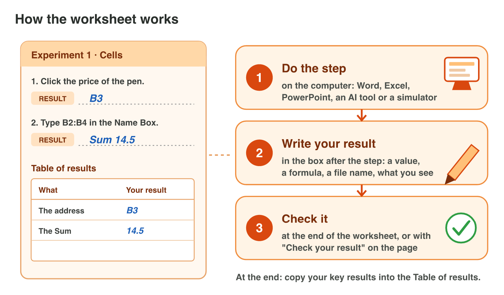
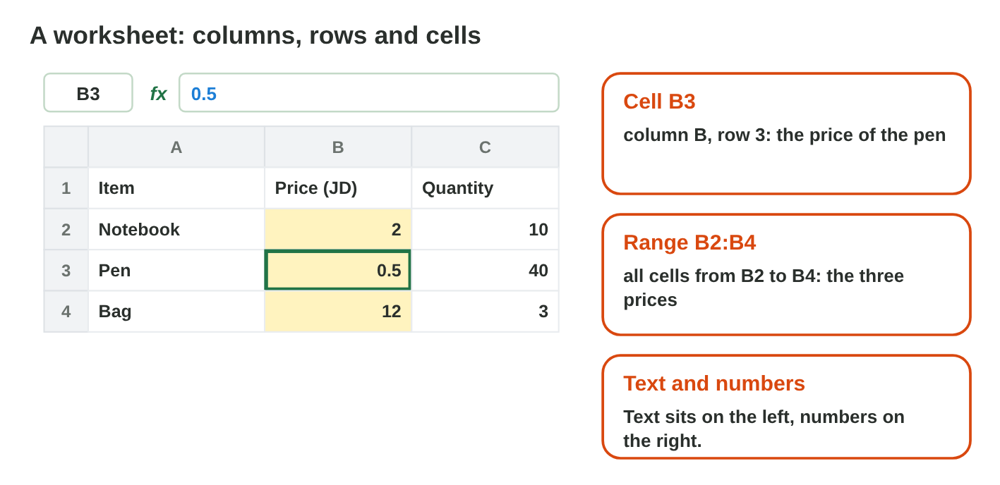
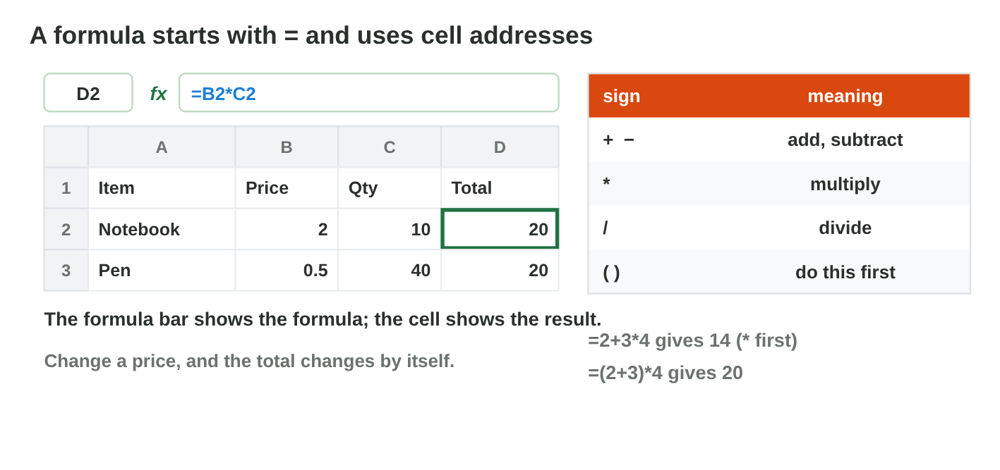
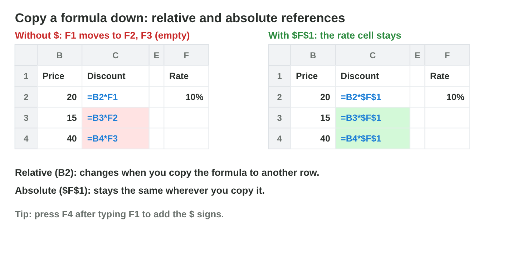
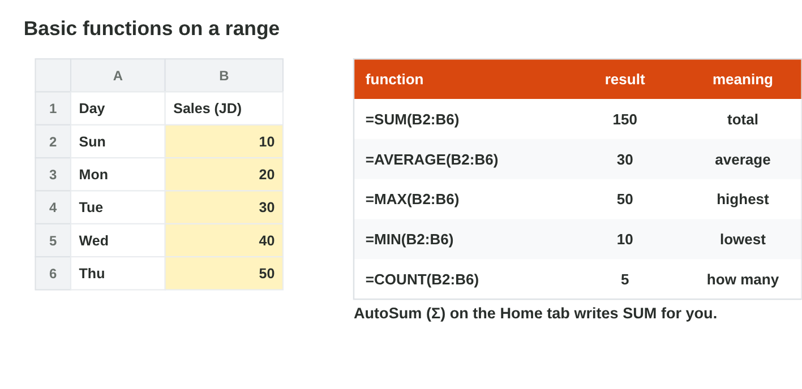

## Keywords



## Before you start

:::: {.columns}
::: {.column width="50%"}
- Open the page of Lecture 6 and download the file shop-start.xlsx.
- The file has two sheets: Shop has three items, and Week has five days of sales.
- Do each experiment of the worksheet when the teacher shows it.
- Write your result after each step, then check it at the end of the worksheet.
:::
::: {.column width="50%"}

:::
::::

## Experiment 1 · Cells and ranges

:::: {.columns}
::: {.column width="50%"}
- A cell address is a column letter and a row number, for example B3.
- **Step 1:** Click the price of the pen. What does the Name Box show?
- **Step 2:** Type B2:B4 in the Name Box. What Sum does the status bar show?
- **Step 3:** Type 2 JD in B6 and 2 in B7. Which one sits on the left?
:::
::: {.column width="50%"}

:::
::::

## Check 1 · Cells and ranges

What did you record in Experiment 1?

::: {.reveal}
- Step 1: The Name Box shows B3, and the cell holds 0.5.
- Step 2: The status bar shows Sum 14.5 for the three prices in B2:B4.
- Step 3: 2 JD sits on the left because it is text, and 2 sits on the right.
:::

## Experiment 2 · A formula

:::: {.columns}
::: {.column width="50%"}
- A formula starts with = and uses cell addresses, so it changes by itself.
- **Step 1:** Type =B2\*C2 in D2. What does D2 show?
- **Step 2:** Change the price in B2 to 3. What does D2 show now?
- **Step 3:** Type =2+3\*4 and =(2+3)\*4. What does each one give?
:::
::: {.column width="50%"}

:::
::::

## Live demo · Formula Lab



## Check 2 · A formula

What did you record in Experiment 2?

::: {.reveal}
- Step 1: D2 shows 20, and the formula bar shows =B2\*C2.
- Step 2: D2 shows 30, because the formula uses the address B2.
- Step 3: =2+3\*4 gives 14, and =(2+3)\*4 gives 20.
:::

## Experiment 3 · Copy a formula

:::: {.columns}
::: {.column width="50%"}
- A copied formula moves B2 to B3, but \$F\$1 stays the same.
- **Step 1:** Copy D2 down with the fill handle. Which formula is in D3?
- **Step 2:** Type 10% in F1 and copy =D2\*F1 from E2 down. What does E3 show?
- **Step 3:** Copy =D2\*\$F\$1 down. Which formula is in E4?
:::
::: {.column width="50%"}

:::
::::

## Live demo · Reference Lab



## Check 3 · Copy a formula

What did you record in Experiment 3?

::: {.reveal}
- Step 1: D3 has =B3\*C3 and shows 20, and D4 shows 36.
- Step 2: E3 shows 0, because F1 moved to the empty cell F2.
- Step 3: E4 has =D4\*\$F\$1 and shows 3.6, because \$F\$1 stayed.
:::

## Experiment 4 · Four functions

:::: {.columns}
::: {.column width="50%"}
- A function is a ready formula with a name, for example =SUM(B2:B6).
- **Step 1:** On the sheet Week, use AutoSum in B7. What does it show?
- **Step 2:** Type AVERAGE, MAX and MIN of B2:B6. What do they give?
- **Step 3:** Type =SUMM(B2:B6). Which error does the cell show?
:::
::: {.column width="50%"}

:::
::::

## Check 4 · Four functions

What did you record in Experiment 4?

::: {.reveal}
- Step 1: B7 shows 100 with the formula =SUM(B2:B6).
- Step 2: AVERAGE gives 20, MAX gives 30, and MIN gives 12.
- Step 3: The cell shows #NAME?, because Excel does not know SUMM.
:::

## Game challenge · The Shop's Week



## Try it 5 · Copy and errors (harder)

The facts: D2 has =C2\*\$F\$1, the week of sales is 10, 20, 30, 40 and 50 JD, and B2 is empty.

a) Rana copies D2 to D3. Which formula is in D3?
b) What does AVERAGE give for the week?
c) What does =A2/B2 show when B2 is empty?

::: {.answer}
a) =C3\*\$F\$1
b) 30
c) #DIV/0!
:::

## Table of results

Which results do you have in your table?

::: {.reveal}
- Experiment 1: The address is B3, and the Sum of B2:B4 is 14.5.
- Experiment 2: D2 shows 30 when the price is 3; the two formulas give 14 and 20.
- Experiment 3: E3 shows 0 with =D2\*F1, and E4 has =D4\*\$F\$1.
- Experiment 4: SUM gives 100, AVERAGE gives 20, and =SUMM shows #NAME?.
:::

## Summary

- A cell address is a column and a row, and a range is written like B2:B6.
- A formula starts with = and changes by itself.
- Copying moves relative references, but not absolute ones.
- SUM, AVERAGE, MAX and MIN work on a range.
- Error values tell you what to fix.
