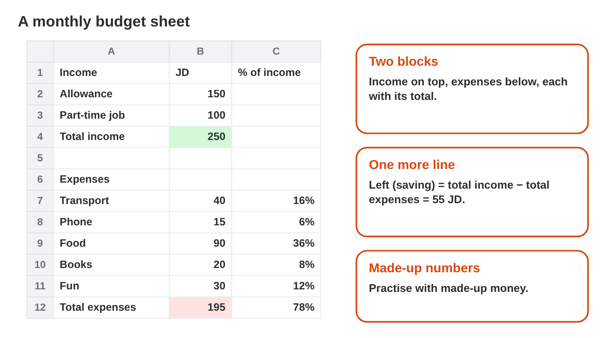
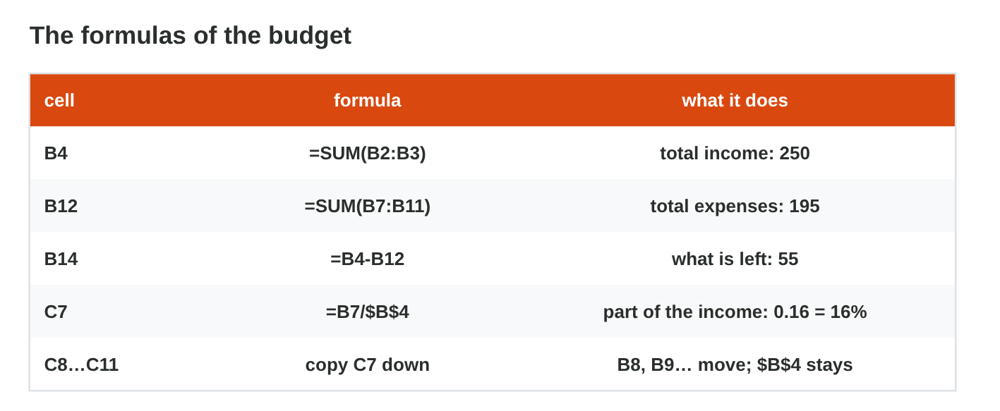
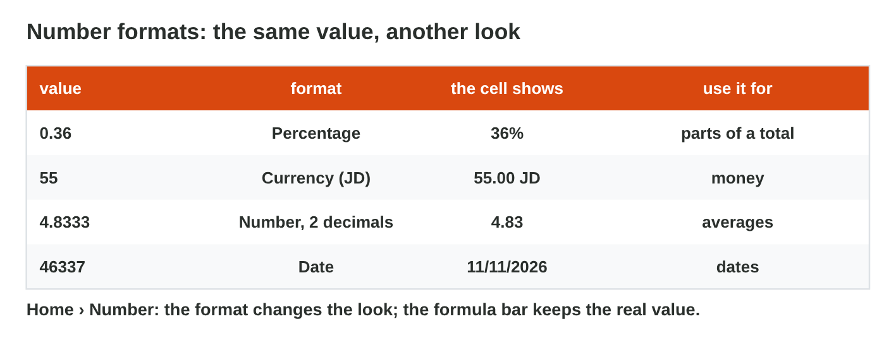

## Before you start {.study}

- **What you need:** Excel (the desktop app, Excel on the web at
  `office.com`, or the free phone app; a computer is easier).
- **Time:** about 60 minutes. Work alone, at your own speed.
- **How it works:** watch the short video made for this course (1:29), then
  do Steps 1–3 on this page: each step has a short text, a simulator and a
  quick check. Then do the **Tasks to submit**.
- **What you submit:** one Excel file and one short answer, on the
  university e-learning platform, before lecture 6. Sami's month in the
  Steps is the model: the tasks do the same with Huda's month.
- **You need Lecture 5:** formulas, SUM, copying with the fill handle and
  `$` references.
- **Use made-up numbers.** Your real money is private; a practice budget
  works as well.

## Key terms {.study}



## Step 1 · The layout: income and expenses {.study}

Watch the short video first: it shows the whole budget, from the layout to
the formulas and the number formats (with captions; the words are also
under it). Then do the three steps.



- A **budget** plans the money of one month: what comes in (**income**) and
  what goes out (**expenses**).
- Make two blocks on one sheet: **Income** at the top, **Expenses** below,
  each with a **Total** line. Leave one empty row between them.
- Column A: the names (Allowance, Transport, Phone, Food …). Column B: the
  amounts in JD. Column C: the part of the income (later, in %).
- Sami's month (made up): Allowance 150 and Part-time job 100; Transport 40,
  Phone 15, Food 90, Books 20, Fun 30.
- Write "JD" in the heading, not in the cells: the cells hold only numbers.

{width=100%}



::: {.callout-tip title="Try it 1 · The layout"}
Choose the right answer.

::: {.match extra="the colour of the sheet|in every cell"}
What is income?
:   the money that comes in

    Why: Income is what comes in, for example an allowance.

What is an expense?
:   money that goes out

    Why: An expense is money that you spend, for example on transport.

Where do you write "JD"?
:   in the heading of the column

    Why: The cells hold only numbers, so Excel can compute with them.

What does each block end with?
:   a Total line

    Why: Each block ends with its total, made with SUM.

Why use made-up numbers in this activity?
:   your real money is private

    Why: A practice budget with made-up numbers works as well.
:::
:::

## Step 2 · The formulas: totals, what is left, and the parts {.study}

- **Total income** in B4: `=SUM(B2:B3)` = 250. **Total expenses** in B12:
  `=SUM(B7:B11)` = 195. (Or click the cell and use AutoSum, Σ.)
- **Left (saving)** in B14: `=B4-B12` = 55.
- **The part of the income** for each expense, in column C: in C7 write
  `=B7/$B$4` and copy it down to C11 with the fill handle. B7 moves to B8,
  B9 …; `$B$4` (the total income) stays.
- Food: 90 ÷ 250 = 0.36. Transport: 40 ÷ 250 = 0.16.
- If an amount changes, every total and every part changes by itself.

{width=100%}

::: {.callout-tip title="Try it 2 · The formulas"}
Use Sami's month: income 150 + 100, expenses 40, 15, 90, 20, 30. Choose the
right answer.

::: {.match extra="=B4+B12|0.9"}
Which formula gives the total income in B4?
:   `=SUM(B2:B3)`

    Why: SUM adds the two incomes in B2 and B3.

What is the total of the expenses?
:   195

    Why: 40 + 15 + 90 + 20 + 30 = 195.

Which formula gives what is left in B14?
:   `=B4-B12`

    Why: What is left is the total income minus the total expenses.

What does `=B9/$B$4` give for food?
:   0.36

    Why: 90 ÷ 250 = 0.36.

Why is there a `$` in `$B$4`?
:   the total income stays the same in every row

    Why: Every part divides by the same total, so its address must not move.
:::
:::

## Step 3 · Make it readable: number formats {.study}

- A **number format** changes how a number looks, not the number itself.
  Home › Number (or right-click › Format Cells).
- The parts in column C: **Percentage** (0.36 looks like 36%).
- The money in column B: **Currency** or Number with 2 decimals (55 looks
  like 55.00).
- Make the Total lines **bold**, and widen a column that shows ####.
- The formula bar always shows the real value (0.36), so the formulas still
  work.

{width=100%}



::: {.callout-tip title="Try it 3 · Formats"}
Choose the right answer.

::: {.match extra="0.36%|36.00"}
0.36 in the Percentage format looks like …
:   36%

    Why: The Percentage format shows 0.36 as 36%.

55 in Currency format with 2 decimals looks like …
:   55.00 JD

    Why: Currency with 2 decimals adds .00 and the currency.

Does a number format change the value in the formula bar?
:   no, only the look

    Why: The formula bar still shows the real value.

A cell shows ####. What do you do?
:   make the column wider

    Why: #### means that the number does not fit in the column.

Where are the number formats in Excel?
:   Home › Number

    Why: The number formats are in the Number group of the Home tab.
:::
:::

## Tasks to submit {.tasks}

Do the tasks alone. Use made-up numbers.

### Task 1 · The budget and its totals

1. In Excel, type Huda's month (made up), in the same places as Sami's
   month in Step 2:

   | | A | B |
   |:-:|---|---|
   | 1 | Income | Amount (JD) |
   | 2 | Family | 150 |
   | 3 | Part-time job | 50 |
   | 4 | Total income | |
   | 6 | Expenses | |
   | 7 | Transport | 40 |
   | 8 | Food | 60 |
   | 9 | Phone | 10 |
   | 10 | Books | 30 |
   | 11 | Total expenses | |
   | 13 | Left (saving) | |

2. In B4 and B11, add the totals with **SUM**. In B13, write the formula of
   what is left: total income − total expenses.
3. Save the file as `budget.xlsx`. (Steps 1 and 2 show how.)

### Task 2 · The part of each expense

In C7, write `=B7/$B$4` and copy it down to C10 with the fill handle. Then
give C7:C10 the **Percentage** format. (Steps 2 and 3 show how.)

*Submit:* the file `budget.xlsx`.

### Task 3 · One short answer

Write the formula in C8. Which part of it did not change when you copied
it?



## How to submit

Upload `budget.xlsx` and your answer to Task 3 to the university
e-learning platform, **before lecture 6**.
