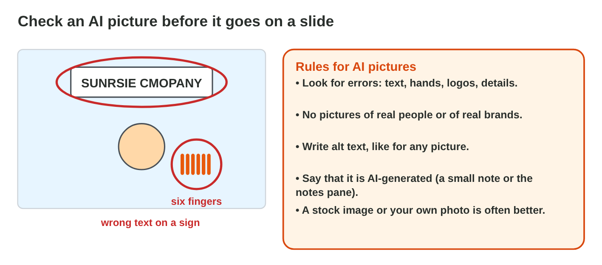

## Before you start {.study}

- **What you need:** PowerPoint (on a computer, on the web at `office.com`
  or the phone app), an AI assistant that the university allows (for
  example Microsoft Copilot with your university account), and a free
  Canva account (`canva.com`).
- **Time:** about 45 minutes. Work alone, at your own speed.
- **How it works:** read Steps 1–3, try each simulator and answer the
  questions: the page checks each answer at once. Then do the **Tasks to
  submit**.
- **What you submit:** a PowerPoint file, a picture and three letters, on
  the university e-learning platform, before lecture 6. You never write a
  prompt: you copy it and choose only the topic.
- **Never type personal data into an AI tool**: no names or phone numbers
  of real people.

## Key terms {.study}



## Step 1 · From an AI outline to slides {.study}

- Ask an AI tool for an **outline**: a title and a few short points for
  each slide.
- A good prompt says the **topic**, **who listens**, **how many slides**
  and **how many words**. Add: "Do not invent numbers or sources."
- In PowerPoint, **View › Outline**: paste the outline. A line at the left
  edge is a **new slide**; **Tab** makes a line a point.
- Then choose one theme (**Design**) and the layout **Title Slide** for
  slide 1 (Lecture 5).

{width=100%}

{width=100%}

::: {.callout-note title="Model · Rana's outline and three slides"}
1. Rana copies this prompt into an AI assistant:

   ::: {.prompt}
   Make an outline of 3 slides about saving paper at the office, for my
   classmates. Each slide: a title and 3 points of at most 8 words. Do not
   invent numbers or sources.
   :::

2. In PowerPoint, she opens **View › Outline** and pastes the outline.
3. She chooses one theme; slide 1 gets the layout **Title Slide**.
:::

**On a computer or on the web.** The orange numbers show where to click.

::: {.screens}
![[1]{.step-n} Click **Design**. [2]{.step-n} Click one theme: every slide gets its colours and fonts.](../week-04/images/ppt-design-1.png)
:::



::: {.callout-tip title="Try it 1 · The outline"}
Choose the right answer.

::: {.match extra="the font|Ctrl+P"}
"For my classmates": which part of the prompt is it?
:   who listens

    Why: It says who will listen to the talk.

Where do you paste an outline in PowerPoint?
:   View › Outline

    Why: In Outline view, every line at the left edge becomes a slide.

Which key makes a line a point under a title?
:   Tab

    Why: Tab moves the line one level in.
:::
:::

## Step 2 · Pictures you may use {.study}

- A picture on the Internet belongs to someone: it has **copyright**.
  Found is not free.
- Use **your own photo**, a **free picture** (PowerPoint **Insert ›
  Pictures › Stock Images**, Canva, Pixabay) or an **AI picture**.
- **Check** an AI picture: wrong letters, strange hands, the wrong thing.
- Write the **source** under the picture: *Photo: Canva*, *Image: made with
  AI*.

{width=100%}

**On a computer or on the web.**

::: {.screens}
![[1]{.step-n} Click **Insert**, then [2]{.step-n} **Pictures**. Choose **Stock Images** for a free picture, or **This Device** for your own photo.](../week-04/images/ppt-picture-1.png)
:::



::: {.callout-tip title="Try it 2 · Pictures"}
Choose the right answer.

::: {.match extra="my name|nothing"}
A photo from Google Images: may you use it?
:   no: it belongs to someone

    Why: Found is not free. Use a free picture or your own photo.

The AI picture shows the word "Librery". What do you do?
:   make it again, or use a stock image

    Why: Check every AI picture before you use it.

What do you write under a free photo from Canva?
:   Photo: Canva

    Why: Say where the picture comes from.
:::
:::

## Step 3 · A title graphic in Canva {.study}

- **Canva** (`canva.com`, free) has ready-made designs.
- Search for a design, click the text and type the **title of your talk**,
  add a **free photo** (Elements), and **Download** it as **PNG**.
- Put the PNG on slide 1 of your talk (**Insert › Pictures › This
  Device**).

**In a browser or the Canva app.** The orange numbers show where to tap.

::: {.screens}
![[1]{.step-n} Search for a design, for example **Presentation**. [2]{.step-n} Choose a design.](../week-14/images/canva-search-1.png)

![[1]{.step-n} Click the text and type yours. [2]{.step-n} Click **Elements**, then [3]{.step-n} a free photo.](../week-14/images/canva-edit-1.png)

![[1]{.step-n} Click **Share**, then **Download**. [2]{.step-n} Choose **PNG**. [3]{.step-n} Click **Download**.](../week-14/images/canva-download-1.png)
:::

::: {.callout-tip title="Try it 3 · Canva"}
Choose the right answer.

::: {.match extra="DOCX|Ctrl+S"}
Which file type do you download for a picture?
:   PNG

    Why: A PNG is a picture that PowerPoint can insert.

Where do you find a free photo in Canva?
:   Elements

    Why: Elements has free photos and shapes.
:::
:::

## Tasks to submit {.tasks}

Choose one topic: *saving paper at our college*, *a free app for students*
or *a good study tip*. Use no personal data.

### Task 1 · Three slides from an AI outline (Step 1)

Copy this prompt into an AI assistant. Change only **[topic]**.

::: {.prompt}
Make an outline of 3 slides about [topic], for my classmates. Each slide:
a title and 3 points of at most 8 words. Do not invent numbers or sources.
:::

Paste the outline in **View › Outline**. One theme, the layout **Title
Slide** for slide 1, and a stock image on slide 2 (Step 2). Save as
`my-talk.pptx`.

*Submit:* the file `my-talk.pptx`.

### Task 2 · A title graphic (Step 3)

In Canva, make a graphic with the title of your topic and a free photo.
Download it as `my-title.png` and put it on slide 1.

*Submit:* the picture `my-title.png`.

### Task 3 · Pictures (Step 2)

a) For slide 2 you find a nice photo on Google Images. **A** use it · **B**
use a stock image or your own photo.

b) The AI picture of a bus shows six wheels on one side. **A** make it
again or use a stock image · **B** use it.

c) What do you write under an AI picture? **A** nothing · **B** Image: made
with AI · **C** Photo: Google.



## How to submit

Upload `my-talk.pptx`, `my-title.png` and your three letters, **before
lecture 6**.
