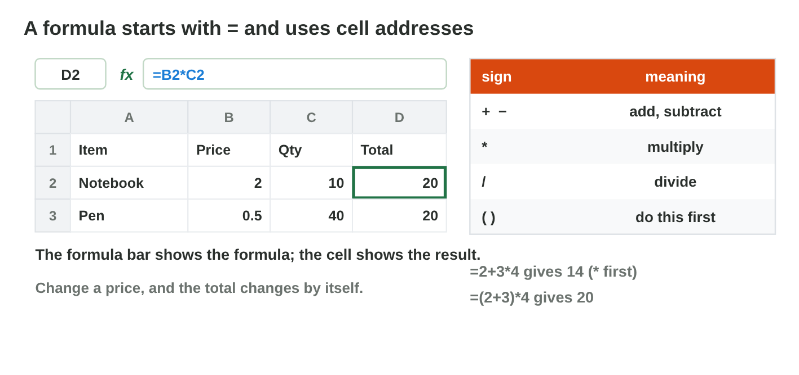
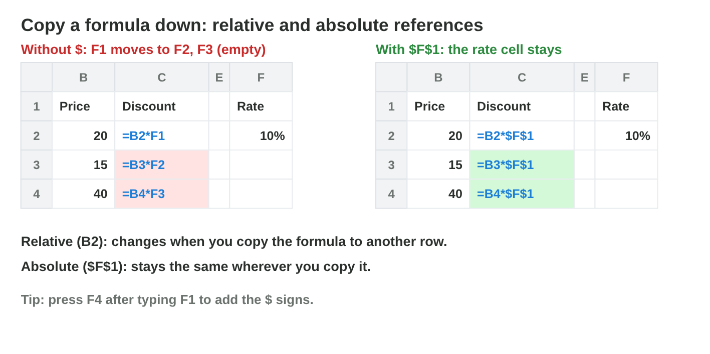
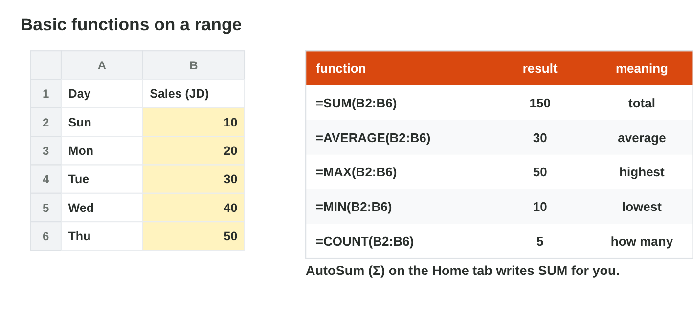

## Keywords



## Cells and formulas

:::: {.columns}
::: {.column width="50%"}
- A cell address is a column letter and a row number, like B3, and a range is like B2:B4.
- A formula starts with = and uses addresses, like =B2\*C2.
- The cell shows the result, and the formula bar shows the formula.
- Excel multiplies and divides before it adds, so =2+3\*4 gives 14.
:::
::: {.column width="50%"}

:::
::::

## Live demo · A formula



## Try it 1 · Cells and formulas

a) Which range holds A2, A3, A4, A5 and A6?
b) B2 = 6 and C2 = 5. What does =B2\*C2 show?
c) What does =(2+3)\*4 give?

::: {.answer}
a) A2:A6
b) 30
c) 20
:::

## Copy a formula: relative and absolute

:::: {.columns}
::: {.column width="50%"}
- The fill handle copies a formula down to the next rows.
- A relative reference like B2 moves when you copy: in the next row it is B3.
- An absolute reference like \$F\$1 stays the same when you copy.
- You use \$ for a cell that every row needs, like a rate, and F4 adds it.
:::
::: {.column width="50%"}

:::
::::

## Live demo · Copy a formula



## Try it 2 · References

a) D2 has =B2\*C2. You copy it to D3. Which formula is in D3?
b) D2 has =C2\*\$F\$1. You copy it to D3. Which formula is in D3?
c) Which key adds the \$ signs after you type F1?

::: {.answer}
a) =B3\*C3
b) =C3\*\$F\$1
c) F4
:::

## Ready formulas: SUM, AVERAGE, MAX, MIN

:::: {.columns}
::: {.column width="50%"}
- A function is a ready formula with a name and a range, like =SUM(B2:B6).
- AVERAGE gives the average, MAX the largest and MIN the smallest value.
- AutoSum (Σ) writes =SUM for the numbers above the cell.
- A wrong name like =SUMM shows the error #NAME?.
:::
::: {.column width="50%"}

:::
::::

## Try it 3 · Functions

a) The sales of a week are 12, 18, 25, 15 and 30 JD. What does =SUM give?
b) What does =AVERAGE give for the same week?
c) What does =MAX give for the same week?

::: {.answer}
a) 100
b) 20
c) 30
:::

## Summary

- A cell address is a column and a row, and a range is written like B2:B6.
- A formula starts with = and changes by itself when a cell changes.
- Copying moves relative references, but not absolute ones with \$.
- SUM, AVERAGE, MAX and MIN work on a range.
- An error value like #NAME? tells you what to fix.

## Your worksheet

:::: {.columns}
::: {.column width="50%"}
- In the computer lab, follow the worksheet alone, step by step, in Excel.
- Five short tasks: type the shop list, a formula, copy it down, AutoSum and MAX, save.
- Nothing to download: you type the text yourself.
- Each step has a picture of the screen; tick each step when it is done.
- Then the Extra: on tutudocs.com an AI assistant adds a row to your sheet.
:::
::: {.column width="50%"}

:::
::::

## Results of the worksheet

What does your file show at the end?

::: {.reveal}
- Tasks 1–2: D2 is =B2*C2 = 20, and it changes by itself.
- Task 3: D3 and D4 have their totals; D3 is =B3*C3.
- Task 4: D5 = 49 (AutoSum), D6 = 20 (MAX); the file is on the Desktop.
:::

## Game challenge · The Shop's Week



## Try it 4 · Copy and errors (harder)

The facts: D2 has =C2\*\$F\$1, the week of sales is 10, 20, 30, 40 and 50 JD, and B2 is empty.

a) Rana copies D2 to D3. Which formula is in D3?
b) What does AVERAGE give for the week?
c) What does =A2/B2 show when B2 is empty?

::: {.answer}
a) =C3\*\$F\$1
b) 30
c) #DIV/0!
:::
