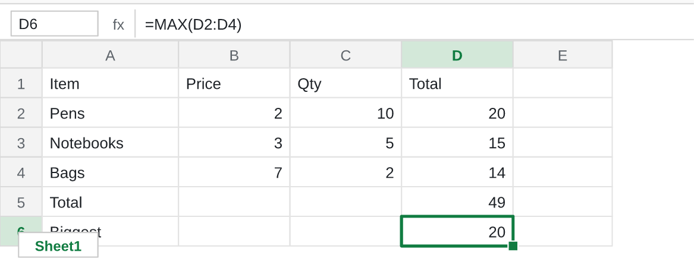
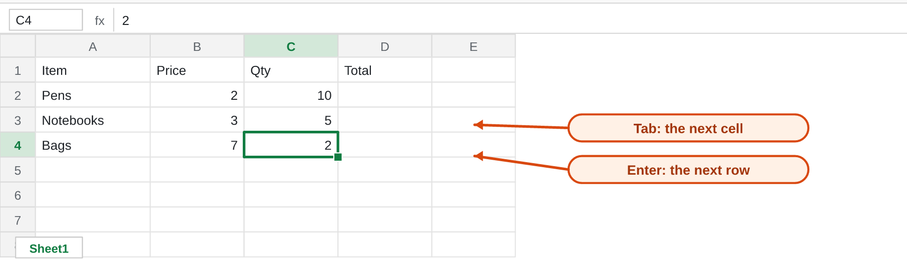

## Today in the lab

::: {.lab-plan}
1. **15 minutes, here:** the teacher shows each idea on a simulator, then
   in Excel.
2. **35 minutes, in Excel:** you follow the **worksheet**, step by
   step, on the lab computer. Nothing to download: you type the text
   yourself.
3. **At the end:** show your sheet to your teacher. Then the **Extra**: an
   AI assistant adds a row to your sheet.
:::

{width=55%}

## Key terms



## 6.1 Cells and formulas

### On the simulator

- A **cell** has an address: column letter and row number, for example **D2**.
- A **formula** starts with **=**: **=B2\*C2** is the price times the quantity.
- Change a number that the formula uses: the result changes **by itself**.

::: {.sim-part}

:::

### In Excel: worksheet Tasks 1 and 2

:::: {.word-part}
Open Excel, then **Blank workbook**, and type the shop list. Then the same steps as on the simulator:

::: {.screens}

![[1]{.step-n} **D2**: type **=B2\*C2**. [2]{.step-n} The formula bar shows it.](images/lab-formula-1.png)
:::
::::

::: {.callout-tip title="Try it 1 · Formulas"}
Choose the right answer.

::: {.match extra="B2*C2|=B2+C2"}
Which formula gives the price (B3) times the quantity (C3)?
:   =B3*C3

    Why: A formula starts with =, and * means times.
:::
:::

## 6.2 Copy a formula: relative and absolute references

### On the simulator

- The **fill handle** is the small square at the corner of the cell: double-click it to copy the formula down.
- The references move with the copy: **=B2\*C2** becomes **=B3\*C3** (**relative** references).
- A **\$** keeps a reference fixed (**\$F\$1**: an **absolute** reference), for one cell that every row uses.

::: {.sim-part}

:::

### In Excel: worksheet Task 3

:::: {.word-part}
::: {.screens}
![[1]{.step-n} Double-click the small square of D2. [2]{.step-n} D3 and D4 get their totals.](images/lab-fill-1.png)
:::
::::

::: {.callout-tip title="Try it 2 · Copy"}
Choose the right answer.

::: {.match extra="=B2*C2|=B4*C4"}
You copy =B2*C2 from D2 down to D3. What is the formula in D3?
:   =B3*C3

    Why: Relative references move one row with the copy.
:::
:::

## 6.3 Ready formulas: SUM, AVERAGE, MAX, MIN

### On the simulator

- **Home › AutoSum** writes **=SUM(D2:D4)**: the total of the cells above.
- **=AVERAGE(…)**, **=MAX(…)** and **=MIN(…)**: the average, the biggest and the smallest.
- **D2:D4** is a **range**: from D2 to D4.

::: {.sim-part}

:::

### In Excel: worksheet Tasks 4 and 5

:::: {.word-part}
::: {.screens}
![[1]{.step-n} Click **D5**. [2]{.step-n} **Home › AutoSum**, then Enter.](images/lab-sum-1.png)

![Press **F12**. [1]{.step-n} **Desktop**. [2]{.step-n} **shop-** and your name. [3]{.step-n} **Save**.](images/lab-save-1.png)
:::
::::

::: {.callout-tip title="Try it 3 · Functions"}
Choose the right answer.

::: {.match extra="SUM|AVERAGE"}
Which function gives the biggest number of D2:D4?
:   MAX

    Why: MAX gives the biggest, MIN the smallest.
:::
:::

## Extra: AI changes your sheet

### On the simulator

- On **tutudocs.com** you open your own sheet, with **no sign-in**.
- **AI Assistant**: ask for one change, for example: a new row of the list.
- **File › Download**, the Excel file (**.xlsx**).

::: {.sim-part}

:::

### On tutudocs.com: the Extra of the worksheet

:::: {.word-part}
::: {.screens}
![**tutudocs.com**: [1]{.step-n} click the box, then choose your sheet.](images/lab-tutu-1.png)

![[1]{.step-n} **AI Assistant**. [2]{.step-n} Your request. [3]{.step-n} The AI adds the row.](images/lab-tutu-2.png)

![[1]{.step-n} **File**, [2]{.step-n} **Download**, [3]{.step-n} the **.xlsx** file.](images/lab-tutu-3.png)
:::
::::

## Now: your worksheet

::: {.lab-go}
Take your **worksheet** and do Tasks 1–5 in Excel on the lab
computer, in order. Tick each step. Raise your hand when you are stuck,
and at the end. Finished? Do the **Extra**: on tutudocs.com an AI
assistant adds a row to your sheet.
:::

## Summary {.summary}

- A formula starts with =; =B2*C2 changes by itself when B2 or C2 changes.
- The fill handle copies a formula down; relative references move one row.
- A $ keeps a reference fixed: $F$1.
- Home › AutoSum gives =SUM(D2:D4); MAX, MIN and AVERAGE work the same way.
- On tutudocs.com (no sign-in) the AI Assistant changes your sheet; File › Download gives the .xlsx.
