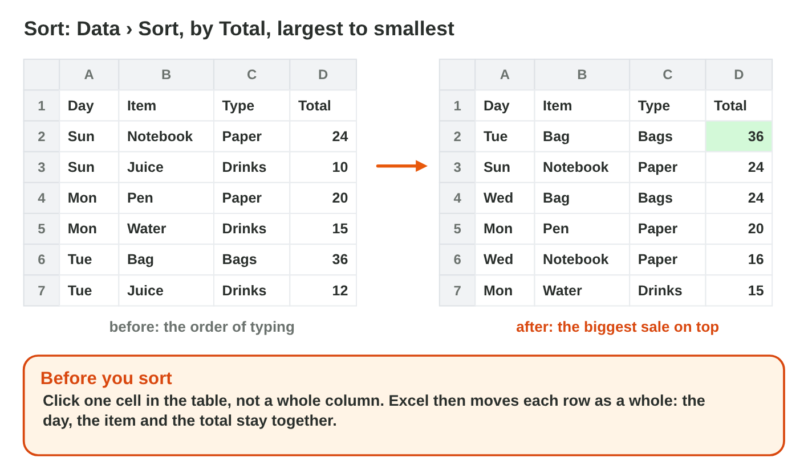
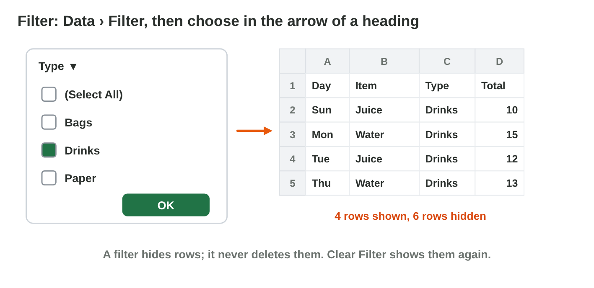
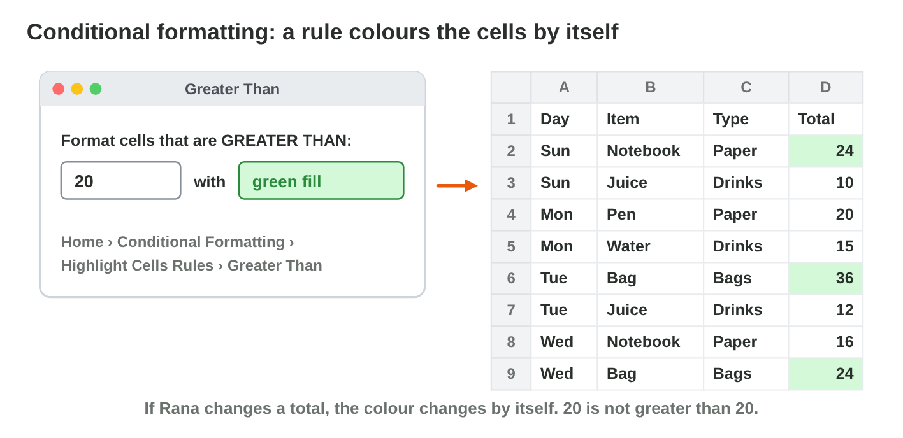
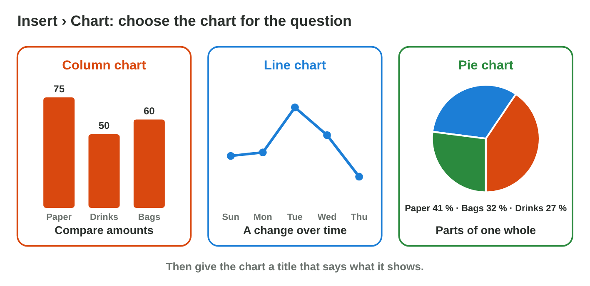

This page is the lecture, in class and at home. Each section explains one
idea, then shows its experiment. The page checks every step at once.

**In class, the teacher chooses the way for each experiment,** by the topic
and the time:

- **On the simulator** of the section, here on the page: nothing to
  install, and it works at home too.
- **In the real app** on the teacher's laptop, connected to the smart
  screen (HDMI): open the start file and follow the steps of **Part A**.
- **In the computer lab:** each student follows the **worksheet (PDF)**,
  Part A in the app and Part B on the simulator, and checks each result
  here.
- **You need:** Excel (the desktop app, or Excel on the web at `office.com`) and the start file, or only the simulators of this page.

## Key terms



## Before you start



## 7.1 Put the rows in order: Sort

- **Sort** puts the rows in order by one column. Each row moves as a whole.
- Click **one cell** in the table › **Data › Sort** › choose the column and
  the order.
- Quick buttons: **A→Z** (smallest first) and **Z→A** (largest first).
- **Table Lab** below holds the sales of the Sunrise shop in one week.

{width=100%}



::: {.callout-warning title="Watch out!"}
Never sort one column alone: the rows break apart.
:::



::: {.callout-tip title="Try it 1 · Sort"}
Choose the right answer.

::: {.match extra="Data › Filter|the colour"}
Which sale is on top after the sort, largest first?
:   the bag of Tuesday, 36 JD

    Why: 36 JD is the biggest total in the table.
:::
:::

## 7.2 Show only some rows: Filter

- A **filter** shows only the rows you choose. The others are **hidden, not
  deleted**.
- Click one cell › **Data › Filter**. Arrows appear in the headings.
- Click the arrow of a heading and tick the values to show.
- **Clear Filter** shows all rows again.

{width=100%}

::: {.callout-warning title="Watch out!"}
Never delete rows to "hide" them. Use a filter.
:::

Part B: **Table Lab** (Task 2), in section 7.1.



::: {.callout-tip title="Try it 2 · Filter"}
Use the sales table of section 7.1. Choose the right answer.

::: {.match extra="they are deleted|10"}
What is the sum of the Drinks totals?
:   50 JD

    Why: 10 + 15 + 12 + 13 = 50 JD.
:::
:::

## 7.3 Colour by a rule: conditional formatting

- **Conditional formatting** colours cells by a rule, by itself.
- Select the totals › **Home › Conditional Formatting › Highlight Cells
  Rules › Greater Than** › 20 › a colour.
- When a number changes, the colour changes too. Remove with **Clear
  Rules**.

{width=100%}

::: {.callout-warning title="Watch out!"}
Colours you add by hand do not change when the numbers change.
:::

Part B: **Table Lab** (Task 3), in section 7.1.



::: {.callout-tip title="Try it 3 · Rules"}
Use the sales table of section 7.1. Choose the right answer.

::: {.match extra="Data › Sort|2"}
Juice changes from 12 to 22. What happens?
:   it turns green by itself

    Why: The rule checks the cells again when a number changes.
:::
:::

## 7.4 Show it as a picture: charts

- **Column chart:** compare amounts. **Line chart:** a change over time.
  **Pie chart:** the parts of one whole.
- Select a small table › **Insert › Recommended Charts** (or Column, Line,
  Pie).
- Click **Chart Title** and write what the chart shows.
- The **+** next to the chart adds data labels.

{width=100%}



::: {.callout-warning title="Watch out!"}
"Chart Title" is not a title. Write what the chart shows.
:::



::: {.callout-tip title="Try it 4 · Charts"}
Choose the right chart.

::: {.match extra="a table|a picture"}
The part of each type in the 185 JD?
:   a pie chart

    Why: A pie shows the parts of one whole.
:::
:::

## Table of results



## Game challenge: Rana's Questions {.challenge}

Huda asks Rana six questions about the sales of the week: the biggest sale,
only the drinks, big totals in green, the change over the days, the three
types compared, and the part of each type in **185 JD**.



::: {.callout-tip title="Try it 5 · Rana's answers (harder)"}
The sales of the week are in the table of section 7.1: Paper, Drinks and
Bags, 185 JD in all. Choose the right answer.

::: {.match extra="type the numbers again|delete the other rows|45 JD"}
Which sale was the biggest? Which tool shows it fast?
:   Sort by Total, largest first

    Why: Sort puts the biggest total on top.
:::
:::

## Summary {.summary}

- Sort puts the rows in order; click one cell first.
- A filter shows only some rows; it never deletes them.
- Conditional formatting colours cells by a rule, also when numbers change.
- Column: compare. Line: change over time. Pie: parts of a whole. Always a
  real title.
