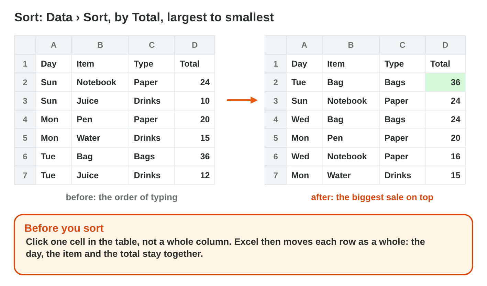
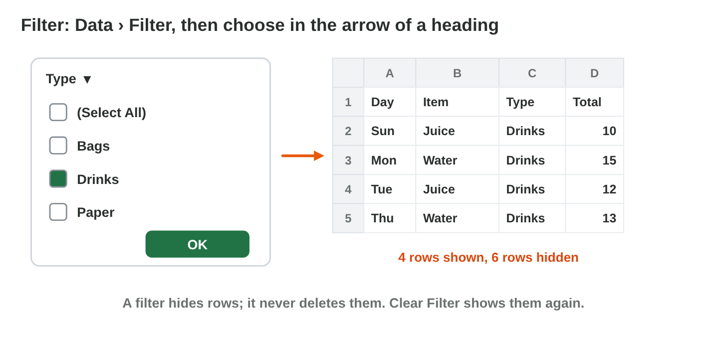
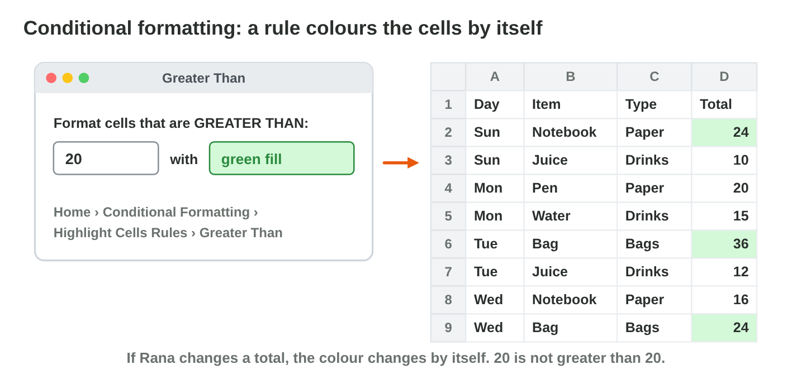

::: {.lead}
Rana has the sales of the *Sunrise* shop for one week in Excel: the day,
the item, the type, the quantity and the total. Huda, the manager, asks her
questions: Which sale was the biggest? How much did we sell of drinks? Show
me the big sales. How did the week go? Rana can answer every question in a
few clicks. In Lecture 6 you made Excel calculate. In this lesson you make
a table easy to read: you **sort** it, you **filter** it, you colour it
with a rule, and you make a **chart**. Every section ends with a lab task.
:::

## Key terms



## 7.1 Put the rows in order: Sort

Huda asks: "Which sale was the biggest?" Rana does not read all the rows.
She **sorts** the table by the Total (@fig-sort).

::: {.callout-important title="Definition 7.1 — Sort"}
To **sort** is to put the rows in order by one column: A to Z or smallest
to largest, or the other way. Each row moves as a whole.
:::

{#fig-sort width=100%}

- Click **one cell** in the table.
- **Data › Sort** › Sort by *Total* › Order *Largest to Smallest* › OK.
- Quick buttons: **A→Z** and **Z→A** on the Data tab.

::: {.callout-note title="Example 7.1 — The biggest sale"}
1. Rana clicks a cell in the table, then Data › Sort.
2. She chooses Total and Largest to Smallest.
3. The bag of Tuesday (36 JD) is now on top; the juice of Sunday (10 JD) is
   at the bottom.
:::

::: {.callout-warning title="Common mistake"}
Selecting only the Total column and sorting it. Then the totals move, but
the days and the items stay: the table is wrong. Click one cell, and let
Excel take the whole table.
:::

| Day | Item | Type | Qty | Total (JD) |
|---|---|---|---|---|
| Sun | Notebook | Paper | 12 | 24 |
| Sun | Juice | Drinks | 20 | 10 |
| Mon | Pen | Paper | 40 | 20 |
| Mon | Water | Drinks | 30 | 15 |
| Tue | Bag | Bags | 3 | 36 |
| Tue | Juice | Drinks | 24 | 12 |
| Wed | Notebook | Paper | 8 | 16 |
| Wed | Bag | Bags | 2 | 24 |
| Thu | Water | Drinks | 26 | 13 |
| Thu | Pen | Paper | 30 | 15 |

: The sales of the Sunrise shop in one week. {#tbl-sales}



::: {.callout-note title="Lab task · Sort the week"}
1. Type the sales of @tbl-sales in a new workbook, and save it as
   `sales.xlsx`.
2. Sort it by Total, largest first. Which sale is on top?
3. Sort it by Day, A to Z. What is strange about the order? (Hint: Mon
   comes before Sun.)

*Your result:* `sales.xlsx`, sorted by Total.

::: {.check}
By Total, largest first: the bag of Tuesday (36 JD) is on top, and the
juice of Sunday (10 JD) is at the bottom. By Day, A to Z, the order is Mon,
Sun, Thu, Tue, Wed: Excel sorts the days as words, by their letters.
:::
:::

## 7.2 Show only some rows: Filter

Huda asks: "How much did we sell of drinks?" Rana shows only the drink
rows with a **filter** (@fig-filter).

::: {.callout-important title="Definition 7.2 — Filter"}
A **filter** shows only the rows that match your choice. The other rows are
**hidden, not deleted**.
:::

{#fig-filter width=100%}

- Click one cell in the table › **Data › Filter**. Small arrows appear in
  the headings.
- Click the arrow of *Type* › tick only **Drinks** › OK.
- **Clear Filter** (Data tab) shows all the rows again.

::: {.callout-note title="Example 7.2 — The drinks"}
1. Rana filters the Type to Drinks: 4 rows stay.
2. She selects the four totals: the status bar at the bottom of Excel
   shows **Sum: 50**.
3. She clears the filter: all 10 rows come back.
:::

::: {.callout-warning title="Common mistake"}
Deleting the rows you do not want to see. Then the data is gone. A filter
only hides rows.
:::

::: {.callout-note title="Lab task · Filter the types"}
1. In `sales.xlsx`, turn on the filter.
2. Show only Paper. Select the totals: what does the status bar show?
3. Clear the filter.

*Your result:* the sum of the Paper sales.

::: {.check}
Paper has 4 rows: 24, 20, 16 and 15 JD. The status bar shows Sum: 75.
After Clear Filter, all 10 rows come back.
:::
:::

## 7.3 Colour by a rule: conditional formatting

Huda asks: "Show me the big sales, over 20 JD." Rana does not colour the
cells by hand. She makes a rule (@fig-cf).

::: {.callout-important title="Definition 7.3 — Conditional formatting"}
**Conditional formatting** is a rule that colours cells by themselves when
their value matches, for example *greater than 20*. When a number changes,
the colour changes too.
:::

{#fig-cf width=100%}

- Select the totals (D2:D11).
- **Home › Conditional Formatting › Highlight Cells Rules › Greater
  Than**.
- Type **20**, choose a colour › OK.
- Other rules: *Data Bars* (a small bar in each cell), *Top 10 Items*.
- To remove: Conditional Formatting › **Clear Rules**.

::: {.callout-note title="Example 7.3 — The big sales"}
1. Rana selects D2:D11 and makes the rule Greater Than 20, green.
2. Three cells are green: 24, 36 and 24. The pen sale of Monday (20) is not
   green: 20 is not greater than 20.
3. She changes the juice of Tuesday from 12 to 22: it turns green by
   itself.
:::

::: {.callout-warning title="Common mistake"}
Colouring cells by hand with the Fill colour. Next week the numbers change,
and the colours are wrong. A rule keeps them right.
:::

::: {.callout-note title="Lab task · The big sales"}
1. In `sales.xlsx`, select the totals and make the rule Greater Than 20.
2. Add Data Bars to the Qty column. Which item sold the most pieces?

*Your result:* green totals and data bars.

::: {.check}
Three totals turn green: 24, 36 and 24; the 20 stays white. The longest
data bar is in the pens of Monday: 40 pieces.
:::
:::

## 7.4 Show it as a picture: charts

Huda asks: "How did the week go?" A **chart** shows the answer at once.
But each question needs its own kind of chart (@fig-charts).

::: {.callout-important title="Definition 7.4 — Three common charts"}
- **Column chart:** compares amounts (Paper, Drinks, Bags).
- **Line chart:** shows a change over time (Sunday to Thursday).
- **Pie chart:** shows the parts of one whole (each type in the week).
:::

{#fig-charts width=100%}

- Make a small table first, for example *Type* and *Sales*: Paper 75,
  Drinks 50, Bags 60.
- Select it › **Insert › Recommended Charts** (or Column, Line, Pie) › OK.
- Click the **Chart Title** and type what the chart shows.
- **Chart Elements** (the + next to the chart): add data labels.

::: {.callout-note title="Example 7.4 — Three questions, three charts"}
1. "Which type sells most?" A column chart: Paper 75 is the tallest.
2. "How did the days go?" A line chart: up to 48 on Tuesday, down to 28 on
   Thursday.
3. "What part of the 185 JD is each type?" A pie: Paper 41 %, Bags 32 %,
   Drinks 27 %.
:::



::: {.callout-warning title="Common mistake"}
A chart with the title "Chart Title", or a pie chart of the days. Always
write a real title, and choose the chart for the question.
:::

::: {.callout-note title="Lab task · Two charts"}
1. In a new sheet of `sales.xlsx`, make the small table *Type / Sales*
   (Paper 75, Drinks 50, Bags 60).
2. Make a column chart with the title "Sales per type, one week".
3. Make a pie chart from the same table. Add data labels.

*Your result:* `sales.xlsx` with two charts.

::: {.check}
A column chart with three columns (Paper 75, Drinks 50, Bags 60) and a
real title, for example "Sales by type in one week (JD)". The pie chart
shows the three parts of 185 JD, each with its label.
:::
:::

## Case study: Rana's Questions

Huda asks Rana six questions about the sales of the week: which sale was
the biggest; show only the drinks; make every total above 20 JD green, also
next week; how the sales changed from Sunday to Thursday; compare Paper,
Drinks and Bags; and what part of the 185 JD came from each type. The Game
challenge of the interactive lesson uses these questions. In the mini-game
below you choose the right tool for each one.



::: {.callout-note title="Lab task · Answer Huda"}
1. In `sales.xlsx`, answer Huda's six questions with the right tool.
2. Save the file.

*Your result:* `sales.xlsx` with a sort, a filter, a rule and two charts.

::: {.check}
Sort by Total, largest first; filter the Type to Drinks; conditional
formatting, Greater Than 20, for the totals; a line chart of the days; a
column chart of the three types; a pie chart of the three types in 185 JD.
:::
:::

## Further reading

Microsoft Support, "Sort data in a range or table", "Filter data in a range
or table", "Use conditional formatting to highlight information" and
"Create a chart from start to finish" (support.microsoft.com).

## Exercises

1. What does Sort do with each row?
2. Which button sorts from the largest to the smallest?
3. Does a filter delete rows?
4. How do you show all rows again after a filter?
5. What is conditional formatting?
6. The rule is Greater Than 20. Is the cell 20 coloured?
7. Why use a rule and not the Fill colour?
8. Which chart compares amounts?
9. Which chart shows a change over time?
10. Which chart shows the parts of one whole?

## Answers to the exercises

::: {.answers}
1. It moves each row as a whole into the new order.
2. Z→A (Largest to Smallest).
3. No, it only hides them.
4. Data › Clear Filter.
5. A rule that colours cells by themselves when they match.
6. No: 20 is not greater than 20.
7. The colours stay right when the numbers change.
8. A column chart.
9. A line chart.
10. A pie chart.
:::
