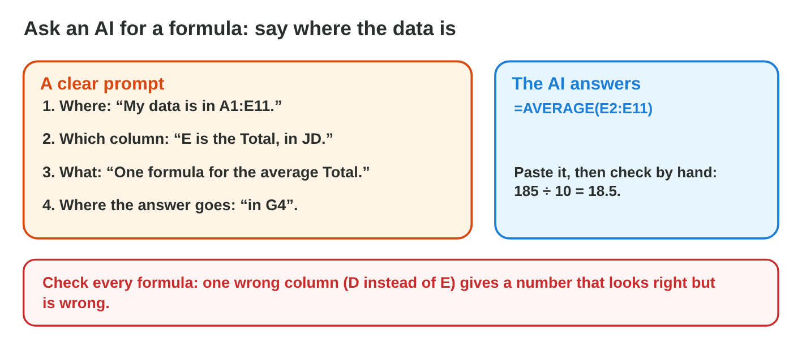
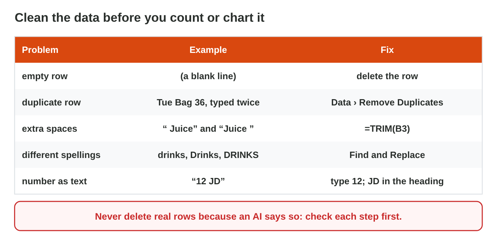
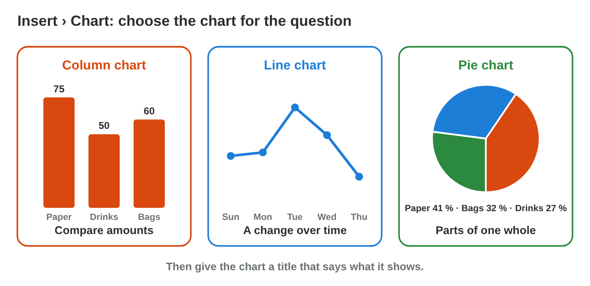

## Before you start {.study}

- **What you need:** Excel (the desktop app, Excel on the web at
  `office.com`, or the free phone app) and a free AI chat tool (for example
  Microsoft Copilot with your university account, ChatGPT or Gemini).
- **Time:** about 60 minutes. Work alone, at your own speed.
- **How it works:** do Steps 1–3 on this page. Each step has a short text, a
  simulator and a self-check. Then do the **Tasks to submit**.
- **What you submit:** one Excel file and three short answers, on the
  university e-learning platform, before lecture 8.
- **You need Lectures 5, 6 and 7:** prompts, formulas, sort, filter and
  charts.
- **Never type personal data into an AI tool.** Use only the made-up shop
  data of this page.

## Key terms {.study}



## Step 1 · Ask an AI for a formula, then test it {.study}

- An AI tool can write a formula for you. Tell it three things: **where**
  the data is, **which column** holds what, and **what** you want.
- Example prompt: "My data is in A1:E11. Column E is the Total in JD. Write
  one formula for the average Total."
- The answer: `=AVERAGE(E2:E11)`: a function of Lecture 6.
- **Test every formula.** Check one small result by hand: 185 ÷ 10 = 18.5.
  An AI can use a wrong column, and the number still looks normal.

{width=100%}



::: {.callout-tip title="Try it 1 · Formulas from an AI"}
Use AI Formula Lab. Choose the right answer.

::: {.match extra="the AI is always right|19.5"}
What must a prompt for a formula say?
:   where the data is, which columns, and what you want

    Why: Then the AI uses the right cells for the right job.

What does =SUM(E2:E11) give?
:   185

    Why: The ten totals add up to 185 JD.

What does =MAX(E2:E11) give?
:   36

    Why: The bag of Tuesday, 36 JD, is the biggest total.

What was wrong in the AI answer of Job 3?
:   it used column D instead of E

    Why: Column D is the Qty, not the Total: 19.5 instead of 18.5.

How do you check a formula from an AI?
:   compute one small result by hand

    Why: A wrong column gives a number that looks normal.
:::
:::

## Step 2 · Clean the data with AI advice {.study}

- Data from paper or from many people is often **messy**: empty rows, rows
  typed twice, extra spaces, "drinks" and "Drinks", "12 JD" as text.
- Messy data gives wrong results: a filter misses rows, and SUM skips text.
- An AI tool can list the steps. **You** check each step before you do it.
- The tools: delete empty rows; **Data › Remove Duplicates**; `=TRIM(B3)`
  for spaces; **Find and Replace** for spellings; type numbers without
  "JD".
- Never delete real rows just because an AI says so.

{width=100%}



::: {.callout-tip title="Try it 2 · Clean data"}
Use Clean Data Lab. Choose the right answer.

::: {.match extra="Data › Sort|keep them"}
Which tool removes rows typed twice?
:   Data › Remove Duplicates

    Why: It removes the rows that are typed twice.

Which function removes extra spaces?
:   TRIM

    Why: TRIM removes the extra spaces in a text.

What do you do with "12 JD" in a Total cell?
:   type 12 and keep JD in the heading

    Why: Then the cell holds a number, and SUM counts it.

Which AI step was a bad idea?
:   delete the totals under 12

    Why: It deletes real sales, so the total of the week is wrong.

What is the SUM of the clean list?
:   185 JD

    Why: The clean list has the ten real sales, as on the paper.
:::
:::

## Step 3 · Check the AI's chart advice {.study}

- An AI can suggest a chart and a title. Its advice is not always right.
- Check it with the rule of Lecture 7: **compare** amounts → column chart;
  **change over time** → line chart; **parts of one whole** → pie chart.
- Make the chart from the **clean** list: a chart of messy data shows wrong
  numbers.
- Check the title: it says what the chart shows, never "Chart 1".
- In **Chart Lab**, try a pie chart of the sales per day, as a weak AI
  answer may advise. Read what the lab says, then make the right chart.

{width=100%}



::: {.callout-tip title="Try it 3 · Check the advice"}
Choose the right answer.

::: {.match extra="a pie chart of the days|keep the title Chart 1"}
The AI says: "Show the sales of the 5 days in a pie chart." What do you make?
:   a line chart

    Why: A line shows a change over time; a pie shows the parts of one whole.

The AI says: "Compare Paper, Drinks and Bags in a column chart." Is it good advice?
:   yes, columns compare amounts

    Why: Columns compare amounts side by side.

The AI suggests the title "Chart 1". What do you write?
:   what the chart shows

    Why: A real title says what the chart shows.

Your chart shows Bags 96 JD, but the paper says 60 JD. What happened?
:   a row was typed twice

    Why: The bag of Tuesday (36 JD) is counted twice: 60 + 36 = 96.
:::
:::

## Tasks to submit {.tasks}

Do the tasks alone. Your teacher marks them (6 marks). Use only this made-up
data.

Type this list into a new Excel workbook, **with its mistakes** (it comes
from a paper notebook of the Sunrise shop):

| Day | Item | Type | Qty | Total |
|---|---|---|---|---|
| Sun | Notebook | Paper | 12 | 24 |
| Sun | Juice | drinks | 20 | 10 |
| Mon | Pen | PAPER | 40 | 20 |
| Mon | Water | Drinks | 30 | 15 |
| Tue | Bag | Bags | 3 | 36 |
| Tue | Bag | Bags | 3 | 36 |
| Tue | Juice | Drinks | 24 | 12 JD |
| Wed | Notebook | Paper | 8 | 16 |

### Task 1 · Clean the list (2 marks)

1. Ask an AI tool how to clean this list. Copy its steps into your answer
   sheet (a second sheet named *AI steps*).
2. Clean the list in Excel: one duplicate row, two spellings of the Type,
   and one total as text. Do not delete real sales.
3. Save it as `sales_clean.xlsx`.

### Task 2 · Two formulas from AI (2 marks)

1. Ask an AI tool for a formula for the **total** of all the sales, and one
   for the **average** sale. Tell it where your data is.
2. Put the formulas under the list, with a label next to each.
3. Check each result by hand. The right results are 133 JD and 19 JD.

### Task 3 · A chart and short answers (2 marks)

1. Make a small table *Type / Sales* from the clean list, and a **column
   chart** of it with a real title.

a) Write your prompt for Task 2 and say if the first AI answer was right.



b) Which AI step did you **not** follow, or change, and why? If all steps
were good, say how you checked them.



## How to submit

Upload `sales_clean.xlsx` (with the sheets *Sales* and *AI steps*) and your
answers to Task 3 to the university e-learning platform, **before
lecture 8**.
