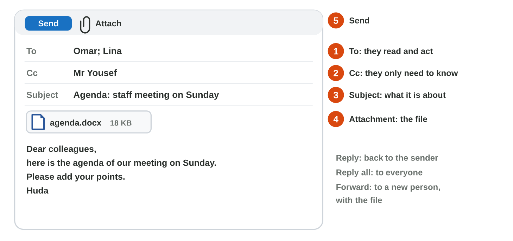

## Recall · Lectures 1–6

a) Which file name is best for the price list of 3 November 2026?
b) The manager only needs to know about Huda's e-mail. Where does he go?
c) Which formula can Huda copy down to multiply every price by the tax rate in F1?
d) An AI draft says "Monday", but the library says Sunday. What do you do?
e) Which layout is best for the first slide of a talk?

::: {.answer}
a) 2026-11-03_price-list.xlsx
b) Cc
c) =B2\*\$F\$1
d) Correct it to Sunday.
e) Title Slide
:::

## Activity 1 · The library notice · 15 min

:::: {.columns}
::: {.column width="50%"}
- The library closes at 2 pm on Sunday because of a meeting.
- **Do it:** Type the three given lines in Word, use the style Title and make 2 pm bold. Save it with a good name and as a PDF, and e-mail the PDF.
- Your product is the Word file, its PDF and the e-mail.
:::
::: {.column width="50%"}

:::
::::

## Check 1 · The library notice

What does a good notice and e-mail look like?

::: {.reveal}
1. The first line has the style Title, and 2 pm is bold.
2. The name starts with the date, for example 2026-11-03_library-notice.docx.
3. A PDF copy has the same name, so nobody can easily change the notice.
4. The club is in To, the manager in Cc, and the PDF is attached.
:::

## Activity 2 · The price list · 15 min

:::: {.columns}
::: {.column width="50%"}
- Rana sells five items, and the tax rate of 10 % is in F1.
- **Do it:** Write =B2\*\$F\$1 for the tax and =B2+C2 for the price with tax, and copy them down. Add the total with SUM and the biggest price with MAX.
- Your product is the file prices.xlsx.
:::
::: {.column width="50%"}

:::
::::

## Check 2 · The price list

What does the finished price list show?

::: {.reveal}
1. The prices with tax are 2.2, 0.55, 13.2, 1.65 and 4.4 JD, and the total is 22 JD.
2. The formula in C3 is =B3\*\$F\$1: B2 moves, and \$F\$1 stays.
3. MAX shows 13.2 JD: the bag is the most expensive item.
:::

## Wrap-up

- You can format a notice in Word, save it as Word and PDF, and send it by e-mail to the right people.
- You can make a price list with formulas, a \$ reference, SUM and MAX.
- You check every fact of an AI draft, and you start a talk with the layout Title Slide.
