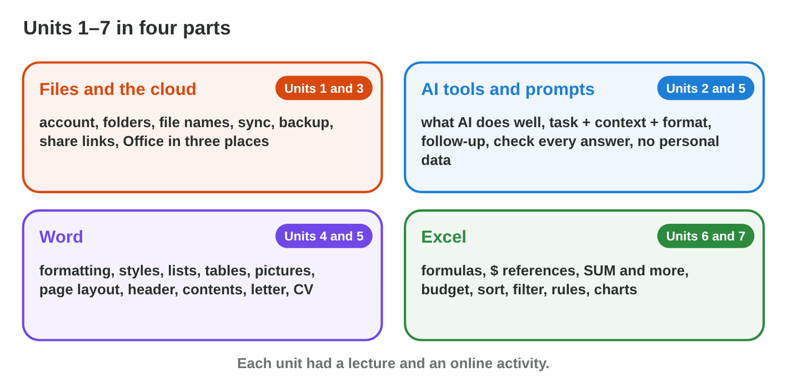
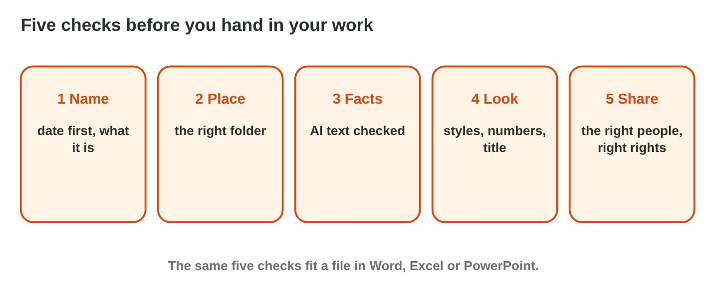

No new ideas today: two short problems on Lectures 1–7, on the lab
computer. Do each one alone, then open "Check your result". Every question
on this page has its answer: try first, then check.

## Recall

- **Files and AI:** a good file name starts with the date. A clear prompt
  has a task, a context and a format. You check every AI answer, and you
  never type personal data.
- **Word:** the styles Title and Heading 1 make clear headings. Keep Text
  Only pastes plain text. A PDF keeps the look of the page.
- **Excel:** a formula starts with =. \$F\$1 stays the same when you copy.
  Sort, a rule and a chart answer questions about the data.

{width=100%}



::: {.callout-tip title="Try it 1 · Recall"}
Play **Huda's Busy Day**. Then choose the right answer.

::: {.match extra="Book1.xlsx|=B2\*F1"}
Which file name is best for the price list of 3 November 2026?
:   2026-11-03_price-list.xlsx

    Why: The date comes first (year-month-day), then what it is, with no spaces.

The AI's notice says that the shop also closes at 1 pm. That is not true. What does Huda do?
:   correct it before she sends it

    Why: Huda checks every AI answer, and she is responsible for the notice.

Every price is multiplied by the tax rate in F1. Which formula can Huda copy down?
:   =B2\*\$F\$1

    Why: \$F\$1 stays in every row, and B2 moves down.
:::
:::

## Activity 1 · A notice with AI, in Word

The library of the college closes early on **Sunday at 2 pm** because of a
meeting. Huda must put a short notice on the door and send it as a PDF.
She asks an AI tool for the text.

{width=100%}

::: {.callout-note title="Activity 1 · The library notice · 15 min"}
1. Ask an AI tool: *Write a notice of 3 short sentences for students: the
   library closes at 2 pm on Sunday because of a meeting.*
2. Check every fact. Delete every fact that you did not give, for example
   free books or another day.
3. Paste the text into Word with **Keep Text Only**. Give the first line
   the style **Title**, and make the time **bold**.
4. Save it in your folder `Digital-Skills › unit-08` as
   `2026-11-03_library-notice.docx` (today's date). Save a PDF copy too.

*Your product:* the Word file and its PDF, with only true facts.

::: {.check}
A good notice: "Library notice. The library closes at 2 pm on Sunday
because of a meeting. Thank you for your understanding."

- ☐ 2 pm and Sunday are right, and the AI added no other fact.
- ☐ The first line has the style Title, and 2 pm is bold.
- ☐ There are two files with the same name: `.docx` and `.pdf`.
:::
:::

::: {.callout-tip title="Try it 2 · The notice"}
Choose the right answer.

::: {.match extra="send it at once|Bold and size 20"}
The AI adds "Books are free this week." Nobody said it. What do you do?
:   delete it

    Why: A notice has only true facts, and the AI invented this one.

Which paste option takes only the words from the AI chat?
:   Keep Text Only

    Why: It pastes plain text, without the look of the chat.

Nobody may change the notice that you send. Which format do you use?
:   PDF

    Why: A PDF keeps the look, and people do not easily change it.
:::
:::

## Activity 2 · Prices with tax in Excel

Rana sells five items in the Sunrise shop: Notebook 2 JD, Pen 0.5 JD, Bag
12 JD, Folder 1.5 JD and Bottle 4 JD. The tax rate, **10 %**, is in cell
F1. Rana wants the price with tax of each item, the total, the most
expensive items first and a chart.

{width=100%}

::: {.callout-note title="Activity 2 · The price list · 15 min"}
1. Type *Item* and *Price (JD)* in A1 and B1, the five items under them,
   and 10% in F1.
2. In C2 write the tax **=B2\*\$F\$1**, and in D2 the price with tax
   **=B2+C2**. Copy both down to row 6. In D8 write **=SUM(D2:D6)**.
3. Sort the table by the price with tax, largest first. Make every price
   with tax above 4 JD green with a rule.
4. Make a column chart of the prices with tax, with a real title. Save it
   as `prices.xlsx`.

*Your product:* `prices.xlsx` with the formulas, the sort, the rule and the
chart.

::: {.check}
The prices with tax: Bag 13.2, Bottle 4.4, Notebook 2.2, Folder 1.65 and
Pen 0.55 JD. D8 shows 22. After the sort, the Bag is on top. The rule
colours two cells green: 13.2 and 4.4. The title says what the chart
shows, for example "Prices with tax (JD)".
:::
:::

::: {.callout-tip title="Try it 3 · The price list"}
Use the price list of Activity 2. Choose the right answer.

::: {.match extra="=B3\*\$F\$2|3"}
C2 has =B2\*\$F\$1. You copy it to C3. Which formula is in C3?
:   =B3\*\$F\$1

    Why: B2 moves one row down, and \$F\$1 stays.

What is the price with tax of the bag (12 JD, tax 10 %)?
:   13.2 JD

    Why: The tax is 12 × 10 % = 1.2 JD, and 12 + 1.2 = 13.2 JD.

How many prices with tax are greater than 4 JD?
:   2

    Why: 13.2 and 4.4 are greater than 4; 2.2, 1.65 and 0.55 are not.
:::
:::

## Wrap-up {.summary}

- You can make a short document with AI help, check its facts, format it,
  and save it with a good name and a PDF copy.
- You can make a price list with formulas, a \$ reference, a sort, a rule
  and a chart.
