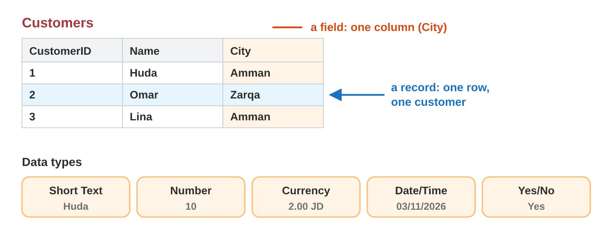
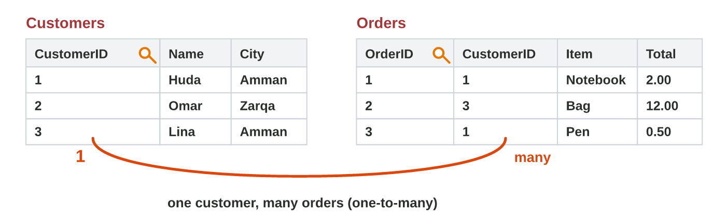
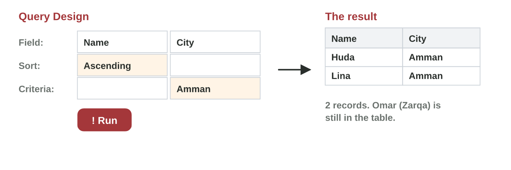

::: {.lead}
The Sunrise shop keeps its customers and orders on paper and in long Excel
lists. The same customer is typed again and again, with small mistakes.
A **database** keeps each thing once, in its own table, and joins the
tables. Then one question to the database (a **query**) gives the answer
at once. In this lesson you build a small database in Microsoft Access.
These notes are a short reference: in class you do each idea in Access, as
an experiment of the **worksheet**.
:::

## Key terms



## 7.1 A table: fields and data types

A database keeps its data in **tables**. Each table keeps one kind of
thing: customers, products or orders (@fig-table).

- A **field** is a column: one piece of information, such as Name or City.
- A **record** is a row: all the information about one thing, such as one
  customer.
- Each field has a **data type**: the kind of value that it holds.

| Data type | For | Example |
|---|---|---|
| Short Text | names, cities, phone numbers | Huda, 079 000 0001 |
| Number | amounts to count or add | 10 |
| Currency | money | 2.00 JD |
| Date/Time | dates and times | 03/11/2026 |
| Yes/No | two answers only | Yes |
| AutoNumber | a number that Access gives | 1, 2, 3 |

: The common data types of Access. {#tbl-types}

{#fig-table width=100%}

::: {.callout-important title="Definition 7.1 — Record and field"}
A **record** is one row of a table (one customer). A **field** is one
column (Name).
:::

::: {.callout-note title="Example 7.1 — The Customers table"}
1. Huda opens Access, makes a blank database `shop` and a table
   `Customers`.
2. In Design View she types the fields: CustomerID (AutoNumber), Name
   (Short Text), City (Short Text).
3. In Datasheet View she types three records: Huda, Amman · Omar, Zarqa ·
   Lina, Amman. The table has 3 records and 3 fields.
:::

::: {.callout-warning title="Common mistake"}
A phone number as Number. Access drops the 0 at the start (079 becomes 79),
and nobody adds phone numbers. Use Short Text.
:::



*In class: Experiment 1 of the worksheet, the Customers table in Access.*

## 7.2 The primary key and a relationship

Two customers can have the same name, and many live in the same city. How
does Access know which Huda is which? With the **primary key**: a field
with a different value in every record, such as **CustomerID**
(@fig-rel).

The orders go into a second table, **Orders**: OrderID, CustomerID, Item,
Total. The field CustomerID is in both tables. A **relationship** joins
them: **one** customer can have **many** orders. Access draws the line 1 —
∞ (**Database Tools › Relationships**).

{#fig-rel width=100%}

::: {.callout-important title="Definition 7.2 — Primary key"}
The **primary key** is the field that has a different value in every
record of a table.
:::

::: {.callout-note title="Example 7.2 — Huda's two orders"}
1. Orders: order 1 (CustomerID 1, Notebook, 2 JD), order 2 (CustomerID 3,
   Bag, 12 JD), order 3 (CustomerID 1, Pen, 0.50 JD).
2. CustomerID 1 is Huda: she has two orders. Her name is typed only once,
   in Customers.
3. One customer, many orders: a one-to-many relationship.
:::



*In class: Experiment 2 of the worksheet, the primary key and the
relationship in Access.*

## 7.3 A query: a criterion and a sort

The manager asks: "Which customers live in Amman?" You do not read the
whole table: you ask a **query** (@fig-query).

- **Create › Query Design**, add the table, double-click the fields that
  you want.
- A **criterion** chooses the records: under City type `Amman`; under Price
  type `>5`.
- A **sort** puts them in order: **Ascending** (A to Z, small to big) or
  **Descending**.
- Click **Run** (the red !). Save the query to use it again.

{#fig-query width=100%}

::: {.callout-note title="Example 7.3 — The products above 5 JD"}
1. The Products table has 8 records.
2. In Query Design, under Price, the criterion `>5`.
3. Run: 2 records, the Bag (12 JD) and the Lunch box (6 JD). The other six
   are still in the table.
:::

::: {.callout-warning title="Common mistake"}
Deleting the records that you do not need. A query only hides them: the
table keeps all the records.
:::



*In class: Experiment 3 of the worksheet, the query City = Amman, sorted by
Name.*

## Case study: the Data Desk at Sunrise Company

Huda's colleagues ask about the new shop database. Which field is the key
of Customers? Which data type is right for Price, InStock or a phone
number? How do the tables join? Which query shows the products above 5 JD,
or the cheapest products first? In the mini-game below, you answer eight
such messages.



## Further reading

Evans, Martin and Poatsy, *Technology in Action*, the chapter on databases
(tables, fields, records, keys and queries). Microsoft 365 Training
(support.microsoft.com/training): Access, the first video course.

## Exercises

1. One row of a table is a … (record or field)?
2. Which data type is right for Price: Short Text or Currency?
3. Which data type is right for a phone number: Number or Short Text?
4. Students table: StudentID, Name, City. Which field is the primary key?
5. One customer has many orders. Which relationship: one-to-one or one-to-many?
6. Which criterion shows the products that cost more than 5 JD: >5 or <5?
7. Which sort puts the names from A to Z: Ascending or Descending?
8. Does a query delete the records that it does not show: yes or no?

## Answers to the exercises

::: {.answers}
1. A record.
2. Currency.
3. Short Text (the 0 at the start stays, and nobody adds phone numbers).
4. StudentID.
5. One-to-many.
6. >5
7. Ascending.
8. No: the table keeps all the records.
:::
