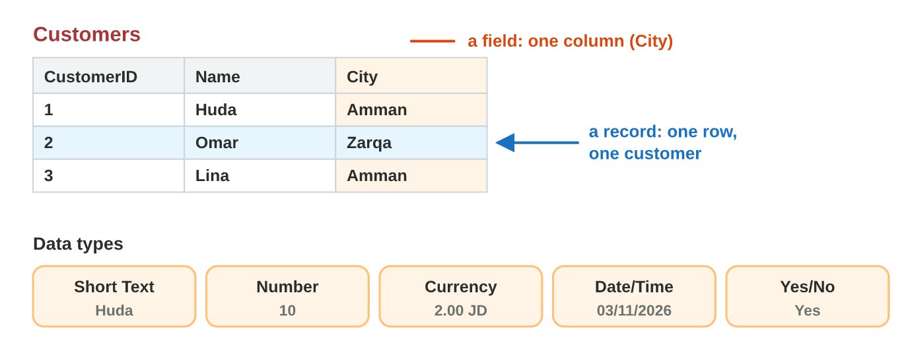
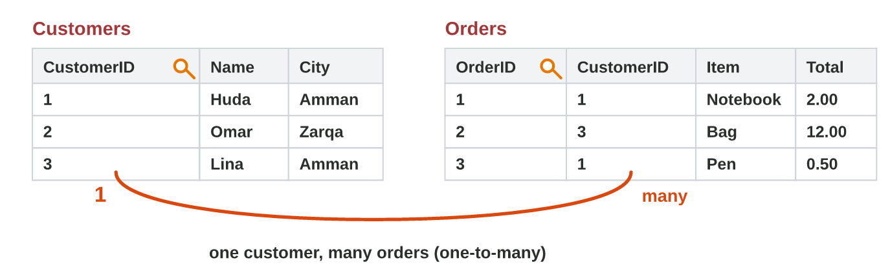
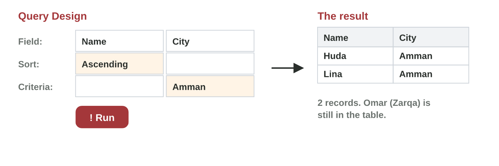

## Keywords



## A table: fields and data types

:::: {.columns}
::: {.column width="50%"}
- A database keeps data in tables, for example in Microsoft Access.
- A field is a column, and a record is a row.
- Each field has a data type, such as Short Text, Currency or Yes/No.
- A phone number is Short Text, because the 0 at the start must stay.
:::
::: {.column width="50%"}

:::
::::

## Live demo · Field Lab



## Try it 1 · Tables

a) What is one row of the Customers table called?
b) Which data type is right for OrderDate (03/11/2026)?
c) Which data type is right for InStock (Yes or No)?

::: {.answer}
a) a record
b) Date/Time
c) Yes/No
:::

## The primary key and a relationship

:::: {.columns}
::: {.column width="50%"}
- The primary key has a different value in every record.
- CustomerID is the primary key of Customers.
- The Orders table has CustomerID too, so it joins the two tables.
- One customer can have many orders, so the relationship is one-to-many.
:::
::: {.column width="50%"}

:::
::::

## Live demo · Key Lab



## Try it 2 · Keys

a) Students table: StudentID, Name, City. Which field is the primary key?
b) Which field joins Orders to Customers?
c) Huda has two orders. Which relationship is it?

::: {.answer}
a) StudentID
b) CustomerID
c) one-to-many
:::

## A query: a criterion and a sort

:::: {.columns}
::: {.column width="50%"}
- A query asks a table a question: Create › Query Design, then Run.
- A criterion chooses the records, for example City = Amman.
- A sort puts the records in order, ascending or descending.
- The table keeps all its records, because the query only hides some.
:::
::: {.column width="50%"}

:::
::::

## Live demo · Query Lab



## Try it 3 · Queries

a) Which criterion shows the products that cost more than 5 JD?
b) Which sort puts the cheapest products first?
c) Huda, Omar and Lina: which customers does City = Amman show?

::: {.answer}
a) Price > 5
b) Price, Ascending
c) Huda and Lina
:::

## Summary

- A database keeps data in tables of fields (columns) and records (rows).
- Each field has a data type, such as Short Text, Number, Currency, Date/Time or Yes/No.
- The primary key is different in every record.
- A relationship joins two tables with the same field, one-to-many.
- A query shows only the records that you ask for, with a criterion and a sort.

## Your worksheet

:::: {.columns}
::: {.column width="50%"}
- In the computer lab, do the three experiments of the worksheet alone.
- Part A is in Microsoft Access, with three short records to type.
- Part B is on a simulator: scan its QR code, or click its link.
- Write your result after each step, and fill in the table at the end.
:::
::: {.column width="50%"}

:::
::::

## Results of the worksheet

Which results do you have in your table?

::: {.reveal}
- Experiment 1: Name is Short Text, the table has 3 records and 3 fields, Price is Currency and InStock is Yes/No.
- Experiment 2: CustomerID is the primary key, and the line 1 — ∞ joins Customers to Orders.
- Experiment 3: City = Amman shows Huda and Lina, Huda is first after the sort, and Price > 5 shows 2 records.
:::

## Game challenge · The Data Desk



## Try it 4 · The shop database (harder)

The facts: Customers has CustomerID, Name and City. Orders has OrderID, CustomerID, Item and Total.

a) Which data type is right for Total (12.00 JD)?
b) Which field is in both tables?
c) Which query shows the customers of Amman from A to Z?

::: {.answer}
a) Currency
b) CustomerID
c) City = Amman, sort Name Ascending
:::
