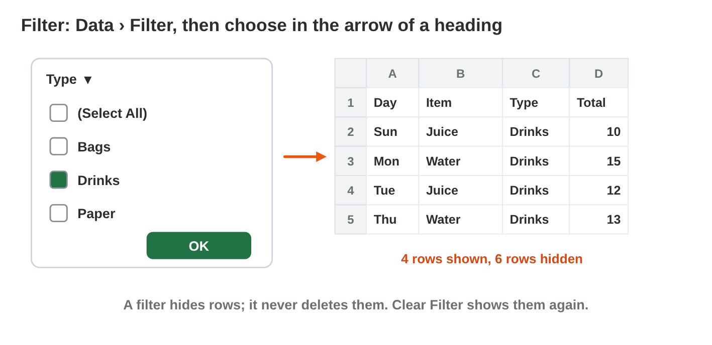
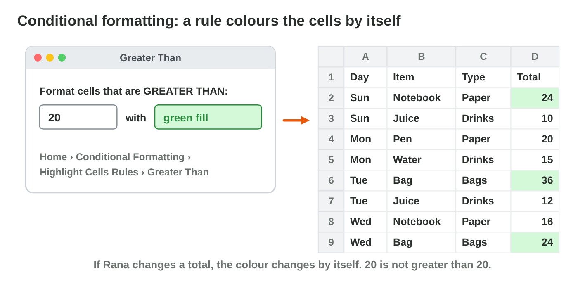
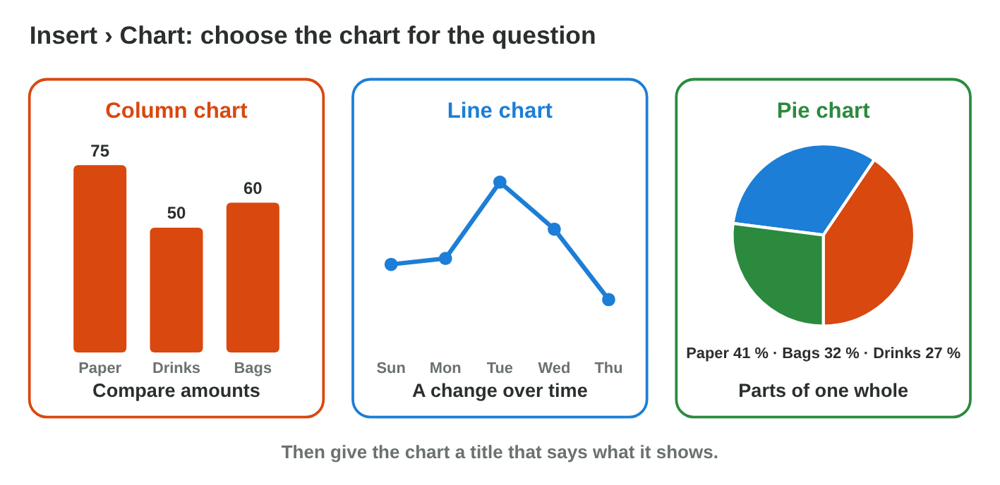

## Keywords



## Sort and filter

:::: {.columns}
::: {.column width="50%"}
- Sort puts the rows in order, by a number or by a word: Data › Sort.
- You click one cell of the table first, so each row moves as a whole.
- A filter shows only the rows that you need, like one type.
- The other rows are only hidden, and Clear Filter brings them back.
:::
::: {.column width="50%"}

:::
::::

## Live demo · Sort



## Try it 1–2 · Sort and filter

a) What happens to each row when you sort?
b) What happens to the rows a filter does not show?
c) How do you see all rows again?

::: {.answer}
a) It moves as a whole.
b) They are hidden.
c) Clear Filter
:::

## Colour by a rule

:::: {.columns}
::: {.column width="50%"}
- Conditional formatting colours cells by a rule, like Greater Than 20.
- It is on Home › Conditional Formatting › Highlight Cells Rules.
- The rule checks the cells again when a number changes.
- A colour that you add by hand does not follow the numbers.
:::
::: {.column width="50%"}

:::
::::

## Try it 3 · A colour rule

a) Is the total 20 coloured by the rule Greater Than 20?
b) The juice changes from 12 to 22. What happens to its cell?
c) Where is conditional formatting?

::: {.answer}
a) no
b) It turns green by itself.
c) Home › Conditional Formatting
:::

## Show it as a picture: charts

:::: {.columns}
::: {.column width="50%"}
- A column chart compares amounts, like the sales of three types.
- A line chart shows a change over time, like Sunday to Thursday.
- A pie chart shows the parts of one whole.
- Every chart gets a real title that says what it shows.
:::
::: {.column width="50%"}

:::
::::

## Live demo · A chart



## Try it 4 · Which chart?

a) You compare Paper, Drinks and Bags. Which chart do you make?
b) You show the part of each type in the 185 JD. Which chart do you make?
c) You compare the sales of five shops in one month. Which chart do you make?

::: {.answer}
a) a column chart
b) a pie chart
c) a column chart
:::

## Summary

- Sort puts whole rows in order, and a filter hides the rows you do not need.
- A filter never deletes rows, and Clear Filter shows them again.
- A colour rule checks the cells again when the numbers change.
- Columns compare, a line shows change over time, and a pie shows parts of a whole.
- Every chart needs a real title.

## Your worksheet

:::: {.columns}
::: {.column width="50%"}
- In the computer lab, follow the worksheet alone, step by step, in Excel.
- Six short tasks: type the sales, sort, filter, a colour rule, a column chart, save.
- Nothing to download: you type the text yourself.
- Each step has a picture of the screen; tick each step when it is done.
- Then the Extra: on tutudocs.com an AI assistant adds a total to your sheet.
:::
::: {.column width="50%"}

:::
::::

## Results of the worksheet

What does your file show at the end?

::: {.reveal}
- Task 2: Sandwich (30) is first; whole rows moved together.
- Task 3: only the 3 drinks are shown (Sum: 39), then Clear.
- Task 4: 25 and 30 are red (Greater Than 20).
- Task 5: a column chart titled Sales of the week.
:::

## Game challenge · Rana's Questions



## Try it 5 · Rana's answers (harder)

The facts: the Paper sales were 24, 20, 16 and 15 JD. Huda wants every total above 20 JD in green, also next week.

a) Which Excel tool puts the biggest sale at the top?
b) What is the total of the Paper sales?
c) Which tool makes every total above 20 JD green, also next week?

::: {.answer}
a) Sort by Total, largest first
b) 75 JD
c) conditional formatting
:::
