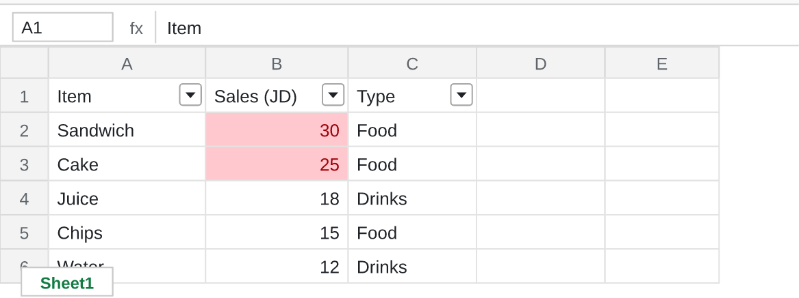
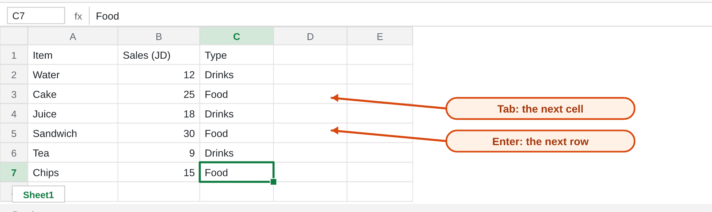

## Today in the lab

::: {.lab-plan}
1. **15 minutes, here:** the teacher shows each idea on a simulator, then
   in Excel.
2. **35 minutes, in Excel:** you follow the **worksheet**, step by
   step, on the lab computer. Nothing to download: you type the text
   yourself.
3. **At the end:** show your sheet to your teacher. Then the **Extra**: an
   AI assistant adds a total to your sheet.
:::

{width=55%}

## Key terms



## 7.1 Put the rows in order: Sort

### On the simulator

- Click **one cell** of the column, then **Data › Z→A** (largest first) or **A→Z**.
- **Whole rows** move together: an item keeps its sales and its type.

::: {.sim-part}

:::

### In Excel: worksheet Tasks 1 and 2

:::: {.word-part}
Open Excel, then **Blank workbook**, and type the sales of the week. Then the same steps as on the simulator:

::: {.screens}

![[1]{.step-n} A cell of Sales. [2]{.step-n} **Data**. [3]{.step-n} **Z→A**.](images/lab-sort-1.png)
:::
::::

::: {.callout-tip title="Try it 1 · Sort"}
Choose the right answer.

::: {.match extra="A→Z|Filter"}
The biggest sales must come first. Which button?
:   Z→A

    Why: Z→A sorts from the largest to the smallest.
:::
:::

## 7.2 Show only some rows: Filter

### On the simulator

- **Data › Filter**: an arrow in each heading.
- The arrow of a column: tick only what you want to see, **OK**. The other rows are **hidden**, not deleted.
- **Data › Clear** shows all the rows again.

::: {.sim-part}

:::

### In Excel: worksheet Task 3

:::: {.word-part}
::: {.screens}
![[1]{.step-n} **Filter**. [2]{.step-n} The arrow of Type. [3]{.step-n} Only **Drinks**. [4]{.step-n} **OK**.](images/lab-filter-1.png)
:::
::::

## 7.3 Colour by a rule: conditional formatting

### On the simulator

- Select the numbers, then **Home › Conditional Formatting › Highlight Cells Rules › Greater Than**.
- Type the number (**20**), **OK**: every bigger number turns red.
- Change a number: its colour follows the **rule** by itself.

::: {.sim-part}

:::

### In Excel: worksheet Task 4

:::: {.word-part}
::: {.screens}
![[1]{.step-n} B2:B7. [2]{.step-n} **Conditional Formatting**. [3]{.step-n} **Greater Than**. [4]{.step-n} **20**. [5]{.step-n} **OK**.](images/lab-cf-1.png)
:::
::::

::: {.callout-tip title="Try it 3 · A colour rule"}
Choose the right answer.

::: {.match extra="it stays white|you must colour it again"}
Water changes from 12 to 26. The rule is Greater Than 20. What happens?
:   it turns red by itself

    Why: The colour follows the rule, not the old number.
:::
:::

## 7.4 Show it as a picture: charts

### On the simulator

- Select the data **with its headings** (A1:B7), then **Insert › Column › Clustered Column**.
- A **column chart** compares items; a **pie** shows the parts of a whole.
- Click **Chart Title** and type a real title.

::: {.sim-part}

:::

### In Excel: worksheet Tasks 5 and 6

:::: {.word-part}
::: {.screens}
![[1]{.step-n} A1:B7. [2]{.step-n} **Insert**. [3]{.step-n} **Column**. [4]{.step-n} The title.](images/lab-chart-1.png)

![Press **F12**. [1]{.step-n} **Desktop**. [2]{.step-n} **sales-** and your name. [3]{.step-n} **Save**.](images/lab-save-1.png)
:::
::::

## Extra: AI changes your sheet

### On the simulator

- On **tutudocs.com** you open your own sheet, with **no sign-in**.
- **AI Assistant**: ask for one change, for example: a Total row at the end.
- **File › Download**, the Excel file (**.xlsx**).

::: {.sim-part}

:::

### On tutudocs.com: the Extra of the worksheet

:::: {.word-part}
::: {.screens}
![**tutudocs.com**: [1]{.step-n} click the box, then choose your sheet.](images/lab-tutu-1.png)

![[1]{.step-n} **AI Assistant**. [2]{.step-n} Your request. [3]{.step-n} The AI adds the total.](images/lab-tutu-2.png)

![[1]{.step-n} **File**, [2]{.step-n} **Download**, [3]{.step-n} the **.xlsx** file.](images/lab-tutu-3.png)
:::
::::

## Now: your worksheet

::: {.lab-go}
Take your **worksheet** and do Tasks 1–6 in Excel on the lab
computer, in order. Tick each step. Raise your hand when you are stuck,
and at the end. Finished? Do the **Extra**: on tutudocs.com an AI
assistant adds a total to your sheet.
:::

## Summary {.summary}

- Data › Z→A sorts largest first; whole rows move together.
- Data › Filter hides the rows that you do not tick; Clear shows them again.
- Conditional Formatting › Greater Than colours the cells by a rule that follows the numbers.
- Select the data with headings, Insert › Column, then type a real chart title.
- On tutudocs.com (no sign-in) the AI Assistant changes your sheet; File › Download gives the .xlsx.
