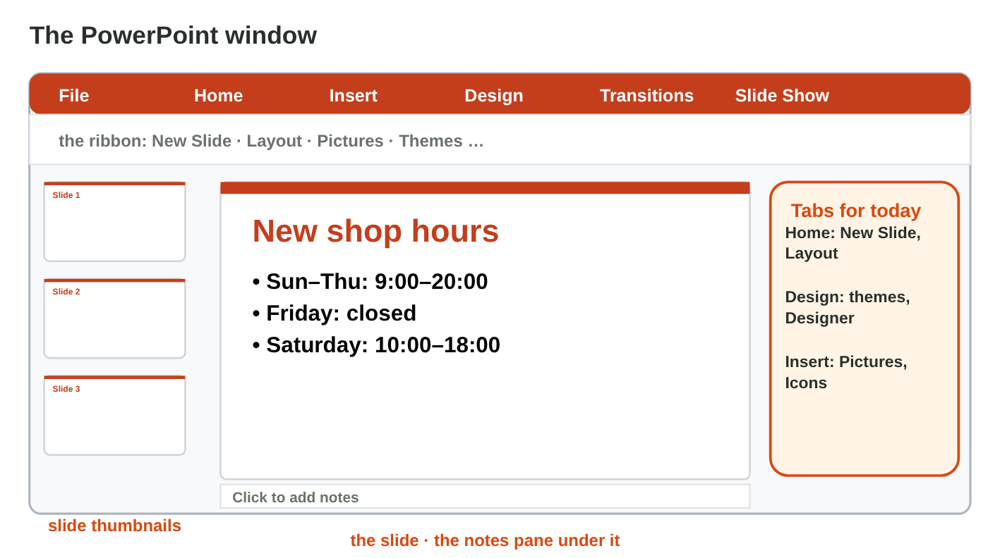
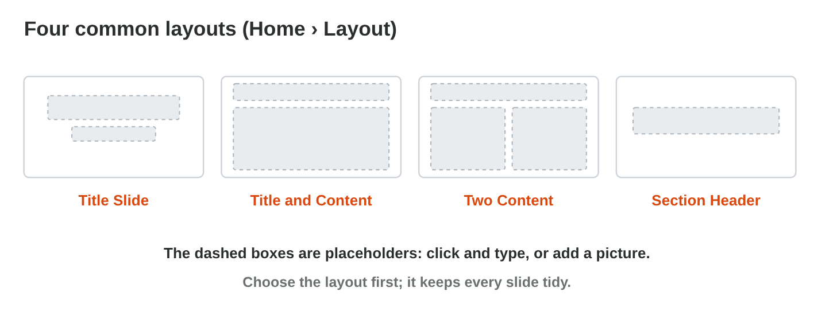
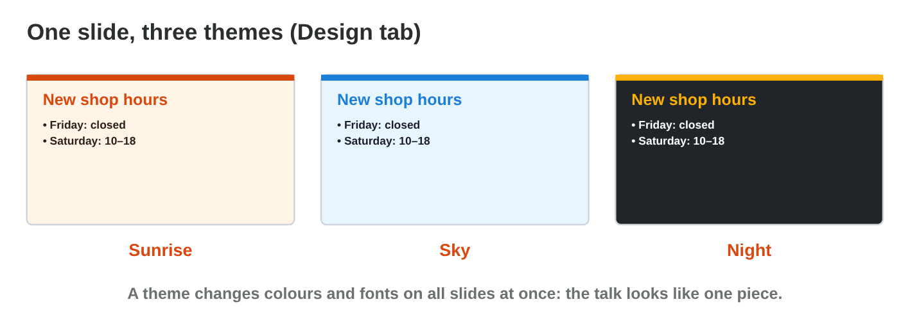
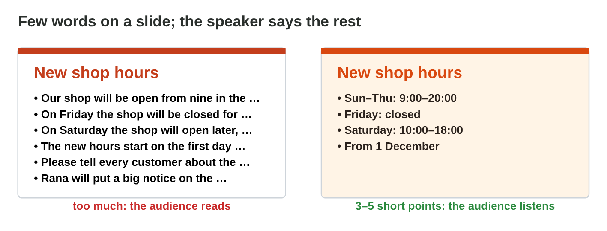
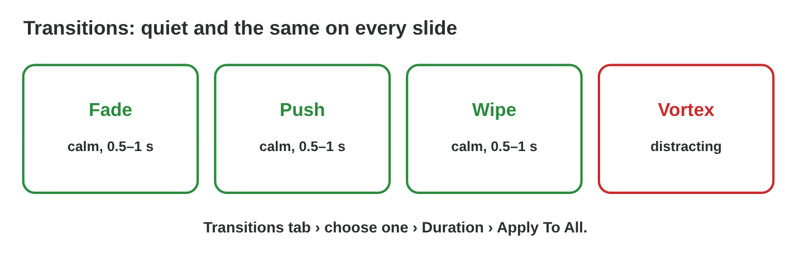
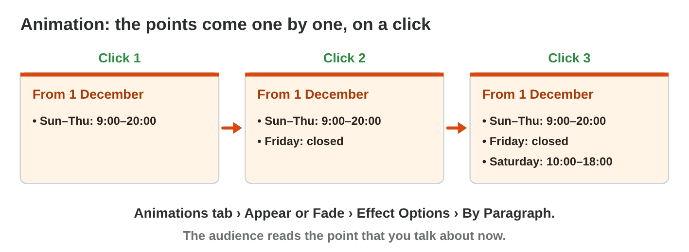

This page is the lecture, in class and at home. Each section explains one
idea, then shows its experiment. The page checks every step at once.

**In class, the teacher chooses the way for each experiment,** by the topic
and the time:

- **On the simulator** of the section, here on the page: nothing to
  install, and it works at home too.
- **In the real app** on the teacher's laptop, connected to the smart
  screen (HDMI): open the start file and follow the steps of **Part A**.
- **In the computer lab:** each student follows the **worksheet (PDF)**,
  Part A in the app and Part B on the simulator, and checks each result
  here.
- **You need:** PowerPoint (the desktop app, or PowerPoint on the web at `office.com`) and the start file, or only the simulators of this page.

## Key terms



## Before you start



## 8.1 Slides, layouts and a theme

- The window: **thumbnails** on the left, the **slide** in the middle, the
  **notes pane** under it.
- A **layout** is the plan of a slide. Its **placeholders** are dashed
  boxes: click and type.
- **Home › New Slide** (choose the layout) and **Home › Layout**.
- First slide: **Title Slide**. Most slides: **Title and Content**. A list
  next to a picture: **Two Content**.
- **F5** starts the slide show, **Esc** stops it.
- A **theme** gives all slides the same colours, fonts and background:
  **Design** tab.
- **Variants** change its colours; **Designer** suggests designs.
- Strong **contrast**: dark text on light, or light text on dark.

{width=100%}

{width=100%}

{width=100%}



::: {.callout-warning title="Watch out!"}
Do not draw your own text boxes on a Blank slide. Use the placeholders. Light grey text on light blue cannot be read from the back of the room.
:::



::: {.callout-tip title="Try it 1 · Layouts and themes"}
Choose the right answer.

::: {.match extra="Insert › Table|Home › Font"}
Which layout puts a list next to a picture?
:   Two Content

    Why: It has two placeholders side by side.
:::
:::

## 8.2 Few words on the slide, the rest in the notes

- **One idea** per slide, a short title, **3 to 5 points**.
- Each point about **8 words or fewer**; text about **24 pt** or bigger.
- The details are what you **say**: write them in the **speaker notes**,
  the notes pane under the slide (View › Notes).
- In the slide show, **Presenter View** shows the notes only to you.

{width=100%}

::: {.callout-warning title="Watch out!"}
A smaller font does not fix a slide with too much text.
:::

Part B of this experiment is the Game challenge of this page: **Slide
Doctor**, below.



::: {.callout-tip title="Try it 2 · Few words and notes"}
Choose the right answer.

::: {.match extra="10 points|a smaller font|everybody"}
Where do you write what you will say?
:   in the speaker notes

    Why: The notes pane under the slide keeps the details.
:::
:::

## 8.3 Movement: transitions and animations

- A **transition** is the way one slide changes to the next: **Transitions**
  tab › Fade › Duration 0.5–1 s › **Apply To All**.
- An **animation** makes one thing on a slide appear or move: select the
  list › **Animations** tab › **Appear** or **Fade** › Effect Options ›
  **By Paragraph**. The points come one by one, on a click.
- Use few effects: one quiet transition, and points one by one only where it
  helps.

{width=100%}

{width=100%}



::: {.callout-warning title="Watch out!"}
Wild effects (Vortex, Spin) pull the eyes away from your message.
:::



::: {.callout-tip title="Try it 3 · Transitions and animations"}
Choose the right answer.

::: {.match extra="Insert › Video|5 seconds"}
You want the points of a list to come one by one. What do you add?
:   an animation, By Paragraph

    Why: An animation By Paragraph shows one point on each click.
:::
:::

## Table of results



## Game challenge: Slide Doctor {.challenge}

Huda's colleagues send slides for the Monday meeting. Each slide has
one problem: too much text, weak contrast, a stretched photo, a photo
without alt text, and a "Thank you!" slide in the wrong layout.



::: {.callout-tip title="Try it 4 · Huda's talk (harder)"}
The slides for Monday: seven long sentences on one slide, light grey text
on light blue, a tall and thin shop photo, a "Thank you!" slide, and the
detail "Rana puts a notice on the door". Choose the right answer.

::: {.match extra="add an animation|change the file name|Blank"}
What is the best fix for light grey text on light blue?
:   dark text on a light background

    Why: Strong contrast can be read from the back.
:::
:::

## Summary {.summary}

- Choose a layout and type in its placeholders.
- One theme gives the talk one look; keep a strong contrast.
- One idea, 3–5 short points per slide; the rest goes in the speaker notes.
- One quiet transition for all slides; an animation shows points one by one.
- A picture keeps its shape from a corner, and it has alt text.
