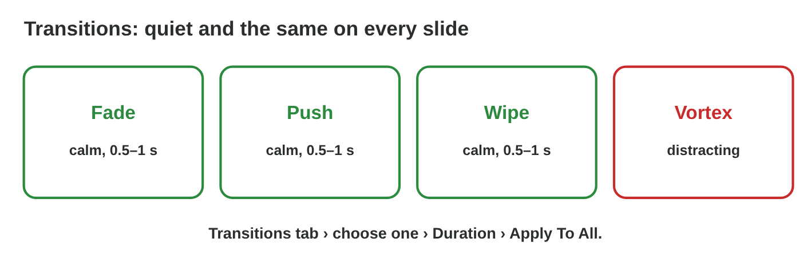
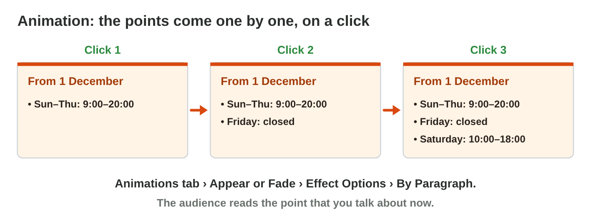

This page is the interactive version of the lesson notes (PDF). Each section
starts with a problem at study or at work. Then it explains one idea. It
ends with a **Lab task** and one set of questions. Every question on this
page has its answer: try first, then check.

## Key terms



## 8.1 Slides and layouts

- The window: **thumbnails** on the left, the **slide** in the middle, the
  **notes pane** under it.
- A **layout** is the plan of a slide. Its **placeholders** are dashed
  boxes: click and type.
- **Home › New Slide** (choose the layout) and **Home › Layout**.
- First slide: **Title Slide**. Most slides: **Title and Content**. A list
  next to a picture: **Two Content**.
- A picture works as in Word: resize it from a corner, write its alt text.
- **F5** starts the slide show, **Esc** stops it.

{width=100%}

{width=100%}



::: {.callout-warning title="Watch out!"}
Do not draw your own text boxes on a Blank slide. Use the placeholders.
:::

::: {.callout-note title="Lab task · Two slides"}
Make `my-place.pptx`: a title slide about a place you know, and a *Title
and Content* slide with three points. Press F5 to check it.

::: {.check}
Slide 1 has the layout Title Slide, with your title and your name. Slide 2
has the layout Title and Content: a title and three points in the
placeholder, with no text boxes of your own. F5 shows both slides on the
full screen; Esc stops the show.
:::
:::

::: {.callout-tip title="Try it 1 · Layouts"}
Choose the right answer.

::: {.match extra="Insert › Table|File › Print"}
What is the dashed box "Click to add title"?
:   a placeholder

    Why: A placeholder is a box of the layout where you click and type.

Which layout fits the first slide?
:   Title Slide

    Why: The first slide gives the topic and your name.

Which layout puts a list next to a picture?
:   Two Content

    Why: It has two placeholders side by side.

Which key starts the slide show?
:   F5

    Why: F5 shows the slides on the full screen; Esc stops the show.
:::
:::

## 8.2 One look: themes and Designer

- A **theme** gives all slides the same colours, fonts and background:
  **Design** tab.
- **Variants** change the colours of the same theme.
- **Designer** (Design › Designer) suggests designs for the slide you are
  on.
- Strong **contrast**: dark text on light, or light text on dark.

{width=100%}

::: {.callout-warning title="Watch out!"}
Light grey text on light blue cannot be read from the back of the room.
:::

::: {.callout-note title="Lab task · A theme"}
In `my-place.pptx`, choose a theme and try two Variants. Read your slide
from two metres away. If you have Designer, keep one of its ideas.

::: {.check}
A good result: both slides have the same colours and fonts, and you can
read every word from two metres away (dark on light, or light on dark).

- ☐ One theme for the whole talk.
- ☐ No light text on a light background.
:::
:::

::: {.callout-tip title="Try it 2 · Themes"}
Choose the right answer.

::: {.match extra="Home › Font|View › Zoom"}
Where do you choose a theme?
:   Design tab

    Why: Themes, Variants and Designer are on the Design tab.

What changes when you click a theme?
:   the colours and fonts of all slides

    Why: A theme gives the whole talk one look.

Which text is easy to read on a dark background?
:   light text

    Why: Light on dark is a strong contrast.

What does Designer give you?
:   design ideas for the slide

    Why: Designer suggests designs for the slide you are on.
:::
:::

## 8.3 Few words on the slide, the rest in the notes

- **One idea** per slide, a short title, **3 to 5 points**.
- Each point about **8 words or fewer**; text about **24 pt** or bigger.
- The details are what you **say**: write them in the **speaker notes**,
  the notes pane under the slide (View › Notes).
- In the slide show, **Presenter View** shows the notes only to you.

{width=100%}

::: {.callout-warning title="Watch out!"}
A smaller font does not fix a slide with too much text.
:::

::: {.callout-note title="Lab task · Fewer words"}
Check every slide of `my-place.pptx`: at most five points of at most eight
words. Move the details into the speaker notes.

::: {.check}
A good result: each slide has 3–5 points of at most eight words, in a big
font. The notes pane under each slide holds what you will say, for example
"The park is open until 10 pm in summer." The notes are not on the slide
in the slide show.
:::
:::

::: {.callout-tip title="Try it 3 · Few words and notes"}
Choose the right answer.

::: {.match extra="10 points|a smaller font|everybody"}
How many points should a slide have?
:   3 to 5

    Why: One idea and a few short points per slide.

How long is a good point?
:   about 8 words or fewer

    Why: Short points can be read from the back at a glance.

Where do you write what you will say?
:   in the speaker notes

    Why: The notes pane under the slide keeps the details.

Who sees the speaker notes in the slide show?
:   only the speaker

    Why: Presenter View shows the notes to you; the audience sees the slide.
:::
:::

## 8.4 Movement: transitions and animations

- A **transition** is the way one slide changes to the next: **Transitions**
  tab › Fade › Duration 0.5–1 s › **Apply To All**.
- An **animation** makes one thing on a slide appear or move: select the
  list › **Animations** tab › **Appear** or **Fade** › Effect Options ›
  **By Paragraph**. The points come one by one, on a click.
- Use few effects: one quiet transition, and points one by one only where it
  helps.

{width=100%}

{width=100%}



::: {.callout-warning title="Watch out!"}
Wild effects (Vortex, Spin) pull the eyes away from your message.
:::

::: {.callout-note title="Lab task · Fade and Appear"}
In `my-place.pptx`, choose the transition **Fade**, 0.7 s, **Apply To
All**. On the slide with three points, add the animation **Appear** (By
Paragraph). Press F5 and click through your talk.

::: {.check}
In the slide show, every slide fades into the next one in less than a
second. On the slide with three points, the title comes first, and each
click shows the next point. In Normal view, the numbers 1, 2 and 3 next to
the points show the order of the animation.
:::
:::

::: {.callout-tip title="Try it 4 · Transitions and animations"}
Choose the right answer.

::: {.match extra="Insert › Video|5 seconds"}
On which tab do you find transitions?
:   Transitions tab

    Why: The Transitions tab has Fade, Push, Wipe and the duration.

Which button gives every slide the same transition?
:   Apply To All

    Why: Apply To All puts the same transition on all slides.

How long should a transition be?
:   0.5 to 1 second

    Why: A longer transition makes the audience wait.

You want the points of a list to come one by one. What do you add?
:   an animation, By Paragraph

    Why: An animation By Paragraph shows one point on each click.

Why not Spin or Vortex in a work talk?
:   they pull the eyes away from the message

    Why: The audience watches the effect, not the points.
:::
:::

## Game challenge: Slide Doctor {.challenge}

Work alone. Use every section of today.

Huda's colleagues send slides for the Monday meeting. Each slide has
one problem: too much text, weak contrast, a stretched photo, a photo
without alt text, and a "Thank you!" slide in the wrong layout.



::: {.callout-tip title="Try it 5 · Huda's talk (harder)"}
The slides for Monday: seven long sentences on one slide, light grey text
on light blue, a tall and thin shop photo, a "Thank you!" slide, and the
detail "Rana puts a notice on the door". Choose the right answer.

::: {.match extra="add an animation|change the file name|Blank"}
What is the best fix for the slide with seven long sentences?
:   keep a few short points, say the rest

    Why: One idea and a few short points; the details are what you say.

What is the best fix for light grey text on light blue?
:   dark text on a light background

    Why: Strong contrast can be read from the back.

The shop photo is tall and thin. What do you do?
:   resize it from a corner

    Why: A corner keeps the shape; a side handle stretched it.

Which layout fits the last slide with "Thank you!"?
:   Title Slide

    Why: A short last slide with one big line uses a title layout.

Where does "Rana puts a notice on the door" go?
:   in the speaker notes

    Why: It is something to say, not something on the slide.
:::
:::

## Summary {.summary}

- Choose a layout and type in its placeholders.
- One theme gives the talk one look; keep a strong contrast.
- One idea, 3–5 short points per slide; the rest goes in the speaker notes.
- One quiet transition for all slides; an animation shows points one by one.
- A picture keeps its shape from a corner, and it has alt text.
