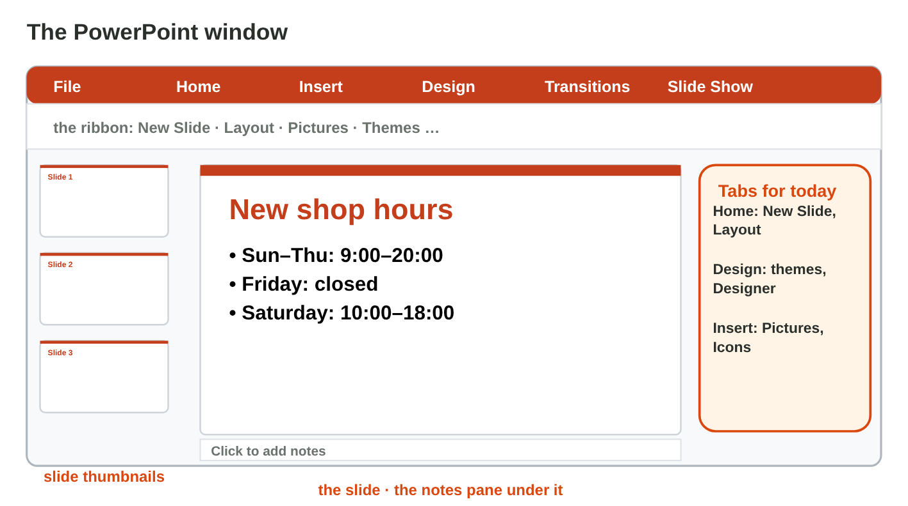
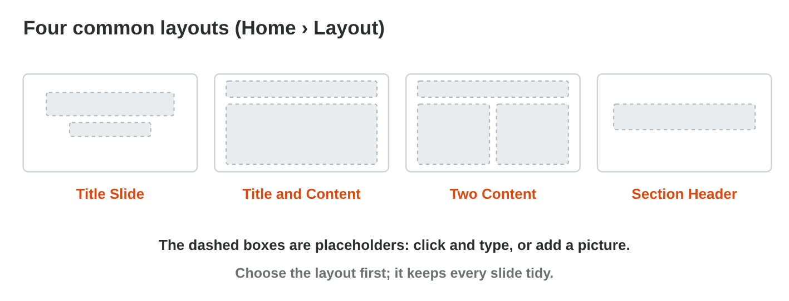
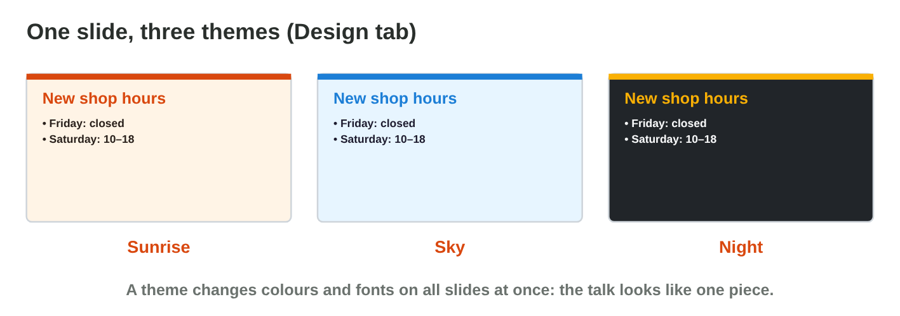
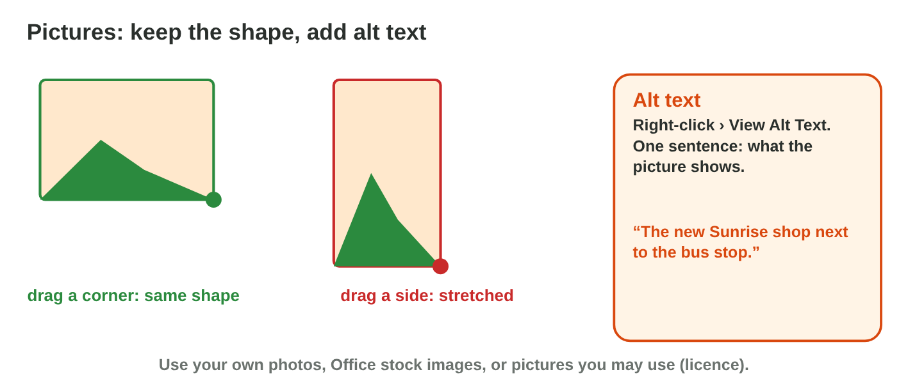
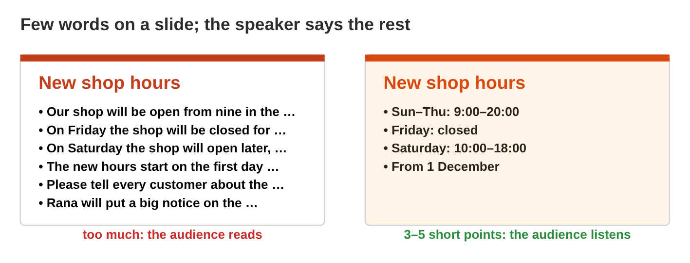

This page is the interactive version of the lesson notes (PDF). Each section
starts with a problem at work. Then it shows one PowerPoint skill. It ends
with a **Lab task** and one set of questions. The full explanations,
examples and exercises are in the notes.

## Key terms



## 17.1 Slides and layouts

- The window: **thumbnails** on the left, the **slide** in the middle, the
  **notes pane** under it.
- A **layout** is the plan of a slide. Its **placeholders** are dashed
  boxes: click and type.
- **Home › New Slide** (choose the layout) and **Home › Layout**.
- First slide: **Title Slide**. Most slides: **Title and Content**.
- **F5** starts the slide show, **Esc** stops it.

{width=100%}

{width=100%}



::: {.callout-warning title="Watch out!"}
Do not draw your own text boxes on a Blank slide. Use the placeholders.
:::

::: {.callout-note title="Lab task · Two slides"}
Make `my-place.pptx`: a title slide about a place you know, and a *Title
and Content* slide with three points. Press F5 to check it.
:::

::: {.callout-tip title="Try it 1 · Layouts"}
Use Slide Builder. Choose the right answer.

::: {.match extra="Insert › Table|File › Print"}
What is the dashed box "Click to add title"?
:   a placeholder

Which layout fits the first slide?
:   Title Slide

Which layout puts a list next to a picture?
:   Two Content

Which key starts the slide show?
:   F5
:::
:::

## 17.2 One look: themes and Designer

- A **theme** gives all slides the same colours, fonts and background:
  **Design** tab.
- **Variants** change the colours of the same theme.
- **Designer** (Design › Designer) suggests designs for the slide you are
  on.
- Strong **contrast**: dark text on light, or light text on dark.

{width=100%}

::: {.callout-warning title="Watch out!"}
Light grey text on light blue cannot be read from the back of the room.
:::

::: {.callout-note title="Lab task · A theme"}
In `my-place.pptx`, choose a theme and try two Variants. Read your slide
from two metres away. If you have Designer, keep one of its ideas.
:::

::: {.callout-tip title="Try it 2 · Themes"}
Choose the right answer.

::: {.match extra="Home › Font|View › Zoom"}
Where do you choose a theme?
:   Design tab

What changes when you click a theme?
:   the colours and fonts of all slides

Which text is easy to read on a dark background?
:   light text

What does Designer give you?
:   design ideas for the slide
:::
:::

## 17.3 Pictures and alt text

- **Insert › Pictures**: from your device, Stock Images or the web.
- Resize from a **corner** handle: the picture keeps its shape.
- Right-click › **View Alt Text**: one sentence that says what the picture
  shows.
- Use pictures you are allowed to use.

{width=100%}

::: {.callout-warning title="Watch out!"}
A side handle stretches the picture: the shop becomes tall and thin.
:::

::: {.callout-note title="Lab task · A picture"}
Add a *Two Content* slide: three points on the left, a picture of your
place on the right. Resize it from a corner and write its alt text.
:::

::: {.callout-tip title="Try it 3 · Pictures"}
Choose the right answer.

::: {.match extra="a side handle|the picture name only"}
How do you resize a picture and keep its shape?
:   drag a corner handle

What is alt text?
:   one sentence that says what the picture shows

Who needs alt text?
:   a person who uses a screen reader

Where do you write alt text?
:   right-click › View Alt Text
:::
:::

## 17.4 Few words on each slide

- **One idea** per slide, a short title, **3 to 5 points**.
- Each point about **8 words or fewer**; text about **24 pt** or bigger.
- The details are what you **say**; put them in the notes pane.

{width=100%}

::: {.callout-warning title="Watch out!"}
A smaller font does not fix a slide with too much text.
:::

::: {.callout-note title="Lab task · Fewer words"}
Check every slide of `my-place.pptx`: at most five points of at most eight
words. Move the details into the notes pane.
:::

::: {.callout-tip title="Try it 4 · Few words"}
Choose the right answer.

::: {.match extra="10 points|a smaller font"}
How many points should a slide have?
:   3 to 5

How long is a good point?
:   about 8 words or fewer

A slide has seven sentences. What is the best fix?
:   keep a few short points, say the rest

Where do the details go?
:   in what the speaker says
:::
:::

## Game challenge: Slide Doctor {.challenge}

Work alone. Use every section of today.

Huda's colleagues send her slides for the Monday meeting. Each slide has
one problem: too much text, weak contrast, a stretched photo, a photo
without alt text, and a "Thank you!" slide in the wrong layout.



::: {.callout-tip title="Try it 5 · Fix the slide"}
Choose the best fix.

::: {.match extra="add an animation|change the file name"}
Seven long sentences on one slide.
:   keep a few short points, say the rest

Light grey text on light blue.
:   dark text on a light background

The shop photo is tall and thin.
:   resize it from a corner

A colleague uses a screen reader.
:   alt text for the photo
:::
:::

::: {.callout-tip title="Try it 6 · Huda's talk (harder)"}
Choose the right answer.

::: {.match extra="Blank|Comparison"}
Which layout fits the last slide with "Thank you!"?
:   Title Slide

Which layout fits the slide with the new hours?
:   Title and Content

Where does "Rana puts a notice on the door" go?
:   in the notes pane

Huda wants the same colours on every slide. What does she use?
:   one theme
:::
:::

## Summary {.summary}

- Choose a layout and type in its placeholders.
- One theme gives the talk one look; keep a strong contrast.
- Resize pictures from a corner and give them alt text.
- One idea, 3–5 short points per slide; say the rest.
