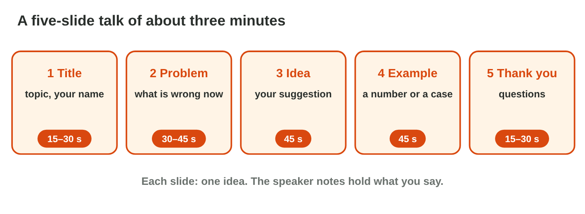

## Before you start {.study}

- **What you need:** PowerPoint (the desktop app, PowerPoint on the web at
  `office.com`, or the free phone app). Google Slides also works; the menu
  names are a little different.
- **Time:** about 60 minutes. Work alone, at your own speed.
- **How it works:** do Steps 1–3 on this page. Each step has a short text, a
  simulator and a self-check. Then do the **Tasks to submit**.
- **What you submit:** one PowerPoint file and two short answers, on the
  university e-learning platform, before lecture 19.
- **You need lecture 17:** layouts, themes, pictures with alt text, and few
  words on each slide.

## Key terms {.study}



## Step 1 · A quiet transition on every slide {.study}

- A **transition** is the way one slide changes to the next in the slide
  show: Fade, Push, Wipe, and many more.
- **Transitions** tab › click one › **Duration** (0.5–1 second is enough)
  › **Apply To All**.
- Choose a **quiet** transition and the **same** one on every slide. A
  wild transition such as Vortex pulls the eyes away from the message.
- No transition is also fine. Press **F5** to see the result.

{width=100%}



::: {.callout-tip title="Try it 1 · Transitions"}
Use Transition Lab. Choose the right answer.

::: {.match extra="Insert › Video|5 seconds"}
Where do you find transitions?
:   Transitions tab

Which button gives every slide the same transition?
:   Apply To All

How long should a transition be?
:   0.5 to 1 second

Why not Vortex in a work talk?
:   it pulls the eyes away from the message
:::
:::

## Step 2 · Speaker notes and Presenter View {.study}

- The slide has few words. What you **say** goes in the **speaker notes**:
  the notes pane under each slide (**View › Notes** if you do not see it).
- In the slide show, **Presenter View** shows you the current slide, the
  next slide, a timer and your notes. The audience sees only the slide.
- With a projector it opens by itself. On one screen: start the show,
  right-click › **Show Presenter View** (or **Alt+F5** in Windows).
- Write notes as short reminders, not a text to read aloud word by word.

{width=100%}

::: {.callout-tip title="Try it 2 · Notes"}
Choose the right answer.

::: {.match extra="on the slide in small letters|nobody"}
Where do you write what you will say?
:   in the speaker notes

Who sees the speaker notes in the slide show?
:   only the speaker

What does Presenter View show?
:   the slide, the next slide, a timer and the notes

Which keys open Presenter View in Windows?
:   Alt+F5
:::
:::

## Step 3 · Plan a five-slide talk {.study}

- A short talk of about **three minutes** needs about **five slides**, one
  idea on each.
- A good order: **1 Title** (topic, your name) › **2 The problem** › **3
  The idea** › **4 An example** (a number or a case) › **5 Thank you and
  questions**.
- Give each slide its time: the problem, the idea and the example take the
  most. The last slide is short.
- **Rehearse** twice with Presenter View and its timer.

{width=100%}



::: {.callout-tip title="Try it 3 · The talk"}
Use Talk Planner. Choose the right answer.

::: {.match extra="Thank you and questions first|10 minutes"}
Which slide comes right after the title?
:   the problem

Which slide gives a number or a case?
:   the example

How long is Sami's whole talk?
:   about three minutes

How long is the last slide?
:   at most 30 seconds

What does Sami do before the talk?
:   rehearse with the timer
:::
:::

## Tasks to submit {.tasks}

Do the tasks alone. Your teacher marks them (6 marks). Choose **one topic**
from your own life at the university, for example *a longer opening time
for the library*, *a quiet study room*, or *a study group for a hard
course*.

### Task 1 · Five clear slides (2 marks)

1. Make a new presentation `my-talk.pptx` with **five slides** in the order
   of Step 3. Use the right layouts (Title Slide for slides 1 and 5).
2. Use **one theme**, at most five short points per slide, and at least
   **one picture with alt text**.

### Task 2 · Transitions and notes (2 marks)

1. Add one quiet transition of 0.5–1 second with **Apply To All**.
2. Write **speaker notes** on every slide (at least two sentences each):
   what you will say.

### Task 3 · Rehearse and answer (2 marks)

1. Rehearse the talk twice with Presenter View and its timer.

a) How long was your talk the second time? What did you change after the
first time?



b) Which slide was the hardest to keep short, and what did you move into the
notes?



## How to submit

Upload `my-talk.pptx` (five slides with notes) and your answers to Task 3
to the university e-learning platform, **before lecture 19**.
