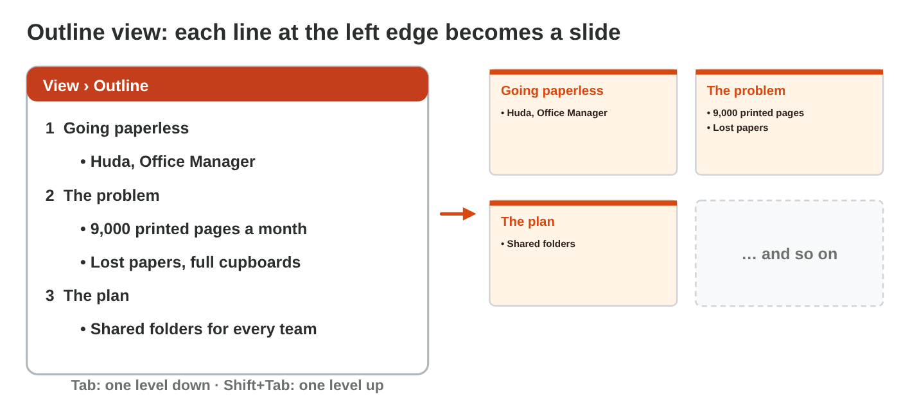
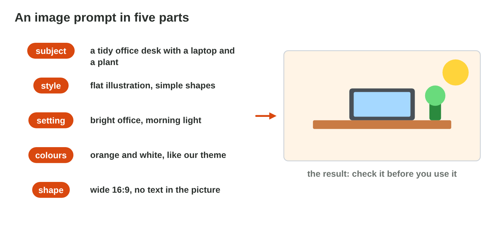

## Before you start {.study}

- **What you need:** PowerPoint (the desktop app, PowerPoint on the web at
  `office.com`, or the free phone app) and a free AI chat tool (for example
  Microsoft Copilot with your university account, ChatGPT or Gemini).
  An AI image tool is optional: stock images also work.
- **Time:** about 60 minutes. Work alone, at your own speed.
- **How it works:** do Steps 1–3 on this page. Each step has a short text, a
  figure and a self-check; Steps 1 and 2 have a simulator. Then do the
  **Tasks to submit**.
- **What you submit:** one PowerPoint file and one Word file with your
  prompts and short answers, before lecture 9.
- **You need Lectures 2 and 8:** what AI does well and where it fails;
  layouts, themes, few words and speaker notes.
- **Never type personal data into an AI tool**: no names, phone numbers or
  marks of real people.

## Key terms {.study}



## Step 1 · From an AI outline to slides {.study}

- Ask an AI tool for an **outline**, not for finished slides.
- A good outline prompt has five parts: **topic**, **audience** (12 office
  staff, your classmates), **length** (5 slides, 3 minutes), **form** (a
  title and 3 points per slide) and a **limit** (at most 8 words per
  point). Add: "Do not invent numbers or sources."
- In PowerPoint, **View › Outline**: paste the outline. A line at the left
  edge is a **new slide**; **Tab** makes a line a point; **Shift + Tab**
  makes it a title again.
- Then choose a theme and the layouts (Lecture 8). Copilot in PowerPoint
  can also make slides, if your account has it.

{width=100%}

{width=100%}



::: {.callout-tip title="Try it 1 · The outline"}
Choose the right answer.

::: {.match extra="the font|Ctrl+P"}
"12 office staff, not technical": which part of the prompt is it?
:   the audience

    Why: It says who will listen to the talk.

"5 slides, about 3 minutes": which part of the prompt is it?
:   the length

    Why: It says how many slides and how much time.

"At most 8 words per point": which part of the prompt is it?
:   the limit

    Why: It keeps every point short.

Where do you paste an outline in PowerPoint?
:   View › Outline

    Why: In Outline view, every line at the left edge becomes a slide.

Which key makes a line a point under a title?
:   Tab

    Why: Tab moves the line one level in; Shift + Tab moves it back.
:::
:::

## Step 2 · A picture with AI, checked {.study}

- An **image prompt** has five parts: the **subject**, the **style**
  (a flat illustration, a photo), the **colours** of your theme, the
  **shape** (wide 16:9 next to the points) and "**no text** in the
  picture".
- Check the picture closely: letters, hands, logos and small details are
  often wrong.
- No real people and no brands. Write **alt text**, and the note
  "AI-generated" under the picture.
- A **stock image** (Insert › Pictures › Stock Images) or your own photo is
  often the better choice.

{width=100%}

{width=100%}



::: {.callout-tip title="Try it 2 · The picture"}
Use Image Prompt Lab. Choose the right answer.

::: {.match extra="a famous singer|tall 9:16"}
Which shape fits a picture next to the points?
:   wide 16:9

    Why: A wide picture fits next to the points on the slide.

What do you ask about text in the picture?
:   no text in the picture

    Why: AI pictures often get letters wrong; you type text on the slide.

Which note goes under an AI picture?
:   AI-generated

    Why: The audience knows that a tool made the picture.

The AI picture has wrong letters and odd hands. What do you do?
:   use a stock image

    Why: A stock image or your own photo has no such errors.
:::
:::

## Step 3 · Check before you present {.study}

- **Facts and numbers:** compare every number with your own data.
- **Sources:** open each one; delete a source that does not exist.
- **Your words:** write the speaker notes yourself, two or three sentences
  per slide.
- **Few words** on the slides: 3–5 points of at most 8 words.
- **Honest:** a short note on the last slide says what the AI did.

{width=100%}

::: {.callout-tip title="Try it 3 · Five checks"}
Choose the check.

::: {.match extra="the theme|the transition"}
The AI wrote 9,000 pages; your notes say 6,500. Which check finds it?
:   facts and numbers

    Why: Every number must match your own data.

"Green Office Report 2021" cannot be found. Which check finds it?
:   sources

    Why: You open every source; a made-up one goes.

A slide has five long sentences. Which check finds it?
:   few words

    Why: A slide has 3–5 short points; you say the rest.

"Outline and pictures made with AI help." Which check is it?
:   the note on the AI use

    Why: It says honestly what the AI did.
:::
:::

## Tasks to submit {.tasks}

Do the tasks alone. Your teacher marks them (6 marks). Choose a topic you
know, for example *a study tip that works for me*, *a free app that helps
students* or *how our college can save paper*. Use no personal data of
other people.

### Task 1 · The outline (2 marks)

1. Write your outline prompt with the five parts and get an outline from an
   AI tool.
2. In a Word file `my-prompts.docx`, paste your prompt and the AI answer,
   and mark (highlight) every number and source you had to check.

### Task 2 · Five slides (2 marks)

1. Make `my-ai-talk.pptx` from the outline with Outline view: five slides,
   one theme, the right layouts, at most five short points per slide.
2. Add one picture (AI-generated and checked, or a stock image) with alt
   text, and speaker notes in your own words on every slide.
3. On the last slide, add a short note on what the AI did.

### Task 3 · Your check (2 marks)

Answer in `my-prompts.docx`:

a) Which number or source from the AI did you check? Was it right? What
did you change?



b) Name two changes you made to the AI outline or picture, and say why.



## How to submit

Upload `my-ai-talk.pptx` and `my-prompts.docx` to the university
e-learning platform, **before lecture 9**.
